# Artificial Evolution

An experiment to investigate whether food-seeking behavior evolves in creatures
controlled by tiny neural networks, with random movement as a comparison.

Current step: **24 — Competition and predator–prey evolution**. Two populations
share an arena and evolve separate brains and bodies through hunting and survival.
Earlier experiments and saved results remain available.

## Run the world

From this project folder:

```sh
source .venv/bin/activate
python main.py
```

Neural control is the default. The existing random movement controller is also
available as a baseline:

```sh
python main.py --controller random --seed 42
```

- Press **G** to hide or show the grid.
- Press **V** to hide or show the selected creature's perception overlay.
- Press **F** to open or close the fitness leaderboard.
- Press **T** to open or close generation history and trend charts.
- Press **S** to cycle between **1x**, **5x**, and **20x** simulation speed.
- Press **A** to switch automatic generation cycling on or off.
- Press **N** after a generation ends to breed manually, within the generation limit.
- Press **Space** to pause or resume movement, eating, energy use, and aging.
- Press **R** to restart with random founders, clearing generations and results.
- **Click a creature** to inspect its properties. Click empty space to deselect.
- Press **Esc**, or close the window, to quit.

The window runs at up to 60 frames per second. The arena has a visible border and
a 40-pixel grid, with a stronger line every 200 pixels. Its coordinates start at
`(0, 0)` in the top-left corner, with x increasing right and y increasing down.
The surrounding header and footer are outside the arena. The border marks the
reflective walls; the grid is a visual guide.

## Competition and predator–prey coevolution

Step 24 adds an **opt-in shared arena** with 80 prey (mint) and 20 predators
(rose). Prey compete for replenished plant food; predators compete to capture
prey. Each species has a separate selection pool, and both offspring populations
are formed from the same completed arena before either population is replaced.
All founders are newly generated eleven-input brains and reference bodies; no
previous experiment's trained models are reused.

```sh
python main.py --predator-prey --seed 2401 --generations 8 --speed 20
python main.py --headless --predator-prey --seed 2401 --generations 8 \
  --report .cache/predator-run.json --plot .cache/predator-run.png
```

`--population` is the **total birth count** and `--predators` specifies the
predator portion; the remainder are prey. `--episode-seconds` sets the evaluation
window, default 60 seconds, in whole 1/60-second ticks. The mode uses neural
controllers and inherited cruise speeds. It is separate from `--seasons`,
`--obstacles`, and `--traits`, and rejects `--fixed-speed`. Body mutation options
from Step 23 remain available. Press **F** for separate role leaderboards or
**T** for survival and capture histories. Click an actor to inspect its genes;
an orange line shows its nearest detected opponent. Counts and captures remain
visible throughout each cohort.

### Senses, hunting, and competition

Both species use **11–8–2 NumPy networks, 114 parameters**, plus three body genes.
The original eight inputs are food proximity/direction/visibility, hunger, and
four wall clearances. Three new inputs give the nearest opponent's proximity,
signed bearing divided by π, and visibility within inherited sensory range.
Prey detect predators; predators detect prey. Predators receive zero plant-food
inputs and cannot eat pellets. Neither species receives a programmed chase or
flee policy. Decisions use a common snapshot of all positions before any actor
moves, so population iteration order supplies no positional advantage.

Body development, storage, maintenance, movement, and sensing follow the declared
Step 23 model, including the common newborn energy allocation. These remain toy
2D energetic assumptions. Brains steer at the inherited cruise speed. Actors pay
costs first; an actor dying during that tick cannot capture, eat, or be rescued
by contact. Reflective movement is split into straight wall-bounce segments;
swept relative disk contact detects encounters between endpoints. The first
contact owns the prey, with exact ties broken by prey ID then predator ID. A
prey can be captured only once. Capture removes prey before plant-food feeding.
Each capture offers the hunter **60 energy units**, clipped to its inherited
capacity; assimilated and wasted capture energy are recorded separately.

Movement/contact geometry is continuous within each fixed tick. Removal,
energetic credit, and survival accounting occur at the tick end. The report
retains both the geometric contact time and removal time. There is no attack
cooldown, injury model, or meat-value scaling with prey size. Plant food remains
at 150 pellets in the declared study; subsequent replacement positions depend
on each arena's behavior.

The two fitness rules are deliberately separate:

```text
prey fitness = seconds alive + 10 × plant meals
predator fitness = seconds alive + 30 × captures
```

Each species' top 20% supplies balanced, shuffled offspring. Linked brain/body
inheritance uses neural mutation probability 0.1 and Gaussian scale 0.1; body
mutation probability 0.25 and Gaussian log scale 0.08. Each species has independent
recorded brain and body mutation streams. The score rewards capture/meal counts,
including partially wasted energy, so it is not an energy-efficiency objective.

### Population and defensive observations

Birth counts reset to the controlled 80/20 split each generation. Within a
cohort, actual live counts are sampled every five seconds and at evaluation end.
Every newborn appears in the report, including prey killed by predators,
starved actors, old-age deaths, and **censored survivors still alive at the time
limit**. Archived genomes from dead actors can be selected for the next cohort.
This is a generational competition experiment, without continuous births,
reproductive resource budgets, demographic growth, or permanent lineage
extinction. A cohort ending with zero predators does not mean the experiment's
predator gene pool became permanently extinct.

Reports retain role-specific survival, food/capture counts, death causes, trait
values, fitness, and individual energy ledgers. Defensive behavior is described
by prey movement **away from the nearest visible predator**, measured over actual
visible-opponent living time; predator movement toward prey is measured the same
way. These describe displacement, not intent or guaranteed successful escape.
Undefined fractions remain missing when there is no visible opponent.
`--prey-sensors hidden` or `--predator-sensors hidden` zeros only that species'
three opponent inputs. Truthful observations and sensing costs remain intact.

### Declared historical-opponent experiment

The pre-change **321-test** transcript and hashes of all **256 tracked files**
are saved in `results/step24-baseline*`. Existing saved experiments remain
unchanged. Before production trials, the protocol and all Python source hashes
are written to `results/step24-protocol.json`.

Eight independent seeds (2401–2408) each train **eight shared cohorts**. Entire
evaluated birth populations, including failures and censored survivors, are
frozen at generations **1, 4, and 8**, without an extra reproduction event after
the final cohort. All nine historical predator/prey pairings are tested on one
new shared layout per seed. Two more cases mask final prey or predator opponent
inputs separately, for **64 training + 88 held-out cohorts**, or **15,200
individual evaluation episodes**. The held-out food/anchors/headings/lifespans
match in all eleven cases per seed; actual body genes and reserves differ as
intended. Shared-layout hashes exclude the treated body properties and test
layouts are excluded from every current training layout.

Four primary paired comparisons ask whether final predators capture more than
founder predators against **founder and final prey**, and whether final prey
survive better than founder prey against **founder and final predators**. Prey
success uses the fraction alive at the horizon: fewer captures alone could arise
because prey starved first. The independent unit is the source seed, **n = 8**.
Exact two-sided paired sign tests use 1e−10 ties and Holm correction across four
comparisons, with 20,000 paired bootstrap resamples for pointwise 95% intervals.
A directional conclusion requires adjusted p < 0.05 and an interval excluding
zero. “Reciprocal improvement detected” requires **all four** primary comparisons
to be higher. With eight seeds, this is a strict criterion with limited power.

The 3 × 3 historical matrices, training trends, trait changes, observed movement,
population trajectories, and sensor interventions are descriptive. Two sensor
interventions report pointwise paired intervals without confirmatory p-values.
There is no frozen-opponent training control or new drift control in this step.
Even reciprocal historical gains cannot establish that changing opponents caused
adaptation, a sustained evolutionary arms race, or ecological population cycles.

```sh
python experiment_predator_prey.py --workers 8 --models-dir results/step24-models \
  --output results/step24-coevolution.json --protocol-output results/step24-protocol.json
python plot_predator_prey.py results/step24-coevolution.json \
  --output results/step24-coevolution.png \
  --populations-output results/step24-populations.png --world-output results/step24-world.png
```

Use new paths for reruns: reports and numeric archives are protected against
replacement. The world screenshot replays the first declared held-out final/final
pairing for a predetermined ten seconds, then selects its first living prey.
The population figure uses every training cohort of that first source seed in
its upper panels and equal-seed mean cohort fates in its lower panels.

The first production attempt stopped at population validation before any aggregate
analysis was produced. In seed 2401, generation 3, predator 92 had a biological
age numerically just below 30 seconds but was still counted alive at the
30-second observation; removal occurred in the following tick. The validator
had inferred removals from rounded biological age. Reports now retain actual
`removed_at` tick times for every death, and population counts use those times.
This changes observation and validation, with no change to movement, capture,
energy, selection, mutation, seeds, or budgets. A dedicated boundary regression
and the full 342-test suite verify the correction. The original protocol,
source versions, log, incomplete report, and two saved numeric banks are retained
in `results/step24-initial-attempt/`; `results/step24-timing-correction.json`
records the correction before the replacement production run.

### Observed Step 24 results

The corrected, complete study evaluated **152 cohorts and 15,200 individual
episodes** across the eight declared seeds. **Reciprocal improvement was not
established.** All four primary results were inconclusive, with Holm-adjusted
p = 1.0 and pointwise intervals containing zero. The frozen historical capture
matrix below uses equal-seed means; rows identify predator generation and
columns identify prey generation:

| Captured fraction of initial prey | Prey G1 | Prey G4 | Prey G8 |
| --- | ---: | ---: | ---: |
| Predators G1 | 89.69% | 91.88% | 89.53% |
| Predators G4 | 92.50% | 92.66% | 89.38% |
| Predators G8 | 92.03% | 92.50% | 90.16% |

The corresponding **prey alive at the 60-second horizon** matrix is:

| Prey survival | Prey G1 | Prey G4 | Prey G8 |
| --- | ---: | ---: | ---: |
| Predators G1 | 4.53% | 4.38% | 6.56% |
| Predators G4 | 2.81% | 3.44% | 6.88% |
| Predators G8 | 4.38% | 3.12% | 4.06% |

Effects below are **percentage-point differences**, with the other population
held fixed in each comparison. Positive values favor the final population.

| Primary improvement | Difference | Pointwise 95% interval | Holm p | Verdict |
| --- | ---: | --- | ---: | --- |
| Final predators, founder prey: captures | +2.34 pp | [−1.09, 5.47] | 1.000 | Inconclusive |
| Final prey, founder predators: survival | +2.03 pp | [−1.25, 5.00] | 1.000 | Inconclusive |
| Final predators, final prey: captures | +0.63 pp | [−3.59, 4.37] | 1.000 | Inconclusive |
| Final prey, final predators: survival | −0.31 pp | [−2.19, 1.56] | 1.000 | Inconclusive |

Founder predators already captured **89.69%** of prey, leaving limited headroom
for improvement in capture fraction. In final/final tests, **90.16%** of prey
died from predation, **5.78%** starved, and **4.06%** remained alive. For predators,
**97.50%** starved and **2.50%** remained alive. Mean observed age was 15.00 seconds
for prey and 35.92 seconds for predators. No old-age deaths occurred in these
final/final tests. These outcomes describe severe predation and predator losses
within controlled cohorts; birth counts still reset between generations.

In the predetermined training example (seed 2401, generation 8), prey declined
from 80 to 29 by ten seconds and to five by the horizon; predators reached zero
by 55 seconds. The population figure retains all eight cohorts of this source
seed rather than selecting a favorable example.

Training showed descriptive movement changes: prey away movement rose from
46.67% to 50.26% of visible-opponent living time, and predator toward movement
from 54.13% to 60.43%. Held-out final/final values were 50.03% away for prey and
58.82% toward for predators. The sensor interventions did not provide a clear
positive interval for either species: intact prey opponent inputs changed
survival by +0.16 pp (interval −1.72 to 1.72), and intact predator inputs changed
capture fraction by +1.09 pp (−5.94 to 7.34). These are descriptive intervals,
without confirmatory sensor tests. Displacement toward or away from an opponent
alone does not establish learned hunting or successful defensive control.

Body genes also diverged descriptively from the common speed/radius/range
reference (60, 8, 160): final prey birth means were **(60.66, 7.78, 158.90)**,
and predator means were **(59.14, 8.70, 160.23)**. Those gene changes do not
isolate selection from drift, identify one causal trait, or overturn the null
reciprocal-improvement result. The study demonstrates the competition and joint
inheritance mechanics; it does not establish a sustained evolutionary arms race.

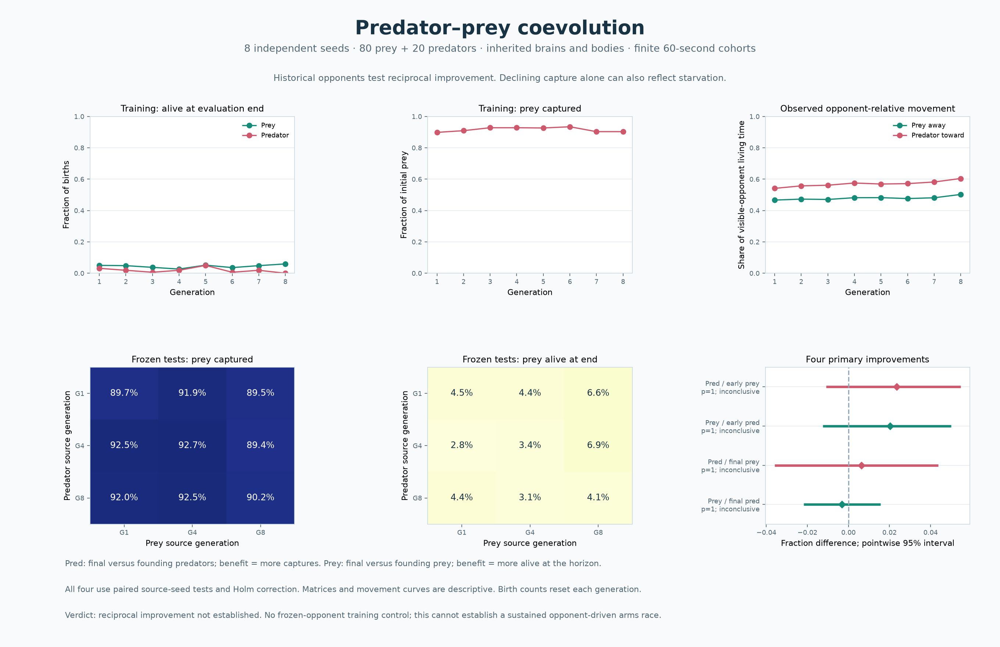

[Population trajectories and fates](results/step24-populations.png) and the
[ten-second held-out arena replay](results/step24-world.png) supplement the
[complete observations](results/step24-coevolution.json). All eight three-checkpoint
archives are retained in `results/step24-models/`.

The audit independently reconstructs **112 species reproduction events**, every
training physical start, all historical opponent combinations, both sensor
masks, all energy ledgers and population losses, and all four exact tests,
bootstrap intervals, and Holm adjustments. A complete final/final arena replay
for the first declared seed matches its stored report bit-for-bit. All **253
preexisting files** outside the intended README/main/simulation changes remain
byte-identical, including **193 earlier result artifacts**. The corrected
production source hashes all match the pre-rerun declaration. The two initially
saved populations have exactly the same numeric genomes after the observer fix;
their training reports are identical apart from the added individual removal
times. All **342 tests pass**, with the full transcript saved in
`results/step24-tests.txt`.

## Joint evolution of brains and bodies

Step 23 adds an opt-in trait world. Its 100 founders have random **8–8–2 brains
(90 weights/biases)** and the same reference body. Selection keeps the top 20 by
`fitness = survival_seconds + 10 × meals`; each supplies five shuffled offspring.
A child inherits its brain and all three body genes from the **same parent**.
Neural mutation remains probability 0.1 and additive Gaussian scale 0.1. Each body
allele mutates independently with probability 0.25 and Gaussian log scale 0.08,
then clips to its bounds; radius rounds to an integer. Separate recorded random
streams keep body mutation from changing the neural mutation sequence.

| Heritable trait | Founder | Bounds | Consequences |
| --- | --- | --- | --- |
| Cruise speed, pixels/second | 60 | 25–100 | More travel, quadratic locomotion cost |
| Body radius, pixels | 8 | 4–12, integer | Larger eating contact and reserves, higher development and maintenance costs |
| Sensory range, pixels | 160 | 60–280 | Longer food detection and wall sensing, quadratic sensing cost |

```sh
python main.py --traits --seed 2301 --generations 8 --speed 20
python main.py --headless --traits --seed 2301 --generations 8 \
  --report .cache/body-run.json --plot .cache/body-run.png
```

Click a creature to inspect its inherited genes, energy capacity, three running
costs, and body mutation count. `--body-mutation-rate` and
`--body-mutation-scale` control body mutation. Each creature cruises at its own
inherited speed; brains choose turning and their throttle output is unused.
`--fixed-speed` is rejected with `--traits`. Trait, seasonal, and obstacle modes
are separate experiments and cannot be combined. Ordinary simulation behavior
and earlier model archives remain unchanged.

### Energetic trade-offs

These are explicit **stylized 2D assumptions, not calibrated biological laws**.
With area-based mass proxy `m = (radius / 8)²`, speed `v`, and range `R`:

```text
capacity = 100 × m
one-off body development = 10 × m
initial energy = min(capacity, 100 − development)
basal power = 2 × m
movement power = 2.5 × m × (v / 60)²
sensing power = 0.5 × (R / 160)²
```

Every newborn receives the same 100-unit allocation before development and
storage limits; larger bodies do not receive free starting reserves. Reference
bodies start at 90 energy and spend 5 units per living second. Small bodies are
cheaper but have limited storage and eating contact. Large bodies can store more
food, but pay more to develop, move, and survive. Sensing costs run continuously.
Food provides 20 units, clipped to each body's capacity. Reports retain actual
assimilated energy and wasted food energy, plus separate integrated cost ledgers.
Expenditure stops at the actual starvation or lifespan time.

Fitness still rewards meals even when some energy is wasted at capacity. There
is no parental reproductive budget, growth, acceleration cost, or inherited color
or lifespan. This is a fixed birth-cohort selection experiment, not a complete
population ecology or evidence of a biological optimum.

### Declared experiment

Before changes, **303 tests passed**. `results/step23-baseline.json` records all
231 pre-step tracked file hashes and the preceding commit; its accompanying
baseline transcript preserves that check. Previous saved results are unchanged.
The new protocol and all Python source hashes are written **before trials**.

Twelve independent seeds (2301–2312) each train eight evaluated cohorts of 100
creatures on uniform food. After seven reproduction events, the final evaluated
birth cohort is frozen without an extra selection or reproduction. Each seed is
tested on two new resource environments: standard (150 pellets) and scarce (50).
Four frozen combinations use every individual, including unsuccessful ones:

| Condition | Brain | Body |
| --- | --- | --- |
| Joint | Evolved | Evolved |
| Brain only | Evolved | Reference founder body |
| Body only | Founder | Evolved |
| Founder | Founder | Reference founder body |

“Brain only” is a frozen intervention on the jointly trained genome, **not a
separately trained fixed-body population**. The body-only case likewise replaces
brains without retraining. Matched conditions share initial positions, headings,
colors, lifespans, and food. Positions and initial food clearance use the same
maximum-body envelope, preventing genes from changing the starting layout.
Actual radius, speed, range, capacity, initial reserves, and costs differ as
intended. Food replenishment subsequently follows each condition's behavior.
Shared-layout hashes exclude treated body characteristics; these new hashes
should not be equated with previous experiments' physical-state hashes.

The study comprises **96 training and 96 test cohorts**, 19,200 creature lives,
and 24 fresh shared test scenarios. Each scenario is excluded from the current
training layouts. The independent unit is the training seed, **n = 12**. Four
primary fitness comparisons test joint minus founder and joint minus brain only
in each environment. Exact paired sign tests use a 1e−10 tie tolerance and Holm
correction across all four; 20,000 paired bootstrap resamples provide pointwise
95% intervals. A directional conclusion requires adjusted p < 0.05 and an
interval excluding zero. Meals, survival, visibility, energy, trait trajectories,
and the factorial brain/body interaction are descriptive. There is no new drift
control or separately trained static-body control in this step. The body
intervention replaces all three traits together, including their energetic and
sensory scaling effects. It cannot isolate the causal contribution of one gene,
and a changed trait mean alone does not distinguish selection from drift.

```sh
python experiment_traits.py --workers 8 --models-dir results/step23-models \
  --output results/step23-traits.json --protocol-output results/step23-protocol.json
python plot_traits.py results/step23-traits.json \
  --output results/step23-traits.png --costs-output results/step23-costs.png \
  --bodies-output results/step23-bodies.png
```

Use new output paths for reruns; existing reports and archives are protected.
The analytic cost plot varies one trait at a time with the others at reference;
its endurance curve assumes no food. The body map uses the first declared test
seed, with actual radii, speed colors, and sensory circles for predetermined ID 1.

### Observed Step 23 results

The complete declared run finished all **192 cohorts and 19,200 lives**. The
final generation's equal-seed birth-cohort means changed as follows; these include
all 100 offspring per lineage, rather than just its successful parents:

| Trait | Founder | Generation 8 | Range of final seed means |
| --- | --- | --- | --- |
| Cruise speed | 60.00 | 67.14 | 62.68–78.19 |
| Radius | 8.00 | 8.41 | 8.03–8.97 |
| Sensory range | 160.00 | 160.89 | 152.72–168.12 |

All twelve final seed means increased in speed and radius. Sensory range showed
little net change, with variation in both directions. These are descriptive gene
trajectories, not separate tests of selection against genetic drift.

The held-out means below weight each independent training seed equally. Survival
means the proportion of all newborns reaching 60 seconds; power is total actual
expenditure divided by observed living time within each seed, then averaged.

| Food condition | Frozen combination | Fitness | Meals | Survival at 60 s | Energy / living second |
| --- | --- | ---: | ---: | ---: | ---: |
| Standard | Joint | 376.60 | 30.03 | 80.25% | 6.17 |
| Standard | Brain only | 358.80 | 27.73 | 88.17% | 5.00 |
| Standard | Body only | 309.08 | 24.04 | 68.08% | 6.14 |
| Standard | Founder | 301.53 | 22.67 | 77.25% | 5.00 |
| Scarce | Joint | 58.79 | 3.34 | 1.58% | 5.97 |
| Scarce | Brain only | 71.61 | 3.92 | 4.92% | 5.00 |
| Scarce | Body only | 50.93 | 2.76 | 0.67% | 6.00 |
| Scarce | Founder | 59.07 | 2.99 | 2.00% | 5.00 |

| Primary fitness contrast | Paired difference | Pointwise 95% interval | Holm-adjusted p | Declared verdict |
| --- | ---: | --- | ---: | --- |
| Standard: joint − founder | +75.07 | [63.42, 87.85] | 0.00195 | Higher |
| Standard: joint − brain only | +17.80 | [8.40, 28.04] | 0.11572 | Inconclusive |
| Scarce: joint − founder | −0.28 | [−4.61, 4.23] | 0.77441 | Inconclusive |
| Scarce: joint − brain only | −12.82 | [−17.70, −7.75] | 0.11572 | Inconclusive |

**Joint evolution improved fitness over founders in the standard environment.**
A distinct fitness benefit from the evolved body bundle is **not confirmed**
under the declared four-test correction. Both body contrasts have pointwise
intervals excluding zero, but their adjusted sign-test p-values exceed 0.05.
The complete evolved genomes also show no established advantage over founders
under scarcity. All four outcomes are retained in `results/step23-traits.json`.

The descriptive trade-off is clear in the observations: faster, larger bodies
ate more meals under standard supply, while spending about 23% more energy per
living second than reference bodies. With the same evolved brains, the joint
bodies had more meals but lower checkpoint survival than the reference bodies.
Under scarce food, the joint bodies had lower observed meals, survival, and
fitness than the reference-body intervention. These secondary observations are
consistent with a movement/storage/maintenance trade-off; they do not isolate
speed from size or establish a confirmed scarcity penalty after correction.
The meal-weighted fitness objective also rewards some food that cannot be stored.

Joint creatures could see food during 99.99% of their living time in standard
tests and 98.82% in scarce tests. Little mean range change therefore occurred in
settings with near-continuous food detection; this does not identify an optimal
sensory range. The descriptive brain/body interaction was +10.25 fitness units
in standard food (interval −7.31 to 29.20) and −4.68 under scarcity (−8.77 to
−0.43), without confirmatory interaction tests. Co-adaptation, changed sensory
normalization, and energetic effects remain bundled in the body intervention.

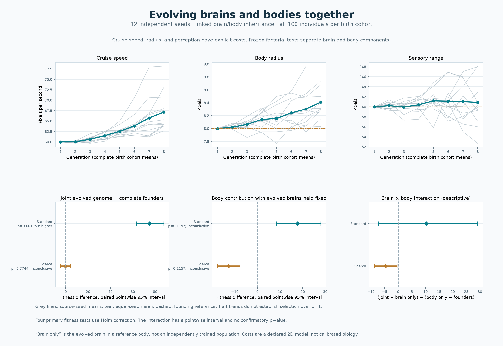

[Energy-cost curves](results/step23-costs.png) and the
[matched body example](results/step23-bodies.png) show the specified mechanical
trade-offs and actual first declared held-out phenotype. All twelve founder and
evolved brain/body banks are preserved in `results/step23-models/`.

The independent audit reconstructs **84 linked reproduction events**, both
mutation streams, every training physical start and every matched test layout.
It independently checks all 19,200 energy ledgers, exact sign tests, and Holm
correction, and recomputes the stored analysis. All **226 preexisting files**
outside the five intended source/document changes remain byte-identical,
including **172 prior result artifacts**. Default-mode compatibility checks match
the preceding simulation bit-for-bit. The only post-declaration Python change
widens a figure margin to prevent real-result labels from clipping; the audit
records its exact reversal and verifies the original source hash. Simulation,
genetics, and analysis code stayed unchanged throughout the study.
The complete **321-test** transcript is saved in `results/step23-tests.txt`.

## Obstacles, hazards, and evolved avoidance

Step 22 adds an **opt-in obstacle world**, with solid internal barriers and
energy-draining regions. Before implementation, all **284 tests passed**;
`results/step22-baseline.json` records the preceding commit and hashes of all
207 tracked files, with the test transcript in `results/step22-baseline-tests.txt`.
Earlier saved results are preserved. The original eight-input neural model remains
the default for ordinary and seasonal worlds; obstacle worlds use **16–8–2
networks with 154 parameters**. Existing eight-input model archives are unchanged.

```sh
python main.py --obstacles --seed 2201 --generations 8 --speed 20
```

The view shows grey barriers, red dangerous regions, and five yellow obstacle
rays for the selected creature. The footer displays its collision count, dangerous
exposure, and risk-sensor mode. Headless runs can export completed-cohort plots:

```sh
python main.py --headless --obstacles --seed 2201 --generations 8 --speed 20 \
  --report .cache/obstacle-run.json --plot .cache/obstacle-run.png
```

`--risk-sensors hidden` masks the eight new inputs while preserving food, hunger,
and outer-wall sensing. This is a diagnostic intervention, not removal of the
physical obstacles or damage. Ordinary controller and population/food/mutation
options remain available. Obstacle mode defaults to fixed 60 pixels/second;
neural throttle remains unused at fixed speed. **Seasonal and obstacle modes are
separate experiments** and cannot be combined in this step. Obstacle mode uses
the ordinary fixed-birth-cohort breeding rule, not Step 21's reproductive-age gate.
All cohorts eventually die; this step does not report permanent lineage extinction.

### Geometry, physical costs, and inputs

The default 1000 × 600 arena has two partial vertical walls and one horizontal
barrier, with open routes around every end. Each generation receives a new seeded
layout from the same family: barrier sizes stay fixed relative to arena size,
while their positions vary within declared ranges. Two circular danger regions
have radius 51 pixels in this arena. They remain fixed during a cohort. This is
local obstacle navigation, not an arbitrary maze generator.

Bodies and replenished food are rejection-sampled outside barriers and danger
regions; body placement also preserves separation between creatures. Barriers
use **radius-expanded axis-aligned boxes** for conservative body clearance:
the same geometry controls spawning, obstacle rays, and motion. This treats
corners conservatively rather than using exact rounded circle/rectangle contact.
Motion sweeps to the nearest barrier or outer-wall contact, reflects the heading,
and processes remaining travel. It cannot jump through a thin wall at high speed.
A safety cap stops extreme calls after 16 impacts at the last safe position;
normal one-pixel ticks never require that many. Outer boundary reflections remain
unpenalized. Internal barrier impacts are counted per reflected contact, not per
frame spent near a wall.

Each internal impact costs **2 energy units**. Body overlap with a dangerous disk
adds **12 energy units per living second** to the ordinary movement/basal cost
(5 units/second at fixed speed 60). Exposure is evaluated at each fixed tick's
starting position, with actual lived time clipped at energy or lifespan limits.
At the study speed, a tick moves at most one pixel; danger exposure therefore has
the usual fixed-step entry/exit approximation. Continuous swept collision tests
apply to solid barriers, not to integrated danger exposure at extreme speeds.
Collision depletion and hazard depletion have distinct death causes. Dead bodies
are removed before they can eat, including deaths caused during movement.

The **selection score** also explicitly penalizes risk:

```text
fitness = survival_seconds + 10 × meals
          − 2 × internal_barrier_impacts − 5 × dangerous_seconds
```

Negative fitness is allowed. Physical energy loss and these score deductions are
both deliberate: the former affects survival; the latter supplies explicit
selection pressure. A larger penalized score alone does not establish effective
avoidance or improved food seeking.

The original eight inputs remain food proximity, signed food bearing, food
visibility, hunger, and four outer-wall clearances. The eight additions are:

| Added input | Encoding |
| --- | --- |
| Obstacle left, front-left, forward, front-right, right | Radius-aware clearance / 160 pixels at −90°, −45°, 0°, +45°, +90°; 1 means no barrier within range |
| Hazard proximity | 1 − nearest danger-boundary clearance / 160, clipped at zero; includes body radius |
| Hazard direction | Signed center bearing / π; zero when undetected or exactly at its center |
| Hazard inside | 1 when the body overlaps a dangerous region; otherwise 0 |

Food sensing retains the original non-occluded nearest-food signal: a pellet can
be sensed behind a barrier. No route, avoidance turn, or food-seeking action is
programmed into the neural controller. Contact reflections are shared world
physics. In hidden-risk tests, the five new clearances become 1 and the hazard
triple becomes 0. The original eight signals remain truthful, so hunger can still
carry indirect information about damage. Such masks can cause input-distribution
shift and do not isolate the roles of individual risk channels.

### Declared avoidance study

```sh
python experiment_obstacles.py --workers 8 --models-dir .cache/obstacle-models \
  --output .cache/obstacles.json --protocol-output .cache/obstacle-protocol.json
python plot_obstacles.py .cache/obstacles.json --output .cache/obstacles.png \
  --layout-output .cache/obstacle-layout.png
```

The fixed study declares **12 independent random-founder seeds (2201–2212)**,
**eight scored training generations**, population 100, uniform maintained food
150, fixed speed 60, intact food/risk sensors, and unchanged mutation probability
0.1 with Gaussian scale 0.1. Selection uses the top 20 penalized-fitness parents,
neutral ID ordering, and five offspring per parent. All 100 final birth-cohort
brains and original founders are archived. There are seven inheritance events;
the last scored cohort is frozen without an extra unobserved birth generation.
The study includes **96 training cohorts**.

Every seed then receives **two new held-out layouts**, both from the training
geometry family. On each, three complete frozen cohorts are tested:

- Evolved brains with intact inputs.
- The same evolved brains with only the eight added risk inputs hidden.
- Exact original unselected founders with all inputs intact.

That is **72 test cohorts**, **24 distinct new layouts**, and **168 complete
cohorts / 16,800 creature lifetimes** in total. Body traits, placements, initial
food, obstacles, and hazard locations match across the three conditions on each
layout. Test namespaces and physical hashes exclude every recorded Step 16–21
layout and every current training start. There is no test-time selection,
mutation, or best-individual filtering. These new 16-input founders provide a
matched architectural baseline; this is not a comparison against the earlier
eight-input controllers or a fresh random-motor baseline.

Metrics include penalized fitness, meals per original creature, age-60 survival,
**barrier collisions per living creature-minute**, and **dangerous seconds / total
living creature-seconds**. The risk ratios pool actual exposure within each cohort;
repeat ratios are then averaged within seed. Lower raw counts caused merely by
early death cannot establish avoidance. All early deaths remain in the cohort.

The five primary paired comparisons are declared before trials:

| Primary comparison | Direction supporting improvement |
| --- | --- |
| Evolved intact − founders: penalized fitness | Higher |
| Evolved intact − founders: meals | Higher |
| Evolved intact − founders: collision rate | Lower |
| Evolved intact − founders: hazard exposure fraction | Lower |
| Evolved intact − same brains with risk inputs hidden: fitness | Higher |

Repeats are averaged **within each independent training seed** before inference,
so n = 12, not 24 layouts or 1,200 related creatures. Tests use two-sided exact
paired sign tests, numerical-tie tolerance 1e−10, Holm correction across all five,
and paired percentile bootstrap intervals (20,000 resamples; pointwise 95%).
Higher/lower requires adjusted p < 0.05 and a mean-difference interval excluding
zero in the same direction. The joint claim of **avoidance with improved
foraging** requires higher fitness **and** higher meals **and** at least one
corrected reduction in collision rate or hazard fraction. Benefit from the added
risk sensors is a separate fifth test; lower risk without a sensor benefit can
reflect general movement changes rather than demonstrated use of the new cues.
A trade-off improving one risk while worsening the other must still be reported.

`results/step22-protocol.json` records settings, sensors, primary decisions,
excluded starts, and source hashes before rollouts. It is a local declaration,
not an external preregistration. All candidate outcomes and mutation traces are
saved. Numeric model archives load with `allow_pickle=False`; existing model and
study output paths cannot be overwritten. The overview refuses partial studies.
The layout illustration uses the first declared seed's first held-out repeat,
chosen before outcomes. It shows initial bodies and food, not trajectories or a
selected success. Standalone lineage plots also support custom runtime settings.

Conclusions concern this architecture, finite budget, penalty weights, fixed
speed, and layout family. Training trends alone mix changing geometry and
ancestry. Held-out founder comparisons test changed inherited performance, while
the risk-mask comparison tests usefulness of the added input group; neither
isolates selection from genetic drift (Step 18 addresses that). They do not
establish planning, maze generalization, or usefulness of every sensor channel.

### Recorded Step 22 findings

The fixed study completed **12 independent training seeds**, **96 training
cohorts**, and **72 frozen held-out cohorts** on **24 new matched layouts**:
168 complete cohorts and 16,800 creature lifetimes. **Foraging and penalized
fitness improved, but the declared joint criterion for evolved avoidance was
not met.** Benefit from the eight added risk inputs was also inconclusive.
No penalty, architecture, seed, or training-budget changes followed these outcomes.

Held-out means (each seed first averages its two layouts):

| Frozen condition | Penalized fitness | Meals / creature | Survival to 60 s | Barrier impacts / living minute | Dangerous share of living time |
| --- | ---: | ---: | ---: | ---: | ---: |
| Evolved, intact | 274.04 | 22.08 | 68.08% | 2.975 | 2.826% |
| Same evolved brains, risk inputs hidden | 274.75 | 22.17 | 67.54% | 2.760 | 2.985% |
| Unselected founders, intact | 245.79 | 19.71 | 59.63% | 3.366 | 2.834% |

All five declared primary comparisons are retained below. The first four are
evolved intact minus founders; the last holds evolved genomes fixed and changes
only the added risk inputs. Hazard differences are in **percentage points of
living time**. Intervals are pointwise paired 95% bootstrap intervals, while the
p-values apply the five-test Holm correction:

| Primary comparison | Mean difference | 95% interval | Holm p | Decision |
| --- | ---: | --- | ---: | --- |
| Penalized fitness | +28.25 | [14.05, 40.80] | 0.031738 | Higher |
| Meals per creature | +2.374 | [1.247, 3.406] | 0.031738 | Higher |
| Barrier impacts per living minute | −0.391 | [−0.743, −0.029] | 1.0 | Inconclusive |
| Dangerous-time share (percentage points) | −0.008 | [−0.281, 0.274] | 1.0 | Inconclusive |
| Fitness: evolved intact − risk-hidden | −0.71 | [−6.88, 5.12] | 1.0 | Inconclusive |

Fitness and food consumption each improved in **11 of 12 source seed groups**.
The mean collision rate was about 11.6% lower, and its pointwise mean interval
excluded zero, but only **8 of 12 seed groups** had lower collision rates. Its
corrected paired sign test did not pass. The declared decision requires **both**
the corrected test and interval, so a negative mean interval alone does not
establish avoidance. Hazard exposure favored each side in six seed groups and
was nearly unchanged on average.

Removing the added obstacle/hazard inputs produced a small mean fitness
increase, but the paired difference interval includes zero and only seven seeds
favored intact inputs. This does **not** establish equivalence, harmful sensors,
or that the inputs are unused. It establishes that this study did not demonstrate
a fitness benefit from those inputs at this training budget. The original eight
inputs and indirect hunger feedback remained available under the mask.

The supported finding is **improved foraging in the obstacle environment**.
Evidence for obstacle avoidance is suggestive in the mean collision rate but
insufficient under the declared rule; hazard avoidance and useful added risk
sensing were not demonstrated. General movement changes, food sensing, and
penalty trade-offs remain possible explanations. There is no basis here for a
claim of learned planning, broad maze navigation, or successful avoidance of
both risk types. These results are conditional on the specified layouts,
154-parameter architecture, costs, and seven inheritance events.

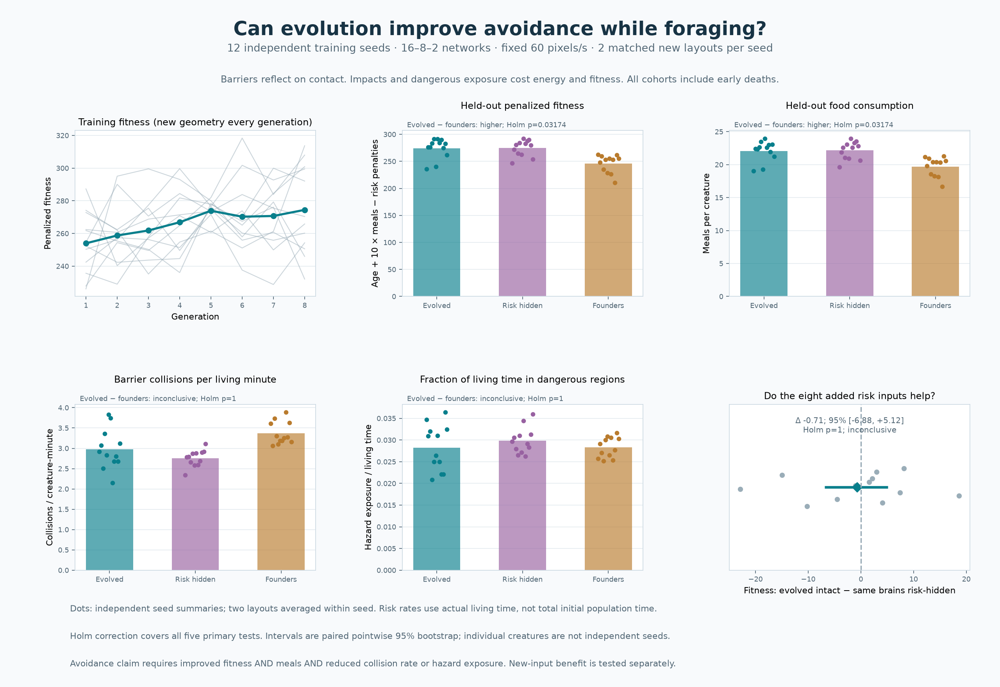

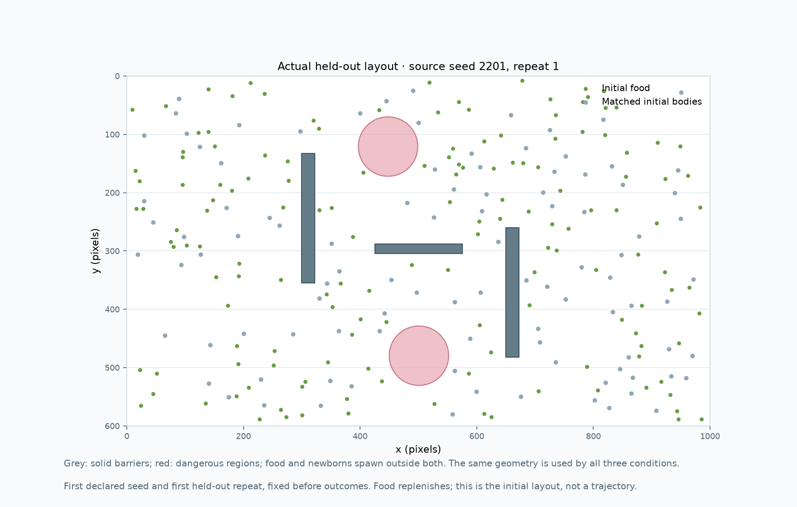

`results/step22-audit.json` reconstructs all **84 reproduction steps** from the
saved founders and mutation traces, validates all **12 numeric archives / 24
brain banks**, reproduces **96 training starts** and **24 held-out starts**, and
checks all actual living-time risk denominators. It also records 2,000 seeded
swept-motion stress cases and the backward-compatibility comparison against the
exact pre-Step-22 commit: five seconds of ordinary foraging and two full zero-food
generations, including inheritance, are bitwise identical in ordinary mode.
All **202 earlier files other than README, brain, world, main, and simulation**,
including **152 prior result artifacts**, remain unchanged. The complete current
**303-test** transcript is saved in `results/step22-tests.txt`.

After declaration, display/export corrections updated the leaderboard's formula
text and made partial-run plots ignore an unfinished next cohort; the export
regression check was supplemented. The audit records the exact replacements and
verifies that reversing them reproduces the declared source hashes. All
experiment, geometry, brain, and statistical-analysis sources match their
pre-rollout hashes; no experimental data or settings changed. The overview,
held-out layout, live geometry, and corrected leaderboard were visually checked.

## Seasons, moving habitats, and lineage extinction

Step 21 adds an **opt-in seasonal world**. The default constant-environment mode
and its movement, sensing, energy, eating, and fitness rules remain available.
All **269 tests passed** before implementation. `results/step21-baseline.json`
records the preceding commit and hashes of all 187 tracked files; its test
transcript is `results/step21-baseline-tests.txt`. Earlier result artifacts are
preserved. This step extends `main.py` and `simulation.py` and introduces new
seasonal modules; the original `world.py` physics is unchanged.

Run the interactive seasonal simulation:

```sh
python main.py --seasons --seed 2101 --generations 8 --speed 20
```

Run the same mode without a window and export its observations:

```sh
python main.py --headless --seasons --seed 2101 --generations 8 --speed 20 \
  --report .cache/seasonal-run.json --plot .cache/seasonal-run.png
```

The seasonal mode uses four food clusters and defaults to fixed 60 pixels/second,
which costs 5 energy units per living second. The normal eight-input neural
network receives no explicit season or generation label. Newborns start with the
existing full energy and random physical traits. Season changes occur **between
generations**, not within a cohort's lifetime:

| Season | Maintained food pellets | Role |
| --- | ---: | --- |
| Spring | 150 | Recovery / standard availability |
| Summer | 200 | Abundance |
| Autumn | 75 | Contraction |
| Winter | 25 | Scarcity |

The four-season cycle repeats. `--season-length` controls generations per season
(default 1); `--season-food SPRING SUMMER AUTUMN WINTER` changes the four counts,
including zero. Seasonal counts and clustered placement take precedence over
`--food-count` and `--food-distribution`, which configure ordinary worlds.
Pellets continue to replenish after eating: these counts control instantaneous
availability, **not a finite seasonal energy budget**.

Each cluster center takes a deterministic seeded step before a new generation,
with a default step length of 120 pixels and reflection at the central 20–80%
rectangle of the arena. Net displacement can be smaller after reflection. Food
spread stays at the existing Gaussian standard deviation of 55 pixels. Centers
are installed **before the first food spawn**, and remain fixed throughout that
cohort, including replenishment. `--cluster-shift 0` holds centers stationary;
positive values enable bounded movement every generation, including transitions
within a multi-generation season. Initial centers and subsequent directions use
independent seed namespaces, so mutation and food RNG streams are unaffected.

### What extinction means here

Ordinary generations end when all creatures eventually die, and previously even
starved creatures could contribute archived weights to the next cohort. In
seasonal mode, a candidate must have reached **reproductive age 60 simulated
seconds**. Up to 20% of the full birth cohort are chosen by the existing fitness
score from among eligible candidates (at most 20 parents for population 100).
Parents are ordered by neutral ID before balanced offspring assignment, and
brains receive the existing Gaussian mutations. Fewer eligible candidates can
produce a genetic bottleneck; if only one qualifies it supplies all offspring.

**Zero eligible candidates ends the lineage.** Automatic and manual generation
advancement stop, reports record the extinction generation, and improved food
in a future season does not resurrect it. Pressing **R** explicitly starts a new
experiment with new founders. `--reproductive-age` allows a different positive
age threshold for future runs; the declared study fixes it at 60 seconds.

This remains a **generational breeding experiment** using archived parental
weights after a cohort ends. Every viable generation has a fixed 100 births;
it does not model continuous reproduction, offspring energy costs, or emergent
population growth. The age rule is a declared modeling choice, not evidence that
60 seconds is a universal biological threshold. The UI distinguishes **cohort
complete** from **lineage extinct** and shows the current season and food supply.
Its history note and seasonal plots identify habitat-dependent fitness. Headless
runs stop early at lineage extinction, even when a larger horizon was requested.

### Declared seasonal study

```sh
python experiment_seasons.py --workers 8 --models-dir .cache/seasonal-models \
  --output .cache/seasons.json --protocol-output .cache/seasons-protocol.json
python plot_seasons.py .cache/seasons.json --output .cache/seasons.png \
  --clusters-output .cache/cluster-paths.png
```

The study declares **eight independent random-founder seeds (2101–2108)** and a
horizon of **eight generations**, or two full seasonal cycles. It fixes population
100, arena 1000 × 600, intact sensors, neural control, speed 60, mutation probability
0.1 and Gaussian scale 0.1, age threshold 60, one generation per season, the food
schedule above, and cluster shift 120. These settings and source hashes are saved
in `results/step21-protocol.json` **before rollouts**. This is a local declaration,
not an externally registered study. No food or threshold tuning follows outcomes.

There are at most **64 seasonal training cohorts**, with fewer if lineages end.
Every seed's exact original founder bank and **all 100 brains of its last evaluated
birth cohort** are saved, including extinct lineages and failed creatures. There
is no extra reproduction after the final scored cohort at the horizon, so an
archive born at generation G has G−1 inheritance events; its last score does not
create another unobserved generation. If a lineage ends in generation 1, its last
cohort bank equals the founders. All candidate ages, scores, eligible counts,
parent choices, mutation draw hashes, offspring slots, initial layouts, body
hashes, and birth-cohort genome hashes are recorded.

To separate changed inherited performance from changing seasonal difficulty,
each seed also receives **four complete frozen diagnostic cohorts**: last birth
cohort versus founders, each on a new matched **standard (150 food)** and **scarce
(25 food)** clustered world. These 32 cohorts cover all eight seeds, even those
whose lineages went extinct. The `step21:test` namespace and physical hashes
exclude previous Step 16–20 layouts and every current training start. Tests use
unmodified physics, speed, and neural inputs and never evolve the archived
brains. These are **shadow evaluations of saved weights**, not resumed living
lineages or demographic rescues. A last cohort can perform well in a new arena
after its real lineage has already failed the reproduction gate.

The plots report food availability, lineages eligible to continue after each
generation, raw fitness with the number of cohorts actually reached, and paired
archive-minus-founder fitness differences. Post-extinction unborn cohorts are
**absent**, not invented zero-fitness observations. Lineage retention always uses
all eight original seeds as denominator; raw cohort means after extinctions are
explicitly conditional on reaching that generation. The cluster-path illustration
uses the **first declared seed**, not a selected survivor, and only realized
cohorts are drawn. A run still eligible at the horizon is right-censored; it has
not demonstrated indefinite persistence.

All statistics are **exploratory and descriptive**. Archive differences use 20,000
paired bootstrap resamples of the eight independent seed groups and pointwise
95% intervals, without new confirmatory p-values. Raw seasonal fitness changes
mix food availability, cluster locations, genetic changes, and survivor selection;
comparing different seasons cannot by itself demonstrate adaptation. Fresh
archive tests measure changed inherited capacity relative to founders under those
specific conditions. They do not isolate selection from genetic drift (Step 18
addresses that), compare seasonal evolution with a static-environment training
control, or prove an optimal response to season changes. The chosen maturity
threshold and finite horizon materially affect extinction risk.

Seasonal model archives use numeric arrays with `allow_pickle=False`; existing
models and output paths are preserved. `plot_seasons.py` accepts either a complete
study report or an individual seasonal simulation report. The former rejects
partial studies; the latter plots completed cohorts and includes any terminal
extinction outcome.

### Recorded Step 21 findings

The unchanged declared study completed **56 realized seasonal training cohorts**
and all **32 frozen diagnostic cohorts**, totaling **88 complete cohorts** and
8,800 creature lifetimes. **Four of eight lineages went extinct**: seeds 2102 and
2104 at the first winter (generation 4), then 2106 and 2108 at the second winter
(generation 8). The remaining four retained eligible parents at the horizon;
this is finite-horizon viability, not demonstrated indefinite persistence.

| Generation | Season | Food | Cohorts reached | Lineages eligible to continue | Mean fitness among reached cohorts |
| ---: | --- | ---: | ---: | ---: | ---: |
| 1 | Spring | 150 | 8 | 8 | 206.45 |
| 2 | Summer | 200 | 8 | 8 | 361.32 |
| 3 | Autumn | 75 | 8 | 8 | 151.40 |
| 4 | Winter | 25 | 8 | 6 | 48.22 |
| 5 | Spring | 150 | 6 | 6 | 371.42 |
| 6 | Summer | 200 | 6 | 6 | 510.87 |
| 7 | Autumn | 75 | 6 | 6 | 196.27 |
| 8 | Winter | 25 | 6 | 4 | 47.02 |

The winter reproduction gate became a strong bottleneck. At generation 8, the
four viable lineages had only **3, 1, 2, and 1** eligible individuals out of their
100 births (seeds 2101, 2103, 2105, and 2107). The two other lineages reaching that
winter had none. Their age-60 survival rate averaged **1.17% across the six reached
cohorts**; the first winter averaged 2.50% across eight cohorts. Having 100 births
therefore did not imply a broad breeding pool. No children were created after
the final generation, and no extinct lineage was restarted by later abundance.

Spring and summer raw mean scores were higher in year two, but cluster locations
and the set of surviving lineages had also changed. Those raw trends alone do
not establish genetic adaptation. The standardized archive tests give a separate
comparison on matched new layouts:

| Fresh diagnostic | Last-cohort mean fitness | Founder mean fitness | Paired difference | Pointwise 95% interval |
| --- | ---: | ---: | ---: | --- |
| Standard: 150 food | 370.49 | 206.10 | +164.40 | [110.62, 226.07] |
| Scarce: 25 food | 50.84 | 37.63 | +13.21 | [7.10, 20.08] |

All **eight independent seed groups** favored their last-cohort archive on both
fitness comparisons, including the four extinct lineages. These are descriptive
paired results with pointwise intervals and no new confirmatory significance
claim. They support **improved inherited controller performance under the tested
conditions**, while not demonstrating that seasonal training is superior to
static training or attributing the changes exclusively to selection.

The archived cohorts also consumed more food and reached age 60 more often:

| Diagnostic | Meals: archive / founders | Survival to 60 s: archive / founders |
| --- | ---: | ---: |
| Standard | 30.97 / 16.25 | 54.63% / 27.75% |
| Scarce | 2.33 / 1.33 | 4.00% / 0.63% |

**Controller improvement and lineage extinction can coexist.** A better average
policy can still fail to produce even one mature individual in a particular
scarce, shifted habitat. Evaluating an extinct lineage's saved weights in a new
arena measures a counterfactual capacity; it does not undo its actual extinction.
The four remaining lineages were still near severe winter bottlenecks at the
observation limit, so their long-term fate remains unknown.

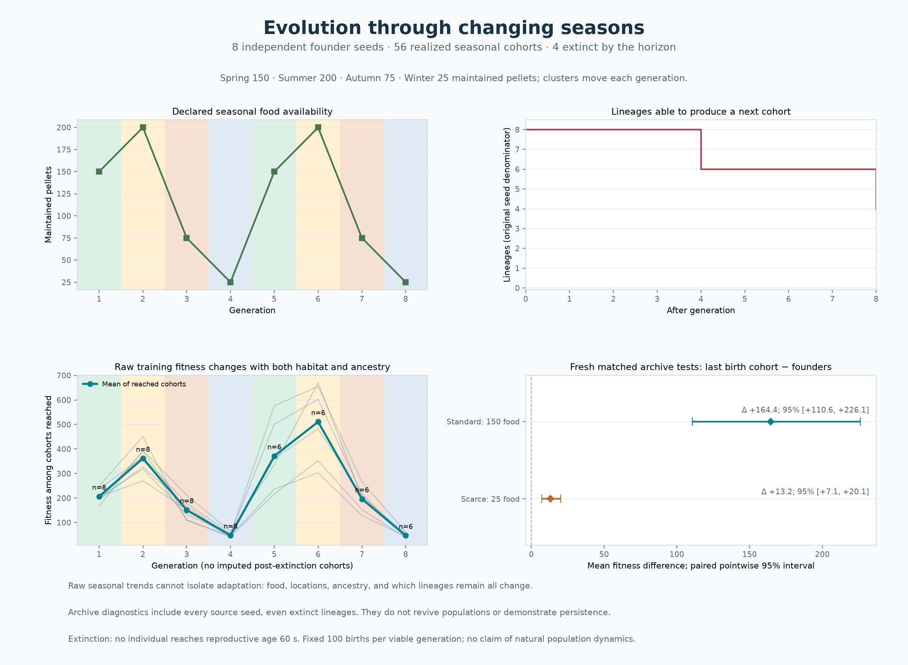

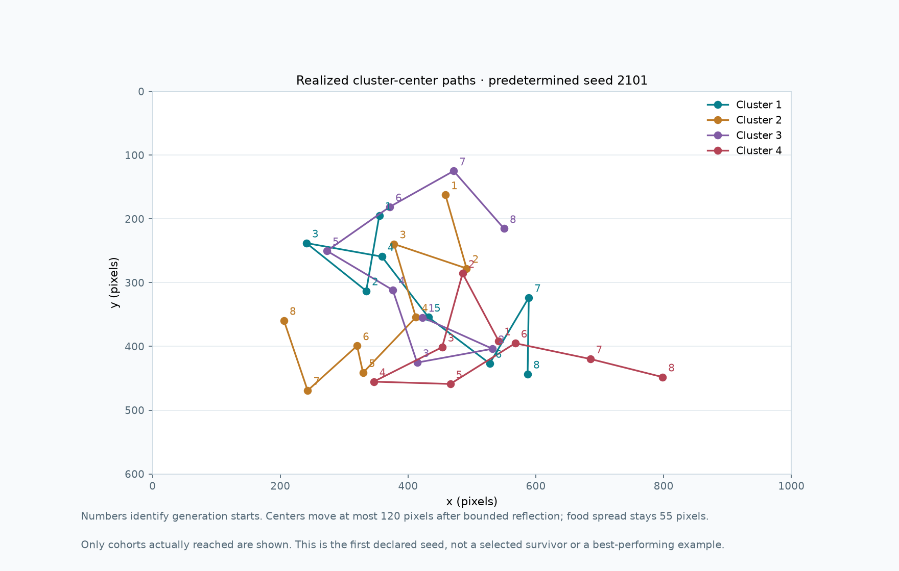

`results/step21-audit.json` independently reconstructs all **48 reproduction
steps** from founders, parent choices, and recorded mutation streams, reproduces
all **56 training starts** and **16 distinct held-out starts**, validates maturity
eligibility and balanced offspring, and recomputes the full analysis. All declared
source hashes match. All **184 earlier files other than README, main, and
simulation**, including **136 prior result artifacts**, remain unchanged;
`world.py` retains its original physics source. The complete **284-test**
transcript is saved in `results/step21-tests.txt`. The seasonal UI, overview,
and cluster-path figures were rendered and visually checked.

## Understand evolved brains

Step 20 extends Step 17's whole-run sensor interventions with **passive trajectory
recordings and single-decision network diagnostics**. It reuses all 16 fixed-speed
evolved populations from Step 16 and their exact unselected founder controls
saved in Step 17. No retraining, selection, or mutation occurs. Published genome
hashes are checked before the new study. Step 19's specialists and generalists
remain a separate preserved experiment; this study explains the original
Step 17 controller comparison, not every later specialist.

Before implementation, all **256 tests passed**. `results/step20-baseline.json`
records the previous commit and hashes of all 159 tracked files; the baseline
transcript is `results/step20-baseline-tests.txt`.

Run recordings and export the visualizations:

```sh
python inspect_brains.py --workers 8 --trace-dir .cache/brain-traces \
  --output .cache/brain-analysis.json --protocol-output .cache/brain-protocol.json
python plot_brains.py .cache/brain-analysis.json \
  --plot .cache/brain-overview.png --viewer .cache/brain-viewer.html
```

The declared study uses **seeds 1601–1616**, two frozen banks (evolved and
unselected), and two fresh test habitats (uniform and clustered, both 1000 × 600,
150 maintained pellets). All 100 brains in each population are tested until the
cohort dies: **64 complete test cohorts**, zero training cohorts, 32 new layouts,
and 6,400 creature lifetimes. Physical starts are matched across the two banks.
The `step20:test` namespace and initial-condition hashes exclude all recorded
Step 16–19 training and test layouts. Source weights and archives remain frozen.
Speed stays at 60 pixels/second and energy expenditure at 5 units/living second.
The neural throttle output is visible for completeness but has no movement effect.

The recorder subclasses the existing world and observes its existing sensory
calls. It does not replace the controller, advance time, consume simulation
randomness, or alter physics. All 100 creatures contribute decision summaries
sampled at one-second intervals while alive. Within each creature, samples are
averaged before averaging the 100 creature summaries within a seed; seed groups
then have equal weight. These samples describe encountered living states, not a
continuous-time integral. Food-directed turning pools eligible off-axis visible
states within each seed (absolute normalized bearing > 0.02), then reports all
16 seed ratios and denominators; it is not a measure of actual capture success.

**IDs 1, 34, and 67** are chosen before outcomes for detailed recordings every
0.2 simulated seconds, including their position, heading, energy, meals, target,
all eight inputs, eight hidden activations, both outputs, eight turn derivatives,
and eight immediate neuron-ablation effects. Every recorded meal is also logged,
including those between decision samples. All 16 numeric archives retain these
192 individual traces (16 seeds × 2 habitats × 2 banks × 3 IDs), including deaths
and poor performers. The figure and standalone viewer use **seed 1601**, fixed in
advance; the figure uses ID 1 and the viewer allows all three recorded IDs.
These illustrations are not selected winners. Reproduction preserves weights,
not physical bodies, so matching ID numbers are birth slots, not the same agent
or proof of direct individual ancestry across banks.

The network computation is exposed directly:

```text
hidden = tanh(inputs @ input_weights + hidden_bias)
outputs = tanh(hidden @ output_weights + output_bias)
turn_rate = outputs[0] × π/2 radians/second
```

The Jacobian computes exact local derivatives of each output with respect to
each encoded input. Central numerical perturbations verify it. These are
**per encoded input unit**, not standardized feature importance: bearing spans
[-1, 1], other inputs span [0, 1], and visibility is binary. A derivative at a
binary input describes the mathematical network extension, not a realizable
infinitesimal change in visibility. Small derivatives can arise from tanh
saturation even when a finite intervention has a large effect.

Single-decision interventions hold the remaining inputs fixed:

- Hide all three food inputs together (proximity, bearing, visibility → zero).
- Mirror visible food bearing, preserving the angular wrap convention.
- Clamp hunger to 0.5.
- Set all four wall clearances to 1 (open space).
- Independently zero each hidden unit's post-tanh activation.

Effects are **original command minus counterfactual command**. Population bars
show mean absolute turn changes, while the viewer preserves signed effects.
Clamp magnitudes differ, and hiding food or opening walls can produce states
outside the naturally observed input distribution. These manipulations reveal
how the network's immediate computation depends on inputs or units; they do
**not** estimate food consumption or fitness under those interventions. Step 17's
complete-run interventions remain the evidence for those outcome effects.
A unit's activity alone does not establish that it detects a named concept;
hidden-unit indices are specific to each network and may be redundant.

A common controlled probe grid tests every brain on the same **222 states**:
37 food bearings from −162° to +162°, three proximities (0.25, 0.5, 0.75), two
hunger values (0.25, 0.75), food visible, and open walls. Turn curves average the
six proximity/hunger combinations per bearing. Input derivatives and command
effects are also summarized on this common grid. Opening walls has zero effect
on this grid by construction; the overview instead shows finite-intervention
bars on **observed uniform-world states**, where wall clearances vary. Observed
states differ between policies, so their sensitivities are not a controlled
between-policy mechanism comparison. The common grid supplies the matched
input comparison but represents only those specified sensory states.

All Step 20 statistics are **exploratory and descriptive**. Whole-run performance
and common-probe differences have paired pointwise 95% bootstrap intervals using
20,000 resamples of the 16 source seeds. No confirmatory p-values, multiplicity
adjustment, or significance decisions are added. Creatures are related within
lineages; frames, brains, and test habitats do not increase the independent seed
count. Existing Step 17 inference is unchanged. Population mean turn curves can
hide heterogeneous policies, so per-brain results and individual traces are saved.

`results/step20-protocol.json` records settings, source model hashes, chosen IDs,
probe inputs, excluded layouts, source/template hashes, and UTC declaration time
before new rollouts. It is a local declaration, not an externally registered
study. Running reports cannot be visualized. Numeric archives load with
`allow_pickle=False`; existing recordings cannot be overwritten.

The generated HTML is self-contained: open it locally, choose a recorded creature,
then use **Play** or the time slider. The trajectory, neural graph, local input
sensitivity, and hidden-unit ablation panels refer to the same pre-control state.
Grey food dots show **initial** pellets only; the gold target is the food actually
sensed at that sample. Meal markers show creature positions when it ate. Last
recorded decisions precede death by at most one sampling interval; full-run death
and survival information is shown separately. These feed-forward networks have
no recurrent hidden memory. Their trajectories cannot establish planning,
semantic understanding, or an exclusive food-seeking strategy.

### Recorded Step 20 findings

The declared study completed **64 full cohorts**, 6,400 creature lifetimes, and
192 individual recordings across 16 source seed groups and 32 new matched layouts.
All 32 source brain banks remained unchanged. The results support an explanation
combining **food-bearing responses with gentler general turning**, rather than
one universal strategy shared by every evolved creature.

| Fresh test habitat | Bank | Mean fitness | Meals per creature | Survival to 60 s |
| --- | --- | ---: | ---: | ---: |
| Uniform | Evolved | 357.49 | 27.55 | 87.25% |
| Uniform | Unselected | 288.66 | 21.51 | 72.31% |
| Clustered | Evolved | 350.37 | 29.31 | 48.13% |
| Clustered | Unselected | 191.19 | 14.97 | 24.44% |

The evolved-minus-unselected fitness differences are +68.83 [56.89, 81.58] on
uniform food and +159.18 [121.79, 202.31] on clustered food. These are descriptive
paired pointwise 95% intervals, not new confirmatory tests.

**Food direction changes decisions.** On the identical controlled probe grid,
evolved mean turn changes from −0.313 at a −162° bearing to +0.277 at +162°;
the unselected population mean stays near zero (+0.007 to −0.004), although its
individual policies need not be near zero. Mean absolute bearing sensitivity is
0.336 versus 0.149 per encoded bearing unit; the paired difference is +0.187
[0.123, 0.253]. Mirroring bearing changes the turn command by a mean absolute
0.328 versus 0.139 on those same inputs; all 16 source seed groups show a larger
mean change for evolved banks, with descriptive paired difference +0.188
[0.123, 0.257]. These common-state effects demonstrate changed input-to-command
computation, not by themselves successful food capture.

The passive trajectories provide a complementary observation: mean seed-level
fractions of eligible sampled states turning toward the visible target are
**69.4% versus 47.1%** on uniform food and **73.2% versus 53.1%** in clusters.
A turn toward the current nearest pellet can still miss it, switch targets,
reflect off a wall, or lose food to another creature. These ratios therefore
describe decisions and do not establish an exclusive pursuit strategy.

**Food inputs are influential, while hunger and wall inputs also matter.**
On observed uniform-world states, the following immediate changes occur:

| Diagnostic clamp | Evolved mean absolute turn change | Unselected mean absolute turn change |
| --- | ---: | ---: |
| Hide all food channels | 0.314 | 0.216 |
| Mirror food bearing | 0.312 | 0.141 |
| Hunger → 0.5 | 0.065 | 0.044 |
| All walls → open | 0.070 | 0.065 |

The food clamps produce larger observed mean changes under these specific
manipulations, but clamp sizes and input support differ. This is not a universal
importance ranking or a claim that wall sensing is dispensable. Common-grid
mean absolute derivatives for evolved brains are 0.229 (food proximity), 0.336
(bearing), 0.200 (visibility), 0.206 (hunger), and 0.144/0.185/0.186/0.180
(forward/right/back/left walls). Interpret these on their encoded scales.

**Movement also differs.** On the common probe grid, evolved mean absolute turn
is 0.281 versus 0.389, with paired difference −0.108 [−0.138, −0.075]. In recorded
uniform runs it is 0.259 versus 0.375, and in clusters 0.268 versus 0.359. Evolved
controllers issue gentler turns on average while remaining responsive to food;
this is consistent with Step 17's evidence for both food guidance and residual
movement benefits. It does not attribute all improved fitness to one input.

**Hidden units combine opposing effects.** In the predetermined clustered
example (seed 1601, ID 1), at 40 seconds the turn command is approximately +0.312.
Zeroing h0 reduces the command to about +0.054, while zeroing h3 increases it to
about +0.547, even though both units have positive activations. Their output
weights make their influences oppose each other. The activation heatmap and
viewer show state-dependent activity; a positive activation is not synonymous
with a right-turn role, a food detector, or a named strategy.

**Individual failures remain visible.** In clusters, the displayed evolved ID 1
ate 73 meals and lived 90.12 seconds, compared with 5 meals and 34.42 seconds for
the matched unselected slot. However, evolved ID 34 ate nothing and starved at
20 seconds, while its matched unselected slot ate 36 meals and lived 64.38
seconds. These examples were fixed before testing, and both are available in
the viewer. Population improvement does not mean every creature improves.

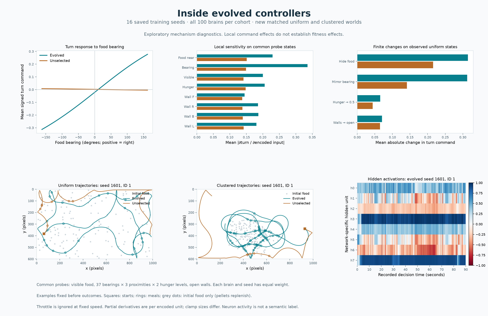

Open [the standalone playback](results/step20-brains.html) locally in a browser.
It contains all 12 examples for seed 1601; numeric archives retain the remaining
180 traces. The full exploratory analysis and per-brain summaries are in
`results/step20-brains.json`.

`results/step20-audit.json` verifies all **61,685 decision frames**, reproduces
activations and outputs exactly, and compares every recorded turn derivative
against finite input perturbations (maximum absolute error below 3 × 10⁻¹⁰).
It independently reproduces neuron-zeroing effects, target geometry, meal events,
all 3,200 brain probes, and the stored statistical analysis. All 158 preexisting
files other than README, including **112 previous result artifacts**, are
unchanged. All declared source and viewer-template hashes match. The saved
`results/step20-tests.txt` records **269 passing tests**. A headless Chromium
check exercised every viewer choice, keyboard scrubbing, play/pause, and desktop
and mobile layouts without page errors or horizontal overflow.

## Evolutionary specialization and transfer

Step 19 trains three specialists and a **domain-cycling generalist**, then tests
every population in all three habitats. Earlier code and results remain
unchanged. Before this step, all **242 tests passed**. The baseline manifest
`results/step19-baseline.json` records the preceding commit and hashes of all
131 tracked files, including 87 prior result artifacts. Its test transcript is
`results/step19-baseline-tests.txt`.

Run the fixed-protocol study:

```sh
python experiment_specialization.py --workers 8 --models-dir .cache/specialization-models \
  --output .cache/specialization.json --protocol-output .cache/specialization-protocol.json \
  --plot .cache/specialization.png
```

All habitats use a **1000 × 600** arena, population **100**, neural control,
truthful sensors, and fixed **60 pixels/second** with **5 energy units per living
second**. Mutation probability stays 0.1 per parameter, Gaussian mutation scale
0.1, and selection uses the best 20 parents with five offspring each and neutral
parent-ID ordering. The existing physics, sensing, food replenishment, lifespan,
and fitness formula (`survival_seconds + 10 × meals`) are unchanged.

| Habitat | Food distribution | Maintained pellets |
| --- | --- | ---: |
| Uniform | Uniform across the arena | 150 |
| Clustered | Existing four seeded clusters, Gaussian spread 55 pixels | 150 |
| Sparse | Uniform across the same arena | 50 |

There are **18 new matched seed groups (1901–1918)**. Each starts all four
regimes with identical founder genomes and bodies. Training food differs as
intended; bodies match across all regimes each round, and regimes visiting the
same habitat in the same round also match their initial food layouts. Mutation
masks, Gaussian draws, and birth-slot shuffles share the same streams across
all four regimes, with recorded draw hashes and complete parent-choice traces.

Each specialist receives nine scored rounds in its home habitat. Generalists
receive nine scored rounds in three blocks, with every habitat appearing once
in each block. The six possible orders are counterbalanced: each order appears
three times per block across the 18 seeds, and six generalists end on each
habitat. Schedules are deterministic and declared before outcomes are observed.
This is **cycling between environments**, not simultaneous optimization of a
three-environment average fitness. Curriculum and recency effects can remain
despite counterbalancing; conclusions are conditional on this generalist design.

Every scored round is followed by selection and mutation, **including the last
round**. Testing freezes all 100 unscored offspring born at generation 10.
Consequently all three habitats contribute exactly three selection events to
each generalist's ancestry. Freezing the already-scored generation 9 instead
would omit its last environment's contribution. All regimes get the same nine
evaluations and nine reproductions, for **900 creature evaluations each**. The
unscored newborn cohort adds no training evaluation. Founder weights are saved
for genetic provenance, not as an additional test row.

The study includes **648 scored training cohorts** and **216 test cohorts**,
totaling **864 evaluated cohorts**. Its 72 trained populations are frozen and
tested on **54 new layouts**: one layout per habitat and source seed group, shared
by all four training regimes. The `step19:test` namespace separates test seeds;
hashes exclude all current training layouts and previous Step 16–18 training/test
layouts. No selection, mutation, weight updates, tuning, or choosing test winners
occurs during testing. Complete cohorts include creatures that die early.

The result is a **4 × 3 performance matrix**:

- Rows: uniform specialist, clustered specialist, sparse specialist, generalist.
- Columns: unseen uniform, clustered, and sparse test layouts.
- Entries: mean fitness, meals per creature, and survival to 60 simulated seconds.

The independent unit is **one matched source seed group (n = 18)**. Repeats, if
requested for another declared study, are averaged within seed group and habitat.
The primary family comprises **nine fitness contrasts**: within each test habitat,
its home specialist is compared with the generalist and each of the two other
specialists. All use two-sided exact paired sign tests with Holm correction over
all nine, and the existing numerical-tie tolerance of `1e-10`. Mean-difference
intervals use 20,000 paired percentile bootstrap resamples with approximate
pointwise 95% coverage. A higher/lower decision requires adjusted p < 0.05 and
an interval excluding zero in the same direction.

**Reciprocal specialization** requires both members of a specialist pair to win
in their own habitat after correction. A globally stronger population that wins
everywhere does not satisfy this crossover criterion. Likewise, the claim that
all specialists beat generalists requires all three home-versus-generalist
contrasts to pass. Inconclusive tests do not establish equivalence or absence
of specialization.

Sparse food changes task difficulty, so **compare training regimes within the
same test column**. Raw home-versus-away scores, or a visually high diagonal,
cannot establish specialization. The figure shows the raw fitness matrix,
within-column differences from the generalist, and all nine primary contrasts.
Gold borders identify matching training/test habitats, not significant winners.

Meals, survival, and generalist-minus-specialist fitness across an equally
weighted mixture of the three test habitats are descriptive secondary results
with pointwise intervals and no confirmatory p-values. The mixture score means
expected raw fitness under one-third probability per habitat; it is not a
difficulty-normalized score or a search for an optimal generalist. All findings
concern this architecture, selection rule, speed, training budget, and habitat
family. Specialization and broad transfer are empirical possibilities, not
outcomes enforced by the program.

`results/step19-protocol.json` records settings, curricula, contrasts, excluded
layouts, UTC declaration time, and source hashes before trials begin. This is a
local declaration, not an externally registered study. Partial reports stay
`running` and cannot be plotted. Numeric archives use `allow_pickle=False` and
contain four final evolved banks, their original founder bank, all scored
episodes, and parent/mutation traces. Existing archives are preserved.

Replay the same held-out tests without retraining:

```sh
python experiment_specialization.py --workers 8 --reuse-models \
  --models-dir results/step19-models --output .cache/replayed-specialization.json
python plot_specialization.py results/step19-specialization.json --output .cache/specialization.png
```

Replaying deterministic tests does not create new independent seed groups.
`--seeds`, `--rounds`, and `--repeats` allow future studies; rounds must be divisible
by three to retain equal generalist exposure. Keep their budgets and decisions
fixed before inspecting results.


### Recorded Step 19 results

The declared study completed all **18 independent seed groups**, 72 evolved
populations, 648 scored training cohorts, and 216 frozen test cohorts on 54 unseen
layouts. **Reciprocal specialization was not established, and no home specialist
conclusively outperformed the generalist.** These inconclusive results do not
establish equivalence. There are two corrected within-habitat advantages among
specialists, described below.

Mean fitness across matched unseen environments (compare rows within each column):

| Training regime | Uniform test | Clustered test | Sparse test |
| --- | ---: | ---: | ---: |
| Uniform specialist | 350.16 | 344.30 | 74.38 |
| Clustered specialist | 260.85 | 469.57 | 63.74 |
| Sparse specialist | 349.92 | 360.99 | 75.82 |
| Cycling generalist | 345.74 | 403.12 | 75.91 |

All nine primary fitness contrasts are shown below. Differences are home
specialist minus the named comparison population in the **same test habitat**.
Intervals are pointwise paired 95% bootstrap intervals; p-values use the declared
nine-test Holm correction. A positive mean or interval alone does not override
the corrected paired sign test.

| Test habitat | Comparison | Mean difference | 95% interval | Holm p | Decision |
| --- | --- | ---: | --- | ---: | --- |
| Uniform | Home − cycling generalist | +4.43 | [-10.10, +21.79] | 1 | Inconclusive |
| Uniform | Home − clustered specialist | +89.31 | [+68.25, +112.76] | 6.86646e-05 | Higher |
| Uniform | Home − sparse specialist | +0.25 | [-11.39, +11.35] | 1 | Inconclusive |
| Clustered | Home − cycling generalist | +66.45 | [+8.87, +126.89] | 1 | Inconclusive |
| Clustered | Home − uniform specialist | +125.27 | [+74.37, +180.30] | 0.0527649 | Inconclusive |
| Clustered | Home − sparse specialist | +108.58 | [+68.99, +152.37] | 0.010498 | Higher |
| Sparse | Home − cycling generalist | -0.09 | [-4.05, +3.93] | 1 | Inconclusive |
| Sparse | Home − uniform specialist | +1.44 | [-2.07, +4.82] | 1 | Inconclusive |
| Sparse | Home − clustered specialist | +12.08 | [+7.93, +16.51] | 0.0527649 | Inconclusive |

The uniform specialist beat the clustered specialist on uniform food in all
18 seed groups. The clustered specialist beat the sparse specialist on clustered
food in 16 of 18 groups. The reciprocal comparisons needed to confirm a crossover
did not pass correction: clustered versus uniform at its own home and sparse
versus clustered at its own home both had adjusted p = 0.052765. Consequently
**none of the three specialist pairs satisfies the declared reciprocal criterion**.
The clustered mean advantage over generalists (+66.45) is suggestive, with a
positive pointwise interval, but only 12 of 18 seed groups favor it and its
corrected sign-test p-value is 1.0.

Descriptive food consumption and survival to 60 simulated seconds:

| Training regime | Uniform: meals / survival | Clustered: meals / survival | Sparse: meals / survival |
| --- | ---: | ---: | ---: |
| Uniform specialist | 26.91 / 85.7% | 28.61 / 49.6% | 4.02 / 4.6% |
| Clustered specialist | 19.16 / 65.4% | 40.46 / 61.4% | 3.25 / 2.7% |
| Sparse specialist | 26.89 / 85.4% | 30.14 / 51.6% | 4.14 / 6.2% |
| Cycling generalist | 26.52 / 85.3% | 34.03 / 58.4% | 4.13 / 5.9% |

On an equally weighted mixture of the three habitats, the generalist has mean
raw fitness **274.92**, versus 256.28 (uniform), 264.72 (clustered), and 262.24
(sparse). Its descriptive paired differences are +18.64 [−5.29, 38.39], +10.20
[−15.02, 32.89], and +12.68 [−6.10, 30.13], respectively. All intervals include
zero; this does not establish that the cycling generalist is superior. Uniform
and sparse training show similar observed transfer to each other, while
clustered training has a larger observed cost on uniform and sparse food.
Those patterns motivate further study; they are not confirmed reciprocal
specialization. Conclusions remain conditional on this finite training budget
and cycling curriculum.

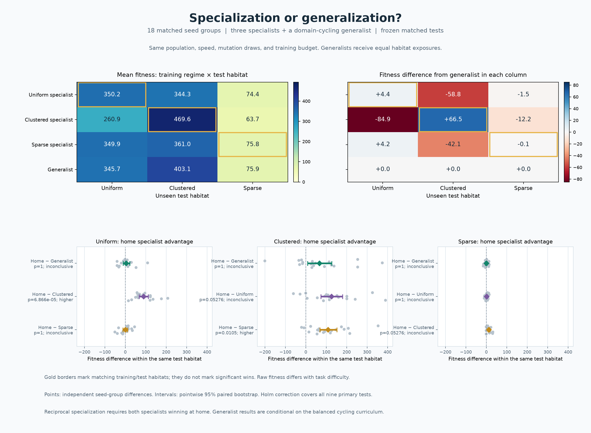

`results/step19-audit.json` records reconstruction of all 648 reproduction steps
from original founder genomes and recorded parent/mutation traces, validation of
all 18 model archives, matching physical conditions and mutation schedules, and
preservation of all 87 earlier result artifacts. The complete **256-test**
verification transcript is saved in `results/step19-tests.txt`.

One presentation-only change followed the completed trials: duplicate row labels
were hidden on the right heatmap to prevent overlap with the left colorbar.
The original source hashes remain in the sealed declaration; the audit records
the exact one-line plotting change and verifies that removing it reproduces the
declared plotting source hash. All experiment, analysis, and other source files
match their pre-trial hashes. No data, inference, or experiment settings changed.

## Test the causal contribution of parent selection

Step 18 addresses the limitation of comparing evolved brains only with their
unmutated founders. A new **random-parent reproduction** arm inherits weights
through the same generational bottleneck and mutations as the fitness-selected
arm. It is neither random movement nor fresh random-brain replacement.

Before adding this step, all **227 tests passed**. The baseline manifest
`results/step18-baseline.json` records the preceding commit and hashes of all
105 tracked files, including 64 result artifacts. The baseline transcript is
`results/step18-baseline-tests.txt`. Earlier experiment code and records remain
unchanged; new standalone experiment files are added and this README is extended.

Run the full study:

```sh
python experiment_selection.py --workers 8 --models-dir .cache/selection-models \
  --output .cache/selection.json --protocol-output .cache/selection-protocol.json \
  --plot .cache/selection.png
```

The fixed protocol uses **16 new independent seed pairs (1801–1816)**. Both
arms start from the same 100 random neural networks, bodies, food, and lifespans.
Both receive **10 complete generations**, with the same 100 newborns and 150
maintained food pellets per generation. Training is uniform food in 1000 × 600.
Neural control, truthful food inputs, fixed **60 pixels/second**, **5 energy units
per living second**, turning limits, sensory range, fitness, and death rules
match the preceding fixed-speed experiments. Fitness remains survival seconds
plus ten times meals consumed.

Only the choice of parents differs:

| Rule | Fitness selection | Random-parent control |
| --- | --- | --- |
| Eligible population | All 100 completed-cohort creatures | Same, including early deaths |
| Parent choice | Highest-fitness 20; lower ID breaks exact ties | Uniform sample of 20 without replacement, independent of fitness |
| Parent ordering | Sort chosen IDs before reproduction | Same neutral ordering |
| Offspring | Five per parent, 100 total | Same |
| Birth-slot assignment | Existing shuffled balanced allocation | Same shuffle draws |
| Inherited weights | Copy parent's neural parameters | Same |
| Mutation | Per-parameter probability 0.1, Gaussian scale 0.1 | Same masks and Gaussian draws |

Sorting chosen parent IDs is a common rule in **both new experimental arms**;
it keeps the random-parent arm independent of fitness even in inheritance
ordering. The existing `World` and its earlier experiments are not modified.
The new `ParentPolicyWorld` subclass varies the parent-set rule while reusing
the existing physics and reproduction/mutation code.

Random-parent sampling uses a separate deterministic RNG namespace. It never
consumes the mutation stream. Both arms use the canonical generation-specific
mutation seed. `RecordedMutationRNG` observes every birth-slot shuffle, mutation
mask draw, and Gaussian draw without altering its sequence. Hashes of the actual
draws must match across paired arms, along with per-offspring mutation counts.
The model archives retain those traces, chosen parents, all candidate fitness
scores, and offspring parent IDs for all **nine reproduction transitions**.

Every training generation must also begin with identical physical hashes across
arms. The first generation's complete observations must match exactly. Reversing
fitness rankings in a controlled test changes the fitness-selected parent set,
while random-parent choice and its resulting offspring remain unchanged.

The training budget is **1,000 creature evaluations per arm and seed**, for
**320 total training cohorts**. This matches population size, generation count,
reproductive bottleneck, fecundity, and mutation opportunity. It does not force
the same survival duration or wall-clock time: living longer is an outcome.
The random-parent control contains both neutral bottleneck drift and mutation,
with no preference for successful creatures.

After training, all 100 brains in each final birth cohort are frozen. The
original 100 founder brains are also retained as an additional test group,
without extra founder training. Each seed pair faces **one new layout in each
of three environments**:

| Environment | Geometry | Maintained food |
| --- | --- | --- |
| Uniform | 1000 × 600 | 150 uniform pellets |
| Clustered | 1000 × 600 | 150 pellets around the existing four seeded clusters |
| Wide clustered | 1200 × 500 | Same cluster rule, unfamiliar arena shape |

Both trained groups and the founder group run in separate matched worlds for
every layout. Starting bodies, food, lifespans, cluster centers, and initial
random streams match. Later replenishment can diverge as behavior diverges.
No reproduction, mutation, learning, or test-based model choice occurs during
testing. Full cohorts include early deaths. The `step18:test` seed namespace
separates test layouts from training and previous Step 16/17 layouts, and hashes
verify separation from all newly trained lineages as well.

The study has **48 unseen test layouts**, **144 test cohorts**, and **464 total
cohorts**. The independent unit is **one independently initialized seed pair
(n = 16)**. Test repeats, if requested for a future study, are averaged within
environment and seed pair before inference.

The **six primary contrasts** are:

1. Fitness selection minus random-parent fitness, in each of three environments.
2. Fitness selection minus founder fitness, in each of three environments.

All six use two-sided exact paired sign tests, the existing `1e-10` numerical-tie
tolerance, and Holm correction over the full family. Mean-difference intervals
use 20,000 paired percentile bootstrap resamples, with approximate pointwise
95% coverage. A higher/lower decision requires adjusted p < 0.05 and an interval
excluding zero in the same direction. A net selection improvement within an
environment requires **both contrasts higher**. This distinguishes improvement
over founders from merely preventing a drift-related loss. An inconclusive
contrast does not establish equivalence or absence of a selection effect.

Meals, survival to 60 seconds, drift-minus-founder comparisons, and training
curves are descriptive secondary results. Training bands resample seed pairs
and have pointwise 95% coverage; changing training layouts mean that curve
trends alone are not the primary evidence. The matched held-out contrasts are
the causal comparison. They test the effect of **fitness-dependent parent
choice in this model and budget**, not a universal mathematical proof that
selection always improves every population or environment.

`results/step18-protocol.json` records settings, contrasts, source hashes, UTC
declaration time, and excluded layouts before trials start. This is a local
declaration, not an externally registered study. Partial reports remain `running`
and cannot be plotted. Numeric model archives use `allow_pickle=False` and
include all three brain cohorts, both complete training histories, and mutation
and parent-choice traces. Existing archives are preserved rather than overwritten.

Replay only the held-out tests, without retraining:

```sh
python experiment_selection.py --workers 8 --reuse-models \
  --models-dir results/step18-models --output .cache/replayed-selection.json
python plot_selection.py results/step18-selection.json --output .cache/selection.png
```

Replaying deterministic seeds checks reproducibility and does not add independent
training pairs. `--seeds`, `--generations`, and `--repeats` permit other studies,
whose budgets and decision rules should be chosen before inspecting outcomes.


### Recorded Step 18 results

All **16 seed pairs**, **320 training cohorts**, **144 test cohorts**, and **48
unseen test layouts** completed. The audit reconstructed every parent choice,
verified all 160 paired training layouts and identical first-generation
observations, and independently replayed all **144 paired mutation schedules**.
Recorded shuffle, mask, and Gaussian-draw hashes matched for both arms. Every
transition used 20 parents with five offspring each. All 16 model archives,
containing 48 frozen brain banks, passed validation. All 64 earlier result
artifacts and all pre-existing source files remain unchanged.

Mean held-out fitness:

| Environment | Fitness selection | Random parents | Original founders |
| --- | ---: | ---: | ---: |
| Uniform | 353.10 | 279.46 | 287.96 |
| Clustered | 327.78 | 225.21 | 227.57 |
| Wide clustered | 333.28 | 219.11 | 209.22 |

The six predeclared primary tests produced:

| Environment | Fitness contrast | Mean difference | 95% paired interval | Holm p | Decision |
| --- | --- | ---: | --- | ---: | --- |
| Uniform | Selection − random parents | +73.64 | [53.39, 94.46] | 0.0001831 | Higher |
| Uniform | Selection − founders | +65.14 | [51.55, 78.51] | 0.0001831 | Higher |
| Clustered | Selection − random parents | +102.58 | [44.76, 161.35] | 0.07681 | Inconclusive |
| Clustered | Selection − founders | +100.21 | [58.03, 144.91] | 0.04254 | Higher |
| Wide clustered | Selection − random parents | +114.17 | [65.39, 167.20] | 0.002075 | Higher |
| Wide clustered | Selection − founders | +124.06 | [81.33, 171.67] | 0.002075 | Higher |

**Fitness-dependent parent choice caused a supported net improvement in the
uniform and wide-clustered tests under this protocol.** Both primary contrasts
passed in those environments. Selection beat random parents and founders in
all 16 uniform seed pairs and 15 of 16 wide-clustered pairs. Because founders,
physical starts, mutation draws, reproductive bottleneck, and training budget
were matched, these contrasts distinguish the effect of choosing successful
parents from random inheritance and mutation. The founder comparison confirms
improvement beyond the initial population, rather than only avoiding drift loss.

The standard clustered result remains **inconclusive against random parents**:
12 pairs favored selection and four favored drift. Its mean-difference interval
was positive, but its sign-test p-value did not meet the declared threshold.
Selection exceeded founders in 13 of 16 pairs there, passing that comparison.
Five of six primary contrasts therefore pass, and the criterion requiring net
improvement in all three environments is **not met**. This uncertainty does not
establish absence of a selection effect, and the protocol was not changed to
turn the result into a positive decision.

Descriptive feeding and survival means:

| Environment | Selection meals | Drift meals | Founder meals | Selection survival | Drift survival | Founder survival |
| --- | ---: | ---: | ---: | ---: | ---: | ---: |
| Uniform | 27.20 | 20.75 | 21.49 | 86.9% | 70.1% | 73.2% |
| Clustered | 27.39 | 18.20 | 18.37 | 42.8% | 27.1% | 27.6% |
| Wide clustered | 27.69 | 17.48 | 16.65 | 46.8% | 29.1% | 25.9% |

Meals are per creature and survival means reaching 60 simulated seconds. These
secondary means favor selection in all environments, but have no confirmatory
p-values. Drift-minus-founder fitness intervals cross zero in every environment;
they do not demonstrate equivalence or prove that drift necessarily harms fitness.

Training began at an identical mean fitness of **288.05** in both arms. At
generation 10, the means were **348.63 with selection** and **271.34 with random
parents**. This trajectory is descriptive; the held-out comparisons above are
the primary evidence. The experiment supports selection's causal contribution
in this virtual world and budget, not a universal guarantee of improvement.

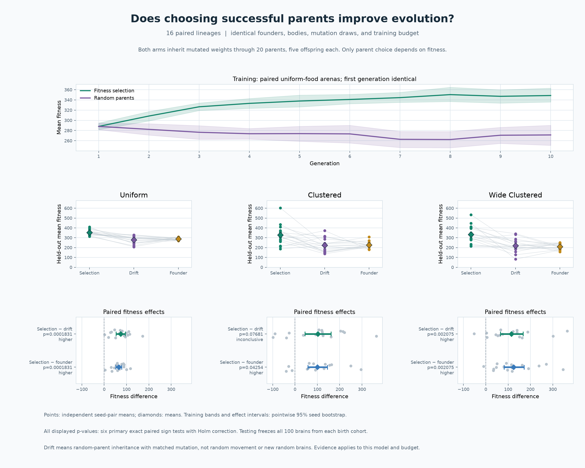

The figure was visually inspected. `results/step18-audit.json` records all
preservation, parent-choice, independently replayed mutation, model, budget,
layout, and statistical checks, plus runtime versions and artifact hashes.
`results/step18-tests.txt` saves the passing **242-test** transcript. The full
JSON report retains each cohort, each parent decision, and all secondary intervals.

## Investigate learned food guidance and movement

Step 17 adds a new analysis; **Step 16 is preserved**. It reuses every brain in
the sixteen saved final birth cohorts from seeds 1601–1616, without retraining,
selection, mutation, tuning, or choosing test winners. Before this step, all
**212 existing tests passed**. `results/step17-baseline.json` records the preceding
commit and hashes of all 79 tracked files, including all 41 prior result
artifacts; `results/step17-baseline-tests.txt` saves that test transcript.

Run the fixed-protocol study:

```sh
python experiment_strategy.py --workers 6 --output .cache/strategy.json \
  --unselected-models-dir .cache/unselected-models \
  --protocol-output .cache/strategy-protocol.json --plot .cache/strategy.png
```

The source defaults are `results/step16-models` and the published
`results/step16-speed-comparison.json`. Model-file hashes and complete-cohort
genome hashes link the new experiment to the original records. All evolved
weights stay frozen throughout testing.

The **unselected neural baseline** consists of the original random founder
brains, reconstructed deterministically from each Step 16 training seed using
unchanged initialization code. The founder world's physical hash must match
the archived first training layout. This check verifies the starting bodies,
lifespans, and food; founder weights are regenerated from the deterministic
initialization, then saved in numeric archives for this study. These brains
undergo no training, selection, or mutation. The comparison measures the effects
of the evolved history relative to its initial policy distribution; it does
not separate selection from mutation or provide a neutral-drift control.

Each lineage faces **one new layout in each of the three Step 16 environment
families**: uniform food in 1000 × 600, clustered food in 1000 × 600, and clustered
food in 1200 × 500. The new `step17:test` seed namespace includes lineage,
environment, and repeat. Every layout must differ from **every** Step 16 training
and test layout, including those from other lineages. There are **48 unseen
layouts**, repeated independently across sixteen source lineages per environment.
The default uses one layout per lineage/environment, rather than the two used
in Step 16; `--repeats` can specify a different budget for a future declared study.

Each layout runs all seven conditions in separate matched 100-creature worlds:

| Condition | Weights | Direct food inputs |
| --- | --- | --- |
| Evolved intact | Saved evolved cohort | Truthful |
| Evolved mirrored | Same evolved cohort | Food bearing reflected left/right |
| Evolved hidden | Same evolved cohort | Proximity, bearing, and visibility set to zero |
| Unselected intact | Original random founders | Truthful |
| Unselected mirrored | Same founder cohort | Food bearing reflected left/right |
| Unselected hidden | Same founder cohort | All three food inputs set to zero |
| Random | Existing random steering | Unused by controller |

All conditions share **60 pixels/second**, **5 energy units per living second**,
150 maintained pellets, body traits, lifespan limits, initial food, cluster
centers, and initial random streams within a layout. The same existing turning,
food replenishment, energy, and death rules apply. The sensor interventions are
the existing Step 15 implementation: they alter inputs only at the brain-control
boundary. Food, hunger, walls, collision detection, and recorded observations
remain physical truth. Later replenishment and random-stream consumption can
diverge as behavior diverges. Complete cohorts are evaluated, including early
deaths. The study has **336 test cohorts and zero training cohorts**.

The independent statistical unit is **one source training lineage (n = 16)**.
Repeats, if requested, are averaged within lineage and environment before
inference. The **twelve predeclared primary tests** comprise four contrasts in
each of the three environments:

| Contrast | Outcome | Question |
| --- | --- | --- |
| Evolved intact − evolved mirrored | Meals per creature | Does truthful food bearing help the evolved population? |
| (Evolved intact − mirrored) − (unselected intact − mirrored) | Meals per creature | Did the useful bearing benefit increase beyond the founders' benefit? |
| Evolved intact − unselected intact | Fitness | Do evolved brains outperform the original neural population? |
| Evolved hidden − unselected hidden | Fitness | Is an evolved advantage retained when direct food inputs are hidden? |

The second contrast is calculated **within lineage** before paired analysis;
it is not a difference between two separately pooled significance tests. All
twelve use two-sided exact paired sign tests with the Step 16 numerical-tie
tolerance of `1e-10`, and Holm correction across the full family. Intervals use
20,000 paired percentile bootstrap resamples, with approximate pointwise 95%
coverage. A higher/lower decision requires adjusted p < 0.05 and an interval
excluding zero in the same direction. The declared food-guidance attribution
requires the first three contrasts all higher within an environment. Individual
test results remain visible when that joint criterion is not met; failure does
not establish absence or equivalence.

Other performance contrasts, including evolved hidden versus random and
unselected hidden versus random, are descriptive with pointwise intervals and
no confirmatory p-values. Fitness, meals, and 60-second survival are saved for
every condition. These contrasts are not an additive decomposition of the
previous Step 16 gain.

Two **descriptive diagnostic probes** characterize all frozen evolved and
founder brains:

- The existing steering probe flips only target side at ±45°/±90°, distances
  40/80/120, and hunger 25%/75%, with all wall inputs at 1. Its signed gain is
  `(turn_right − turn_left) / 2`. The separate fraction commanding the correct
  turn on both sides distinguishes an appropriate shift from a persistent bias.
- The movement probe supplies no direct food input, open-space wall values,
  and hunger clamped at 25% or 75%. A feed-forward brain then has a constant
  turn output. It reports mean absolute turn and the analytic displacement/arc
  length ratio after 12 seconds: `abs(sinc(angular_speed × 12 / (2π)))` with
  NumPy's normalized sinc. A straight path has ratio 1; a complete circular
  orbit has ratio 0. This is a controlled probe, not a natural trajectory,
  navigation test, or evidence of planning.

Food-channel removal creates an input distribution shift, and hidden creatures
still receive **indirect feedback from eating through hunger/energy**. A residual
advantage can reflect turning biases, wall/hunger responses, or other aspects
of control. It does not identify an exclusive general-movement strategy, and a
drop does not rule out such strategies. Mirroring also changes closed-loop
trajectories; its useful-bearing effect demonstrates the value of truthful
directional information, rather than human-like understanding. Food guidance
and residual movement benefits can coexist.

`results/step17-protocol.json` records the protocol, UTC declaration time, all
source hashes, source model hashes, and excluded layouts before testing. This
is a local declaration, not an externally registered study. Partial reports
remain `running` and cannot produce a final plot. Unselected archives use
`allow_pickle=False`; existing matching archives are preserved, and conflicting
archives or attempts to overwrite source inputs are rejected.

Regenerate the figure:

```sh
python plot_strategy.py results/step17-strategy.json --output .cache/strategy.png
```

Re-running the same source models and deterministic test seeds checks
reproducibility and does not increase the independent sample size. Keep replay
outputs in a new directory to preserve the published reports.

### Recorded Step 17 results

The complete study evaluated **336 cohorts on 48 new matched layouts**, reusing
all sixteen evolved populations and evaluating their sixteen unselected founder
cohorts. No population was retrained. The audit verified all frozen weights,
founder reconstruction, model archives, probes, source hashes, and stored
statistics. All **41 previous result artifacts and all previous code files remain
unchanged**. Only this README is extended among the pre-existing tracked files.

Mean fitness under the seven conditions:

| Condition | Uniform | Clustered | Wide clustered |
| --- | ---: | ---: | ---: |
| Evolved intact | 354.12 | 353.24 | 350.80 |
| Evolved mirrored | 277.65 | 137.83 | 135.37 |
| Evolved hidden | 258.99 | 222.61 | 237.99 |
| Unselected intact | 291.21 | 206.14 | 211.04 |
| Unselected mirrored | 291.26 | 218.01 | 221.72 |
| Unselected hidden | 293.25 | 207.76 | 213.68 |
| Random | 323.44 | 211.90 | 196.64 |

The twelve primary tests produced these mean paired differences:

| Environment | Contrast and unit | Difference | 95% paired interval | Holm p | Decision |
| --- | --- | ---: | --- | ---: | --- |
| Uniform | Evolved intact − mirrored meals | +6.71 | [4.86, 8.60] | 0.002075 | Higher |
| Uniform | Bearing benefit above founders, meals | +6.75 | [4.90, 8.71] | 0.0003662 | Higher |
| Uniform | Intact evolved − founders, fitness | +62.91 | [52.37, 73.27] | 0.0003662 | Higher |
| Uniform | Hidden evolved − founders, fitness | −34.27 | [−64.54, −6.16] | 0.6303 | Inconclusive |
| Clustered | Evolved intact − mirrored meals | +19.24 | [14.47, 24.32] | 0.0003662 | Higher |
| Clustered | Bearing benefit above founders, meals | +20.37 | [15.97, 24.82] | 0.0003662 | Higher |
| Clustered | Intact evolved − founders, fitness | +147.09 | [103.08, 194.83] | 0.0003662 | Higher |
| Clustered | Hidden evolved − founders, fitness | +14.85 | [−12.19, 47.42] | 1.0000 | Inconclusive |
| Wide clustered | Evolved intact − mirrored meals | +19.36 | [14.64, 24.63] | 0.0003662 | Higher |
| Wide clustered | Bearing benefit above founders, meals | +20.35 | [15.84, 25.48] | 0.0003662 | Higher |
| Wide clustered | Intact evolved − founders, fitness | +139.77 | [97.15, 187.87] | 0.0003662 | Higher |
| Wide clustered | Hidden evolved − founders, fitness | +24.31 | [−10.07, 66.96] | 1.0000 | Inconclusive |

**All three food-guidance attribution criteria passed in every environment.**
Truthful bearing improved evolved feeding in 15 of 16 uniform lineages and all
16 lineages in each clustered environment. The bearing benefit exceeded the
founders' benefit in all 16 lineages in every environment. Intact evolved brains
also exceeded intact founders' fitness in all 16 lineages in every environment.
These findings support **evolved functional food-directed control** beyond the
initial neural-policy distribution, under the tested conditions.

The three residual hidden-input comparisons were **inconclusive**. The uniform
mean interval was negative, but did not meet the predeclared sign-test threshold;
neither a lower nor a higher effect is confirmed there. Hidden evolved versus
random and hidden founders versus random remain descriptive comparisons. For
example, wide-arena hidden evolved fitness exceeded random by +41.35 on average
with interval [4.10, 85.38], while hidden founders also exceeded random by +17.04
[4.43, 29.97]. Those secondary intervals do not establish an evolved residual
advantage over founders or identify its mechanism.

Descriptive probe averages:

| Population | Steering gain | Both-side correct probe pairs | Absolute no-food turn, fraction of limit | Open-space straightness after 12s |
| --- | ---: | ---: | ---: | ---: |
| Evolved | 0.13355 | 34.36% | 0.35677 | 0.34451 |
| Unselected founders | −0.00264 | 4.61% | 0.36846 | 0.35435 |

The steering probes show a larger food-directed response in evolved brains,
while the simple no-food movement averages are close. Only about one third of
evolved probe pairs commanded correct turns on both sides, so this is not
perfect pursuit by every creature. These controlled averages do not exclude
differences in real hunger- or wall-dependent motion. Hidden-input distribution
shift and indirect feeding feedback limit any exclusive causal explanation.

The result supports useful evolved food guidance; it does **not demonstrate an
additional general-movement advantage when direct food channels are hidden**.
That is not evidence of equivalence or proof that every part of the Step 16 gain
comes from food guidance. The new uniform primary tests concern sensory benefit
and the founder comparison; they do not change Step 16's inconclusive uniform
evolved-versus-random result. The same sixteen source populations are reused,
so the two studies must not be pooled as 32 independent training lineages.

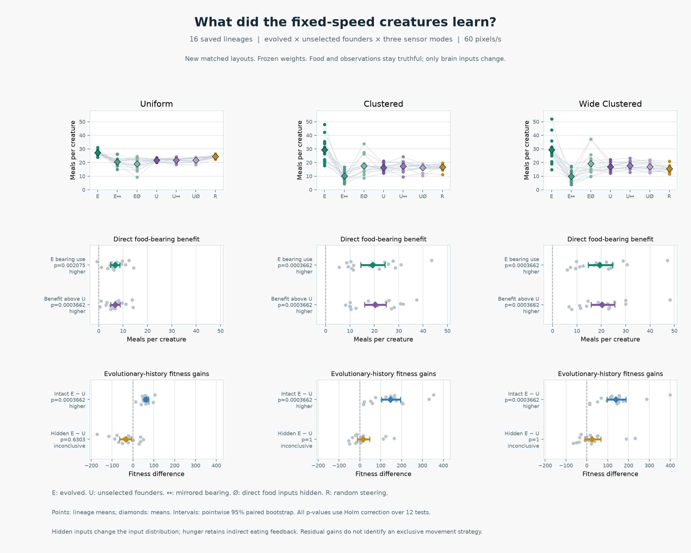

The figure was visually inspected. `results/step17-audit.json` records the
completeness, preservation, model/probe reproduction, and statistical audits,
with runtime versions and artifact hashes. `results/step17-tests.txt` saves the
passing **227-test** transcript. Fitness, meals, and 60-second survival for every
condition, all secondary intervals, and per-brain probes remain in the JSON report.

## Compare steering at identical movement speed

The earlier comparison allowed random creatures to cruise at full speed while
neural creatures chose throttle. It therefore measured a combination of steering,
speed, and energy cost. Step 16 controls this by retraining from random founders
with **every creature moving at 60 pixels/second**, overriding neural throttle
before energy use and movement, including the first tick. Every body also has
the same 60-pixel/second maximum speed. The original behavior remains the default
when `--fixed-speed` is omitted.

Try the controls directly:

```sh
python main.py --seed 42 --controller neural --fixed-speed 60
python main.py --seed 42 --controller random --fixed-speed 60
python main.py --seed 42 --controller greedy --fixed-speed 60 --food-distribution clustered
```

All controllers share the original body generation, sensing radius (160 pixels),
turning limit (90°/second), boundary reflection, energy formula, and survival
rules. **Per living second**, energy cost is now exactly `2 + 0.05 × 60 = 5`
units for every creature. This equalizes commanded speed and per-second movement
cost, not total lifetime expenditure or lifetime distance: survivors move and
consume energy for longer. Motion still follows the existing fixed timestep and
wall reflection rules.

The **greedy reference** turns toward the nearest detected pellet using the
shortest signed bearing, bounded by the same turning limit. It limits the last
turn to avoid overshooting the target angle. When no food is detected, it uses
the existing random steering policy. It has no access to unseen food, future
pellets, test outcomes, or extra sensory range. The evolved network architecture
remains 8–8–2; its throttle output is ignored under the speed constraint.

Before modification, all **193 existing tests passed**. The full test transcript
is saved in `results/step16-baseline-tests.txt`. The baseline manifest
`results/step16-baseline.json` records the preceding commit and SHA-256 hashes of
its tracked source and result files. Earlier experiment reports, plots, and model
archives remain unchanged in place and in Git history. The source changes for
this step are relative to that preserved commit.

Run the full study:

```sh
python experiment_speed.py --workers 6 --models-dir .cache/speed-models \
  --output .cache/speed-comparison.json --protocol-output .cache/speed-protocol.json \
  --plot .cache/speed-comparison.png
```

The fixed protocol uses **16 new independent training seeds (1601–1616)**,
**10 generations**, population 100, food supply 150, mutation probability 0.1,
mutation scale 0.1, and the existing fitness and selection rules. Training uses
uniform food in a 1000 × 600 arena throughout. It does not reuse variable-speed
Step 15 models or tune parameters against test results. All 100 brains from each
final birth cohort are frozen, without selecting a test winner or generation.

Each lineage faces **two new layouts per environment**:

| Test environment | Geometry | Food distribution | Relationship to training |
| --- | --- | --- | --- |
| Uniform | 1000 × 600 | Uniform | New layouts at the trained distribution |
| Clustered | 1000 × 600 | Four seeded clusters | Unseen food distribution |
| Wide clustered | 1200 × 500 | Four seeded clusters | Unseen distribution and aspect ratio |

All arenas have equal area and the same maintained food count. For clustered
food, four centers are drawn independently within the middle 60% of each axis.
Each spawn chooses a center uniformly and proposes a Gaussian offset with
55-pixel standard deviation on each axis. Out-of-bounds or overlapping proposals
are rejected; there is no uniform fallback. Centers remain fixed during a
cohort and are resampled for the next layout. These parameters are declared in
the protocol. Clusters can overlap; they are not enforced as four separate
non-overlapping patches.

Food remains continuously replenished in every condition. Clustered spawning
changes where replenishment occurs and may reward staying near food patches;
it does not remove the existing benefit of random exploration in uniform arenas.
Step 16 does not test depleted finite food supplies or every possible environment.

Test seeds use a separate `step16:test` namespace. For each layout, evolved,
random, and greedy conditions start in separate worlds with identical bodies,
food, lifespans, cluster centers, and random streams. Body IDs receive matched
physical traits across conditions. Initial physical hashes verify matching and
separation from training. Later food replenishment and random-stream consumption
can diverge as behavior diverges. This is a comparison of complete populations,
with within-population competition, rather than isolated creature trials.

No selection, reproduction, mutation, or weight updates occur during testing.
Genome hashes verify that the complete evolved cohort remains frozen. The same
brain arrays are also recorded for baseline bodies, whose steering policies do
not consult them. Numeric model archives use `allow_pickle=False` and validate
configuration, IDs, array shapes, finite values, and hashes on loading.

There are **160 training cohorts** and **288 test cohorts**, totaling **448**,
with **96 distinct unseen test layouts**. Repeats are averaged within each
lineage and environment before inference, keeping the independent sample size
at **16**, not 96 layouts or 1,600 creatures. Training trajectories and every
test condition are saved. Progress stays `running` until all planned trials
finish, and incomplete studies cannot be plotted.

The primary family contains **nine evolved-minus-random contrasts**: fitness,
meals per creature, and survival to 60 seconds in each of the three environments.
Two-sided exact paired sign tests exclude ties and use Holm correction across
all nine. Absolute paired differences within `1e-10` are treated as numerical
ties for sign-test counts only; raw effect sizes and intervals are retained.
Difference intervals use 20,000 paired percentile bootstrap resamples,
with approximate pointwise 95% coverage. A higher/lower decision requires both
adjusted p < 0.05 and an interval excluding zero in the corresponding direction.
Fitness wins are reported separately by environment; a claim of beating random
fitness across all three requires all three fitness contrasts to pass. Greedy
contrasts are secondary descriptive estimates with pointwise intervals and no
confirmatory p-values. A nonsignificant difference does not establish equivalence.

`results/step16-protocol.json` records the protocol, UTC declaration time, and
source hashes before the actual trials started. This is a local record of the
declared analysis, not an externally registered study. Primary conditions, the
trial budget, and significance/interval decision thresholds are fixed before
test analysis.

`results/step16-numerical-ties.json` records one numerical correction during the
run, before any full lineage finished testing: synthetic equal-count averages
could differ by about `1e-16` in binary arithmetic. The `1e-10` sign-test tie
tolerance prevents counting that noise as a win. The note preserves the original
declaration hash, time, and changed analysis/test source hashes. Training,
physics, conditions, seeds, primary family, budget, and decision thresholds stay
unchanged. The final complete raw report is reanalyzed with this correction;
the running parent had already loaded the earlier analyzer.

Reproduce tests from the saved fixed-speed models:

```sh
python experiment_speed.py --workers 6 --reuse-models \
  --models-dir results/step16-models --output .cache/replayed-speed.json
python plot_speed.py results/step16-speed-comparison.json --output .cache/speed.png
```

Replaying the same deterministic test seeds checks reproducibility; it does not
create new independent evidence. `--seeds`, `--generations`, and `--repeats` allow
other studies, whose settings should be chosen before looking at their outcomes.
Conclusions concern this fixed speed, training budget, mutation setting, and
environment family, rather than evolution in general.

### Recorded Step 16 results

All **16 lineages, 448 cohorts, and 96 distinct unseen layouts** completed.
The final audit verified all 16 model archives, matched/frozen test conditions,
and separation from every training layout. All 17 earlier result artifacts
remain unchanged. Stored statistics match fresh recomputation. The documented
numerical-tie correction changed no sign count, p-value, decision, effect size,
or confidence interval in these data.

Mean fitness, averaging test repeats within each lineage first:

| Environment | Evolved | Random | Greedy | Evolved − random, 95% CI | Holm p | Decision |
| --- | ---: | ---: | ---: | --- | ---: | --- |
| Uniform | 354.97 | 321.69 | 637.40 | +33.28 [20.31, 47.06] | 0.06381 | Inconclusive |
| Clustered | 340.25 | 197.63 | 1193.75 | +142.62 [109.86, 178.54] | 0.0002747 | Higher |
| Wide clustered | 361.78 | 202.70 | 1156.48 | +159.08 [115.28, 206.86] | 0.0002747 | Higher |

Feeding and survival means under the same fixed-speed constraint:

| Environment | Evolved meals | Random meals | Greedy meals | Evolved survival | Random survival | Greedy survival |
| --- | ---: | ---: | ---: | ---: | ---: | ---: |
| Uniform | 27.35 | 24.32 | 55.01 | 87.1% | 82.0% | 96.3% |
| Clustered | 28.36 | 15.47 | 110.57 | 47.6% | 25.0% | 97.2% |
| Wide clustered | 30.34 | 15.97 | 107.05 | 49.6% | 25.6% | 94.2% |

Meals are per creature; survival means reaching 60 simulated seconds. Fitness
uses the existing `survival_seconds + 10 × meals` definition. Greedy comparisons
are descriptive secondary benchmarks.

**The evolved populations beat the existing random controller in both clustered
environments.** All 16 lineages favored evolution on fitness, meals, and survival
in each clustered environment. All six contrasts passed the nine-test Holm
correction, with positive difference intervals. Fitness was approximately
**72.2% higher** with standard clustered food and **78.5% higher** in the wider
clustered arena. These are gains over random under the declared conditions.

Uniform-food averages also favored evolution, with fitness and meals higher in
13 of 16 lineages and survival higher in 12. However, none of the three uniform
contrasts passed the corrected sign tests. Their positive mean intervals alone
do not satisfy the declared decision rule. A fitness advantage across all three
environments is therefore **not demonstrated**.

The greedy controller had substantially higher observed mean fitness, meals,
and survival in every environment. Evolution has room to improve under this
budget. The findings benchmark final evolved populations against the specified
random controller; this step does not add an unselected-neural training arm to
isolate selection's contribution from the initial policy distribution. Performance
advantages also do not by themselves establish food understanding or planning.

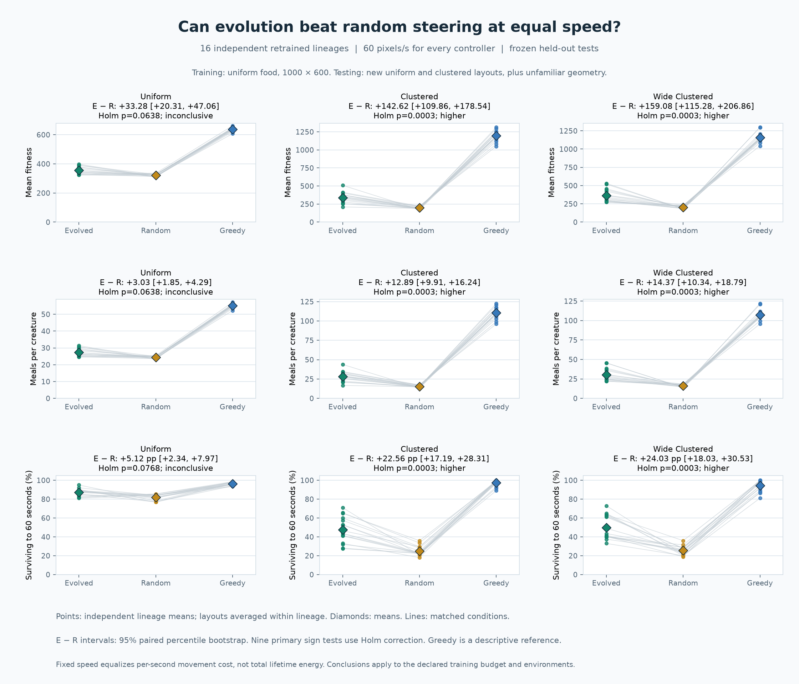

The exported figure was visually inspected. `results/step16-audit.json` records
the completeness, model, source, speed, score, denominator, and data-integrity
checks, along with runtime versions and artifact hashes. The largest difference
between recorded cohort mean speed and 60 was `3.6e-10` pixels/second, from
floating-point accumulation. `results/step16-tests.txt` saves the passing
212-test transcript.

## Analyze emergent food-guided behavior

Run the full, fixed-protocol analysis:

```sh
python analyze_intelligence.py --workers 4 --models-dir .cache/intelligence-models \
  --output .cache/intelligence.json --plot .cache/intelligence.png
```

The study uses **eight new training seeds (1501–1508)** and **ten generations**
under the original settings: population 100, food 150, mutation probability 10%,
Gaussian mutation scale 0.1, and the existing fitness/selection rules. No setting
is chosen from the Step 14 validation results. Founder brains are copied before
training, and all 100 final-cohort brains are frozen after training. No test
result selects a model, creature, generation, or hyperparameter.

Each lineage is tested on **two new layouts in each of two environments**:

| Environment | Dimensions | Food | Relationship to training |
| --- | --- | ---: | --- |
| Standard | 1000 × 600 | 150 | New bodies and food layouts at the trained geometry |
| Wide | 1200 × 500 | 150 | New layouts and an unseen aspect ratio, with equal area/density |

Test seeds use a separate `step15:test` namespace containing lineage, environment,
and repeat. The design has **32 distinct unseen layouts**. Separate training/test
environments are central to evaluating generalization, as illustrated by
[Cobbe et al.'s generalization study](https://proceedings.mlr.press/v97/cobbe19a/cobbe19a.pdf).
This project uses evolutionary selection, with its own operational criteria.

Every layout has five matched conditions:

| Condition | Brain and food information |
| --- | --- |
| Intact | Frozen evolved brains with truthful sensors |
| Mirrored | The same brains with food bearing reflected left/right; distance, visibility, hunger, and walls stay accurate |
| Hidden | The same brains with all three food inputs set to zero |
| Founder | Frozen original founder brains with truthful sensors |
| Random | The existing random movement controller |

Bodies, food, lifespan limits, and random streams start identically within each
layout. Replenishment then follows each condition's behavior. No selection,
reproduction, mutation, or weight updates occur during testing. Genome hashes
verify source and test weights. All creatures are evaluated, including those
that die early. The fresh study runs **80 training and 160 test cohorts**, totaling
**240 cohorts**.

Food interventions happen only at the brain-control boundary. Physical food
and observations remain truthful: `World.get_sensory_inputs()` still reports the
real sensory state, and the simulation's food-facing statistics use real food.
Reports record `food_sensor_mode` and `arena_size`. The hidden-input condition is
a secondary stress test: feature removal can itself change the input distribution,
so its performance drop alone cannot establish feature understanding. This
limitation is discussed by [Hooker et al.](https://papers.nips.cc/paper/2019/file/fe4b8556000d0f0cae99daa5c5c5a410-Paper.pdf).

The separate **counterfactual steering probe** presents each frozen brain with
food at ±45° and ±90°, distances 40/80/120 pixels, and hunger 25%/75%. All wall
inputs are 1, representing open space. Each pair changes only target side.
Its signed response is:

```text
steering gain = (turn output with food on the right - output with food on the left) / 2
```

Positive gain indicates a shift in steering toward target side. A separate
descriptive fraction counts pairs where the brain actually commands right for
the right target and left for the left target; a fixed turning bias cannot satisfy
that fraction. Zero turn counts as neither direction. The probe has 12 pairs per
brain, but these are not independent experimental samples.

The independent unit remains **one trained lineage (n = 8)**. The two test layouts
are averaged within each environment and lineage before inference. Predeclared
primary tests ask whether:

1. Truthful bearing improves mean meals over mirrored bearing in standard arenas.
2. The same benefit appears in wide arenas.
3. Evolved steering gain is positive.
4. Evolved steering gain exceeds the founders' gain.

All four use the existing two-sided exact paired sign test, with Holm correction
across the four tests. Mean-difference intervals use 20,000 paired bootstrap
resamples at 95% confidence and remain approximate/pointwise. The full operational
criterion requires all four adjusted p-values below 0.05 and positive intervals.
Secondary contrasts are descriptive. A positive interval with an insufficient
directional-consistency p-value does not pass the declared rule.

These criteria assess useful **reactive food guidance**, not human-like
intelligence, memory, or planning. Failure does not exclude all food-dependent
behavior, including strategies involving speed or contexts outside the probe.
Effects are reported in meals and steering units so their practical size remains
visible.

Frozen founder/evolved brains are saved as numeric `.npz` archives with seed,
training configuration, complete-cohort IDs, and genome hashes. Loading uses
`allow_pickle=False` and checks shapes, finite values, hashes, and configuration.
You can reproduce testing without repeating training:

```sh
python analyze_intelligence.py --workers 4 --reuse-models \
  --models-dir results/step15-models --output .cache/replayed-intelligence.json
```

The repeated test seeds are deterministic, so this is a reproducibility check,
not new independent evidence. For a new study, choose new training seeds before
examining outcomes. `--seeds`, `--generations`, and `--repeats` set the budget.
Progress reports stay `running` until every planned lineage, environment,
repeat, and condition has finished; incomplete studies cannot be plotted.

Regenerate a figure from a complete report:

```sh
python plot_intelligence.py results/step15-intelligence.json \
  --output .cache/intelligence.png
```

### Recorded Step 15 results

The completed study includes all **240 planned cohorts**, **eight independent
lineages**, and **32 unseen layouts**. Mean meals per creature, averaged within
lineage before averaging across lineages:

| Condition | Standard arena | Wide arena |
| --- | ---: | ---: |
| Intact evolved | 21.88 | 21.97 |
| Mirrored bearing | 17.73 | 17.68 |
| Hidden food inputs | 15.25 | 14.52 |
| Founder brains | 8.43 | 8.25 |
| Random movement | 23.97 | 23.76 |

The four predeclared primary tests produced:

| Test | Mean effect | 95% paired bootstrap interval | Holm-adjusted p | Decision |
| --- | ---: | --- | ---: | --- |
| Intact − mirrored meals, standard | +4.158 | [2.423, 6.171] | 0.03125 | Higher |
| Intact − mirrored meals, wide | +4.293 | [2.362, 6.671] | 0.07031 | Inconclusive |
| Evolved steering gain above zero | +0.07367 | [0.04121, 0.11111] | 0.03125 | Higher |
| Evolved gain above founders | +0.07351 | [0.03985, 0.11410] | 0.03125 | Higher |

**Three of four criteria pass: there is evidence of useful reactive food
guidance, while robust generalization remains unconfirmed.** Truthful bearing
improved feeding in all eight standard-arena lineages. The wide arena had a
similar positive average effect, with seven of eight lineages benefiting, but
did not meet the declared directional-consistency threshold. This uncertainty
does not establish an absence of food guidance in wide arenas.

Evolved mean steering gain was 0.07367, versus 0.00016 for founders. Correct
commands on both sides appeared in **22.0%** of evolved probe pairs versus
**5.47%** for founders; many responses therefore still had turning biases or
failed to turn correctly on both sides. Intact evolved creatures also remained
below random movement in mean food intake and fitness in both environments.
Useful sensory behavior has emerged without establishing superior overall
performance, planning, or human-like intelligence.

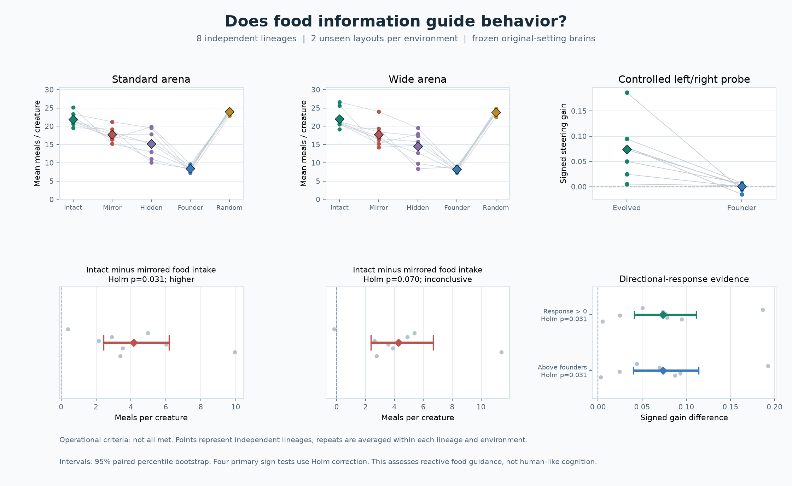

## Experiment with parameters

Choose a world configuration directly:

```sh
python main.py --seed 42 --population 50 --mutation-rate 0.3 --food-count 75
```

- `--population`: positive integer; the same number of newborns is created at
  every generation and restart. Default **100**.
- `--mutation-rate`: independent probability from 0 to 1 for each weight or bias.
  Default **0.1**. A rate of zero still uses fitness selection and inheritance;
  it explores the founders' existing genomes without adding mutations.
- `--mutation-scale`: finite non-negative standard deviation of Gaussian noise.
  Default **0.1**. The recorded sweep holds this fixed.
- `--food-count`: non-negative maintained pellet supply. Default **150**.
  The study uses **75 scarce**, **150 standard**, and **225 rich** pellets to
  change environmental difficulty while keeping other survival rules fixed.

The header shows the configured birth population and mutation probability.
Selection retains the top 20%, rounding up, and reproduction creates exactly the
configured population. Scores and survival rates use the actual cohort size.
Space, N, R, generation limits, reports, and plot exports work with custom settings.

Run the exploratory parameter study:

```sh
python experiment_parameters.py --workers 4 \
  --output .cache/parameters.json --plot .cache/parameters.png
```

The fixed standard is mutation **10%**, population **100**, and food **150**.
The default **seven-setting** design changes one factor from this standard:

| Factor | Tested values | Other factors |
| --- | --- | --- |
| Mutation probability | 0%, 10%, 30% | Population 100, food 150 |
| Population | 50, 100, 150 | Mutation 10%, food 150 |
| Food supply | 75, 150, 225 | Mutation 10%, population 100 |

The standard is shared across the three comparisons. Four new seeds
(**901–904**) each train for **five generations**, including the founders and
four reproduction cycles, at every setting. All final-cohort brains are copied
into fresh bodies in a separate `step14:validation` seed namespace. No weights
change during validation. Within each setting, evolved and random-moving
creatures start with identical bodies and food. Mutation and food variants at
the same population size share their founder brains. Mutation variants also
share all generation-start layouts.

The random controller does not learn, so it needs one validation episode per
seed/population/food combination. These exact baseline outcomes are reused across
mutation settings, without increasing the independent sample count. The default
study therefore runs **188 unique cohorts**: 140 training, 28 evolved validation,
and 20 random validation cohorts. CPU workers change execution speed; physics
always advances in fixed 1/60-second ticks.

Population experiments keep the **arena and maintained pellet count fixed**.
Food is replenished as before. Changing population changes density, food per creature, the founder sample,
and the number of training lives. At five generations, a population of 50 uses
250 training lives per seed, while 150 uses 750. These results describe the total
effect of changing population in this world, rather than isolating a pure benefit
from genetic diversity or equal computation budgets. Matched random controls
provide ecological context for the evolved results.

The report contains fitness, survival to age 60 seconds, food consumption, and
mean survival age. Each setting has seed-paired summaries for:

- Evolved minus its matched random controller.
- Evolved performance minus evolved performance at the standard setting.
- The change in the evolved-minus-random gap relative to the standard.

Intervals are **95% pointwise percentile bootstrap intervals**, resampling four
independent seed pairs, with 20,000 resamples. They are approximate and are not
corrected across settings or metrics. There are **no significance decisions or
confirmed winners** in this exploratory sweep. Using validation results to choose
parameters would require new independent confirmation runs before making a
general improvement claim. Step 14 uses its own seeds, five-generation budget,
standard, and baselines; the earlier Step 13 benchmark remains a separate study.

This one-factor-at-a-time design measures effects conditional on the standard.
It cannot estimate interactions or identify a global optimum; see
[NIST's explanation of the OFAT limitation](https://www.itl.nist.gov/div898/handbook/pri/section2/pri212.htm).
The interactive world accepts combined changes, while the sweep keeps each
variation to one factor so the reported design remains explicit.

You can supply other levels and seeds before running, for example:

```sh
python experiment_parameters.py --seeds 11 22 33 44 --generations 5 \
  --mutation-rates 0 0.05 0.1 0.3 --populations 50 100 150 \
  --food-counts 75 150 225 --workers 4 --output .cache/custom-sweep.json
```

The standard is always included. Reports save the planned protocol and raw
training/validation summaries, matching and genome hashes, cached controls, and
paired estimates. Progress reports remain `running` until all planned settings
and seeds are complete. Incomplete studies cannot be plotted.

Regenerate a figure from the saved data:

```sh
python plot_parameters.py results/step14-parameters.json \
  --output .cache/parameters.png
```

Top panels show evolved and random validation fitness, with individual seed
outcomes and mean curves. Bottom panels show evolved-minus-random fitness with
paired intervals. PNG, SVG, and PDF exports are supported.

The [recorded four-seed pilot](results/step14-parameters.json) completed all
**188 unique cohorts**. Its validation fitness means were:

| Variation from standard | Evolved | Random | Evolved minus random |
| --- | ---: | ---: | ---: |
| Standard: 10% mutation, population 100, food 150 | 273.06 | 317.37 | -44.31 |
| Mutation 0% (selection and inheritance only) | 286.01 | 317.37 | -31.36 |
| Mutation 30% | 278.50 | 317.37 | -38.88 |
| Population 50 | 260.16 | 330.86 | -70.70 |
| Population 150 | 267.79 | 313.51 | -45.72 |
| Food 75 (scarce) | 99.94 | 105.73 | -5.78 |
| Food 225 (rich) | 431.82 | 479.54 | -47.72 |

Zero mutation had the highest observed fitness among the three mutation rates,
12.95 points above standard; the pointwise paired interval was [1.46, 24.43].
The 30% rate was 5.44 points above standard with interval [-15.35, 25.53]. This
short pilot does not establish an optimal rate. Population changes to 50 and 150
had intervals crossing zero for their evolved-fitness changes from standard.

Food supply produced the largest observed fitness shifts in these tested ranges.
Moving from 75 to 225 pellets increased evolved survival to age 60 seconds from
**17.5% to 96.5%**, and mean meals from **5.32 to 34.55**. Random movement also
benefited from richer food. Every tested setting still had a negative average
evolved-minus-random fitness gap, so this sweep did not find a setting with a
positive mean advantage over that baseline.

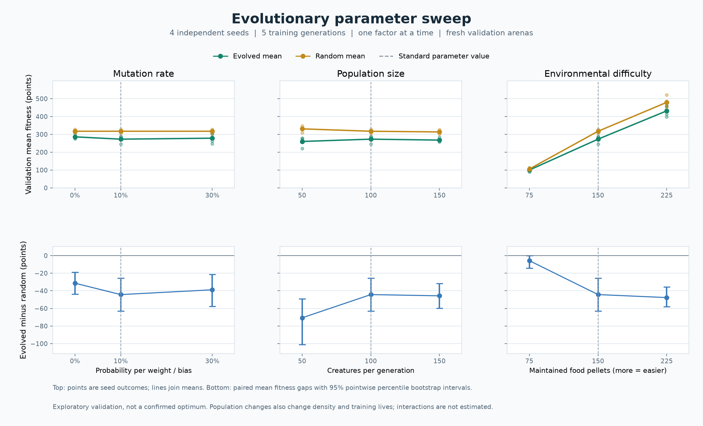

## Compare evolved and random creatures

Run the default comparison with four CPU processes:

```sh
python compare_creatures.py --workers 4 \
  --output .cache/comparison.json --plot .cache/comparison.png
```

The default protocol uses **eight independent training seeds** (101, 202, 303,
404, 505, 606, 707, 808), **ten training generations**, and **100 creatures per
cohort**. All seeds, generation counts, metrics, and decision rules are fixed
before running. There are three conditions:

| Condition | Behavior and reproduction |
| --- | --- |
| Evolved | Neural control; top-20% selection, inheritance, and the existing mutations |
| Random | The original random steering and cruising speed; brains are ignored |
| Unselected NN | The same neural architecture as evolved creatures, with fresh random weights each generation and no inheritance |

`World(evolution_enabled=False)` samples fresh brains when advancing generations;
the `evolution_enabled` report field records this policy.

Each condition occupies its own 100-creature arena. All conditions start each
training generation with identical physical traits, positions, and food. Their
seed streams are matched. Eating and replenishment
subsequently follow each condition's own behavior, so later food layouts can
diverge. The two neural conditions begin with identical founder brains. Only
brains are inherited; body traits are freshly sampled as before.

Each condition runs the same number of complete cohorts under the same lifespan
bound, arena, food supply, energy costs, and fitness rule. Random steering uses
the existing fixed cruising speed; neural controllers can also choose throttle.
The unselected neural control helps separate the effect of evolution from this
difference in movement capabilities.

After training, **all 100 brains from the final birth cohort** are copied into
new bodies in a fresh test arena. Its seed is derived from the training seed in
a separate `step13:held-out` namespace. The test arena has matched starting
conditions across all three groups. Evaluation uses no selection, reproduction,
mutation, or weight updates. Genome hashes verify that training and test weights
stay frozen. No best creature, generation, or seed is chosen using test results.

The default experiment runs **240 training cohorts and 24 test cohorts**. It can
take several minutes. `--workers` controls parallel CPU processes; the default is
one. Results are reproducible across worker counts. Explicit seeds and budgets
can also be supplied, for example:

```sh
python compare_creatures.py --seeds 11 22 33 44 55 66 77 88 \
  --generations 10 --workers 4 --output .cache/another-comparison.json
```

Use at least two distinct seeds and two generations. Choose the budget before
examining outcomes. Reports include the planned protocol, every training/test
summary, initial-condition hashes, frozen-genome hashes, and statistical results.
A progress file is updated after each seed finishes all conditions. Its status
stays `running` until **all planned seeds** complete; partial experiments are not
analyzed or plotted.

The independent experimental unit is **one training seed**, yielding eight
paired observations per contrast in the default experiment. Creatures within a
cohort share ancestry and competition and are not treated as independent trials.
The primary outcome is **held-out mean fitness**. Secondary outcomes are survival
to age 60 seconds, meals per creature, and mean survival age.

For each contrast (evolved minus random, evolved minus unselected NN), the report
estimates the mean paired difference and a **95% percentile bootstrap interval**
from 20,000 resamples of whole seed pairs. Pairing follows the method described in
the [SciPy bootstrap documentation](https://docs.scipy.org/doc/scipy/reference/generated/scipy.stats.bootstrap.html).
These intervals are pointwise and approximate, especially with eight pairs.

The two fitness contrasts also use an **exact two-sided paired sign test**,
excluding ties, following [NIST's sign-test description](https://www.itl.nist.gov/div898/software/dataplot/refman1/auxillar/signtest.htm).
It tests directional consistency across runs; the bootstrap interval separately
describes the average effect. **Holm correction** adjusts the two fitness p-values
as one family, using the method documented by [R stats](https://stat.ethz.ch/R-manual/R-devel/library/stats/html/p.adjust.html).
The declared decision is `higher` or `lower` only when the adjusted p-value is
below 0.05 and the mean-difference interval lies entirely on that side of zero.
Otherwise it is `inconclusive`. Secondary metrics remain descriptive and their
intervals are not corrected for multiple comparisons. The implementation uses
NumPy and Python's standard library; SciPy is not an additional dependency.

This is a small pilot with one held-out arena per training seed. An inconclusive
result does not establish equivalence, and a positive result would apply to this
world, controller, and training budget. Broader layout coverage and larger
independent samples would be needed for stronger general claims.

Export a figure from a completed report without repeating the simulation:

```sh
python plot_comparison.py results/step13-comparison.json \
  --output .cache/comparison.png
```

The top panels show each seed's paired held-out fitness, survival, and meals;
diamonds show means. The bottom panels show paired differences and bootstrap
intervals. Survival differences use **percentage points**. Positive differences
favor evolved creatures. PNG, SVG, and PDF exports are supported.

The [recorded pilot report](results/step13-comparison.json) completed all eight
planned seed trials and all 264 cohorts. Held-out outcomes averaged across seeds:

| Condition | Mean fitness | Reached age 60s | Meals / creature | Mean survival |
| --- | ---: | ---: | ---: | ---: |
| Evolved | 297.36 | 78.75% | 22.01 | 77.29 s |
| Random | 327.18 | 83.00% | 24.72 | 79.97 s |
| Unselected NN | 138.63 | 44.25% | 7.92 | 59.48 s |

| Held-out fitness contrast | Mean difference | 95% paired bootstrap interval | Holm p | Decision |
| --- | ---: | --- | ---: | --- |
| Evolved minus random | -29.83 | [-57.89, -2.03] | 0.2891 | Inconclusive |
| Evolved minus unselected NN | +158.73 | [130.68, 183.83] | 0.0156 | Higher |

Evolved brains beat the unselected neural control in **8/8** seed pairs, showing
a measurable improvement for this neural architecture. They beat random movement
in **2/8** pairs and had lower observed mean fitness. The mean-difference interval
for that contrast is below zero, but the directional sign test did not meet the
declared threshold, so its formal decision remains inconclusive. This pilot
does **not demonstrate an advantage over random movement**.

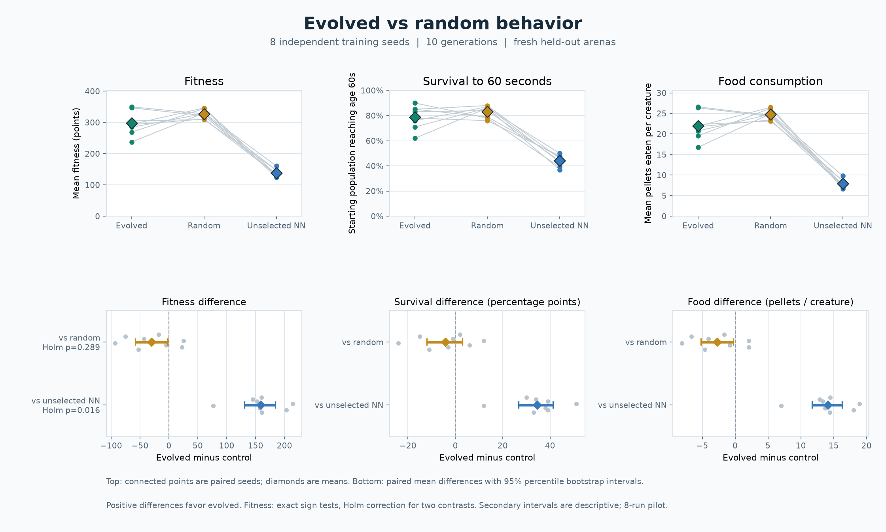

## Visualize evolution

Press **T** to see all three generation plots and the latest eight completed
generations in a table. Fitness shows **mean and best scores**. Food consumption
shows **mean pellets eaten per creature**, counting the whole starting population.
Survival shows the **percentage of the starting population that reaches age 60
simulated seconds**, including creatures that die exactly at that age:

```text
survival rate = creatures reaching age 60 seconds / starting population
```

This checkpoint stays fixed across generations. The percentage axis spans
0–100%; the rate is distinct from mean survival age and the final living count.
All generations eventually become extinct, but their checkpoint survival rates
can differ. Survival is measured from actual creature ages and adds no fitness
bonus or change to selection.

The saved ten-generation seed-42 example includes a standalone figure:

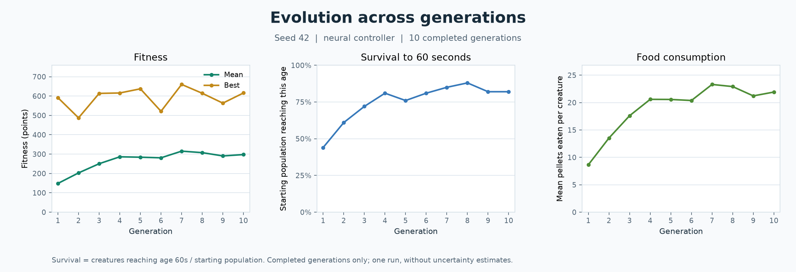

Regenerate this figure from its saved observations without running the simulation:

```sh
python plot_evolution.py results/step12-seed42.json --output .cache/evolution.png
```

Or collect observations and export a figure from a new run:

```sh
python main.py --headless --seed 42 --generations 10 --speed 20 \
  --report .cache/evolution.json --plot .cache/evolution.png
```

`--plot PATH` exports on exit. PNG, SVG, and PDF are supported, using a headless
Matplotlib canvas that opens no additional window. The standalone command accepts
`--output PATH`; without it, output uses the report's name with a `.png` extension.
Only completed generations are plotted. A run ending before any generation
completes reports that its plot was skipped; the standalone command rejects an
empty report.

New JSON reports use **format version 2**, adding `survival_checkpoint_seconds`,
`survivors_at_checkpoint`, and `survival_rate` to every generation. Existing
version-1 reports remain plottable for fitness and food consumption; their
unrecorded survival data is shown as unavailable. Rates are never inferred from
mean age or replaced with zero. Exported charts use actual generation numbers,
so gaps in recorded generations retain their spacing.

Each figure describes one run. Lines join recorded observations; they are not
smoothed fits or averages across independent runs, and contain no uncertainty
bands.

## Multiple generations

Automatic cycling is on by default. When a population becomes extinct, its final
results are recorded and its selected parents produce the next generation.
Use **A** or `--manual` to wait between generations and review results before
pressing **N**. **Space** freezes survival and automatic generation transitions. Increasing
speed runs more fixed 1/60-second ticks per frame; the physics step stays the same.

Run a fixed number of generations while watching the world:

```sh
python main.py --seed 42 --generations 10 --speed 20
```

After generation 10 completes, the simulation stops advancing and opens history.
The window remains open for inspection; **R** starts a new run with the same
generation limit and speed. With no generation limit, automatic cycling continues
until you close the window. **N** cannot advance beyond a configured limit.

To complete the same run without opening a window and save its observations:

```sh
python main.py --headless --seed 42 --generations 10 --speed 20 \
  --report .cache/generations.json --screenshot .cache/generations-preview.png
```

Headless mode exits when the generation target is complete. If `--frames` is also
given, whichever limit is reached first ends the run. Headless manual mode needs
`--frames`, because keyboard input cannot advance its generations.

The **T** history panel plots mean/best fitness, survival to 60 seconds, and mean
meals over all completed generations, with a table of the latest eight.
Incomplete generations are excluded.
The table also shows mean survival age, mean commanded speed weighted by actual
time alive, and the fraction of visible-food time spent facing the nearest pellet
within **±45 degrees**. This last measure samples heading before movement at each
tick, weighted by actual creature-time alive, including partial final ticks.
It displays **N/A** when no food was visible. These observations add no fitness
reward and do not change movement decisions or random streams.

The history and fitness panels keep the simulation running behind them; pause
to inspect at leisure. They are mutually exclusive and block arena clicks while
open. Restart clears both histories and total simulation time while preserving
pause, speed, auto/manual mode, generation limit, and display preferences.

`--report PATH` writes JSON on exit, containing the seed, controller, mutation
settings, fixed timestep, target, completed count, total simulated time, and one
statistics record per completed generation. Reports also include raw visible-food
and facing-food creature-seconds. An interrupted run can contain a partial current
generation in total time, but only completed generations have statistics records.
`World.generation_stats` holds immutable records; `EvolutionSimulation` in
`simulation.py` handles timing, automatic cycles, limits, and reports.

Facing food is a descriptive orientation measure, not proof of food seeking.
Food layout, body traits, competition, and chance vary between generations. A
single seeded trajectory can show changes. The independent comparison above
tests whether improvements extend to held-out arenas and control conditions.

The recorded [seed-42 example](results/step12-seed42.json) completed ten
generations with the default neural controller and mutation settings:

| Observation | Generation 1 | Generation 10 |
| --- | ---: | ---: |
| Mean fitness | 148.36 | 297.50 |
| Mean meals per creature | 8.65 | 21.92 |
| Mean survival | 61.86 s | 78.30 s |
| Reached age 60 seconds | 44% | 82% |
| Mean commanded speed | 30.82 px/s | 52.76 px/s |
| Facing visible food | 28.30% | 28.06% |

Feeding and survival increased in this run, while food-facing time stayed close
to its starting level. Results fluctuated between generations rather than
improving on every cycle. These observations do not yet establish reliable
food-seeking behavior or an advantage over random movement.

## Creatures

Each creature has a unique ID within its population and these initial properties:

| Property | Initial value |
| --- | --- |
| Position | Random, fully inside the arena, with space between creatures |
| Body radius | Random integer from 6 to 9 pixels |
| Color | Random choice of six pastel colors; appearance only |
| Facing direction | Random angle around the full circle, shown by the white eye |
| Maximum speed | Random value from 40 to 80 pixels per second |
| Current speed | Neural throttle selects 0–100% of maximum speed |
| Energy | 100 initially, capped at 100; food restores up to 20 per pellet |
| Hunger | Energy deficit from 0% full to 100% empty |
| Age | 0 simulated seconds initially |
| Lifespan | Seeded random value from 60 to 120 simulated seconds |
| Food eaten | 0 initially; incremented once per consumed pellet |
| Fitness | 0 initially; survival seconds plus 10 points per eaten pellet |
| Generation | 1 for random founders; increases when selected parents reproduce |
| Parent | None for founders; previous generation's selected parent ID for offspring |
| Mutations | Number of parameters actually changed during birth; 0 for founders |

The selected creature has a white ring, and its properties appear below the arena.
The first creature is selected initially. Pause with **Space** to inspect a
creature while it holds still. Its inspector shows energy, hunger, age/lifespan,
food count, fitness, generation, parent, mutation count, position, current/maximum
speed, size, facing direction, and turn rate.
Small energy bars below creatures change from green to amber to red as hunger
increases.

## Fitness and natural selection

The starting scoring rule is:

```text
fitness = 1 * simulated seconds alive + 10 * food pellets eaten
```

For example, a creature that survives 40 seconds and eats 3 pellets earns 70
points. Survival uses each creature's actual age, including partial final steps.
Food rewards count consumed pellets, including meals that restore only part of
their energy because of capacity. Remaining energy adds no separate bonus.

Scores update as living creatures age and eat. A dead creature keeps its earned
score; continued world time does not increase it. Rankings include both living
and dead creatures, ordered by descending fitness. Exact score ties use the lower
creature ID, keeping results reproducible.

During a run, rankings are **provisional** and candidate selection is pending.
When the population becomes extinct, the world freezes the final ranking and
selects the top **20%**, rounding up for small populations: 20 candidates from the
usual 100. These IDs identify the retained creature/brain records used for reproduction.

The header shows best and mean fitness across the entire original population.
Clicking a living creature shows its individual score. **F** opens the top-ten
leaderboard with survival time, meals, score, and live/dead or selected status.
The world continues while the leaderboard is open; use **Space** to pause. Close
the leaderboard before selecting creatures in the arena.

Completed generations retain their best result and selection count in history.
Automatic mode breeds the next generation; **N** does so in manual mode.
**R** restarts with random founders. Ranking and drawing the
leaderboard do not change movement, randomness, food, or brain parameters.

The code exposes live or final immutable snapshots through
`World.get_fitness_evaluation()`. Its `ranking` contains every evaluated creature,
and its `selected_ids` is populated only for completed runs.
`World.final_evaluation` retains the final snapshot until breeding or reset.
`World.generation_history` keeps one immutable final evaluation per completed
generation until restart. The default rule and selection fraction are defined in
`selection.py`.

## Reproduction and mutation

Generations run separately. Once all creatures die, final results are recorded
before the next population is born. Automatic cycling breeds on the next tick;
manual mode waits for **N**, which also works while viewing the leaderboard.
Pressing **N** during a living generation has no effect.

With the default population, **20 selected parents produce five offspring each**,
rebuilding the population to **100**. Other sizes use the same rounded-up 20%
selection rule and balance offspring across parents. Birth slots are shuffled to avoid associating parent rank
with particular body positions. Each offspring receives an independent copy of
one parent's complete network: all **90 weights and biases**. Reproduction is
asexual, without crossover or gradient training.

Every parameter independently has a **10% mutation probability**. A mutation
adds Gaussian noise with **mean 0 and standard deviation 0.1**. About nine
parameters per offspring change on average; the actual count varies, and an
offspring can receive no mutations. Parents and siblings never share parameter
arrays. Parameters remain fixed throughout each creature's lifetime.

Only the brain is inherited. New bodies receive fresh positions, colors, sizes,
headings, speed limits, and lifespans. Energy starts at 100, and age, meals, and
fitness start at zero. Food and per-generation counters also restart. The
inspector shows the creature's generation, its parent's generation and ID, and
the number of changed parameters. IDs are local to each generation.

The founding seed and generation number determine separate random streams for
bodies, food, steering, and mutations. Repeating the same seed, controller, and
generation sequence reproduces the same results; waiting longer on the final
results screen does not change offspring. **R** chooses a new founding seed and
returns to generation 1. Pause and display settings survive both controls.

Programmatically, `World.advance_generation()` returns `True` when reproduction
succeeds and `False` while the generation is incomplete. `World` accepts
`mutation_rate` (0–1) and `mutation_scale` (finite, non-negative) for controlled
checks. Setting either to zero creates exact, independent brain copies.
`reproduction.py` handles parent allocation and birth records, while
`NeuralNetwork.mutated_copy()` implements inheritance and mutation.

The random movement controller can also advance generations, but it continues to
ignore inherited brains when choosing movement. Evolutionary improvement is a
question for repeated experiments; reproduction alone does not establish it.

## Sensory perception

Each creature senses food centers within a **160-pixel radius in all directions**.
It observes the nearest visible pellet, including its position, Euclidean distance,
relative bearing, and the total number of nearby pellets. Direction is measured
from the creature's current heading: 0 degrees is ahead, positive angles are to
the right, and negative angles are to the left. Bearings wrap into [-180, 180)
degrees, with directly behind represented as -180 degrees.

Distance becomes a proximity signal, `1 - distance / 160`, so closer food gives a
stronger signal. Direction becomes `bearing / pi`, in [-1, 1]. A visibility flag
distinguishes food at the range boundary from an absence of food. With no visible
food, distance and bearing are absent and all three food signals are zero. Food
at the creature's center has distance 0 and neutral bearing 0. Equal-distance
pellets retain their list order when choosing the nearest.

Click a creature to inspect its current reading in the header. The overlay shows
its sensing radius, a short forward-facing line, and a line to the nearest food,
which is marked with a ring. **V** controls this visualization; sensing and brain
decisions continue when it is hidden. The overlay is clipped to the arena.

`World.perceive_food()` returns a read-only observation of the current world.
Readings are recomputed after food changes, so removed pellets do not remain as
stale targets. The brain uses the same perception function at the beginning of
each simulation step; the display shows the current view after movement/eating.

## Artificial brains

Every creature owns an independent **8-input, 8-hidden, 2-output** feed-forward
network. NumPy matrix multiplication and `tanh` activations compute each decision.
The network has **90 parameters**, including biases. Founders receive random
parameters; descendants inherit mutated copies from selected parents. Parameters
remain fixed during each creature's lifetime.

The eight inputs, in order, are:

| Input | Meaning and range |
| --- | --- |
| Food proximity | `1 - distance / 160`, from 0 at range limit to 1 at the creature's center |
| Food direction | Relative bearing divided by pi, from -1 to 1 |
| Food visible | 1 when food is within 160 pixels, otherwise 0; absent food signals are also 0 |
| Hunger | Energy deficit, from 0 full to 1 empty |
| Wall forward | Radius-aware forward wall distance, clipped to 160 pixels and divided by 160 |
| Wall right | The same normalized distance to the right |
| Wall back | The same normalized distance behind the creature |
| Wall left | The same normalized distance to the left |

The first two channels now encode explicit proximity and bearing, replacing the
earlier forward/right offsets while retaining the 8–8–2 network. A wall input of 0
means the body is touching that wall; 1 means at least 160 pixels of clearance in
that direction. Sensors update in the creature's current orientation.

```text
hidden = tanh(inputs @ input_weights + hidden_bias)
outputs = tanh(hidden @ output_weights + output_bias)
turn_rate = outputs[0] * 90 degrees/second
throttle = (outputs[1] + 1) / 2
speed = throttle * maximum_speed
```

The first output chooses left/right turning; the second chooses forward speed.
Zero outputs mean straight movement at half maximum speed. Neural decisions run
once per fixed simulation step. Food information reaches movement through the
network's parameters, which may produce useful or unhelpful actions. The brain
label and the selected creature's current speed and turn rate
make the active controller visible.

The random mode retains the earlier gradual random steering and cruising speed.
Both modes start with the same physical traits, food, and seeded network
parameters for a given seed. Both use the same fitness rule. Comparisons across
independent runs are available through `compare_creatures.py`.

## Survival

Energy use is charged per simulated second:

```text
energy cost = 2 + 0.05 * movement speed
```

With neural speeds of 0–80 pixels per second, creatures spend 2–6 energy units
per second. A stationary creature still spends 2 units per second. Food restores
energy up to a capacity of 100. Hunger is `1 - energy / 100`: creatures are hungry
at 50% deficit and starving at 80% deficit. Hunger is also a neural sensory input.

Age advances with simulated time. Each creature has a seeded lifespan of 60–120
seconds. Energy exhaustion causes starvation death; reaching lifespan causes
old-age death, even with energy remaining. If both limits fall inside a step,
the earlier one determines the cause. Age stops at the moment of death.

Every fixed step chooses motor commands, charges energy for the newly chosen
speed, advances age, removes fatal creatures, then moves and feeds survivors.
A creature with positive energy can recover by eating; one that has already died
cannot move, eat, or revive. Death reduces the
population. Final creature states remain in `World.dead_creatures` until breeding
or reset; final fitness snapshots remain in generation history until reset.

The header shows living creatures, hungry creatures, total deaths, and the
starvation/old-age breakdown. An extinct population shows final fitness and
selection results in manual mode or after reaching a generation target. Automatic
cycling breeds offspring; **N** does so manually. **R** starts again with random
founders. Each new population has its configured number of living creatures with zero scores and
deaths. Pause freezes the full simulation,
including hunger, lifespan, and earned fitness.

## Food and eating

By default, the arena starts with 150 green diamond-shaped pellets, each with a collision
radius of 3 pixels and an energy value of 20. Food spawns fully inside the arena,
clear of creatures and other pellets.

Each simulation step checks circle contact using both the creature's and the
pellet's radius. A living creature with room for energy gains up to 20 on contact.
Its food counter increases, and the pellet is removed. If multiple creatures touch one
pellet and can eat, the nearest center wins; an exact distance tie uses the lower
creature ID. Each pellet awards energy only once. A full or dead creature leaves
the food available.

After all contacts are resolved, eaten pellets are replaced at random free
positions, maintaining the configured supply (150 by default). Replacements start clear of creatures
and are eligible for eating on subsequent steps. The header shows available food
and total meals eaten; selecting a creature shows its individual meal count.

Creatures eat food they encounter while following the active controller.
Meals eaten by creatures that later die remain included in the total meal count.

## Movement

Each creature travels forward at its commanded speed and rotates at its commanded
turn rate, bounded to -90 through +90 degrees per second. In neural mode, its
network chooses both commands. In random mode, the creature cruises at its
initial speed and chooses a new random turn rate approximately every 0.75 to 2
seconds.

Creatures bounce off all four walls. Wall contact reflects their direction and
keeps their full body inside the arena, accounting for body radius and any travel
remaining after the impact. Corner hits reflect both direction components.
Creatures move independently and may pass through one another after spawning.

Movement advances in fixed 1/60-second simulation steps, independently of display
frame rate. The footer shows elapsed simulation time. Long desktop frame stalls
are capped at 0.25 seconds of catch-up to avoid a large jump. Pausing freezes
movement, eating, energy use, aging, and simulation time. **R** resets time and
generates a fresh population and food supply, preserving the current pause state.

Use a seed to reproduce a population and its movement at the same simulation time:

```sh
python main.py --seed 42
```

Without `--seed`, startup chooses a random seed. The active seed is displayed in
the footer. **R** chooses a new seed and resets the configured birth population.
Initial physical traits, food, and random steering keep separate seed streams.
Brains are sampled with a NumPy generator after physical traits are created.
The seed recreates their parameters as well as the initial world. Food availability
can now affect both neural decisions and survival.

To render a few frames without opening a window, optionally saving a preview:

```sh
python main.py --headless --frames 120 --seed 42 --screenshot .cache/reproduction-preview.png
```

Headless mode requires `--frames` or automatic `--generations` so it exits on its
own. At the default 1x speed it advances one 1/60-second simulation tick per frame,
without waiting for real time. At 5x or 20x it advances five or twenty ticks per
frame, stopping early if its generation target is reached. The command above
captures the world after 2 seconds of simulated life at 1x.

Run all checks with the standard Python test runner:

```sh
python -m unittest discover -v
```

Verified: **342 checks**, including simultaneous opponent snapshots, reflected swept
captures, unique ownership, censored survivors, separate gene pools, energy
accounting, historical matrices, paired inference, sensor masking, and exports.
The 321-test baseline was saved before Step 24.

The checks also cover linked brain/body inheritance, independent
mutation streams, gene bounds, individual energy conservation, capacity-aware
eating above 100 energy, personalized perception, matched starts, frozen factorial
interventions, deterministic archives, inference, and exports. The 303-test
baseline was saved before Step 23.

The checks also cover legacy eight-input draws, 16-input inheritance,
swept barriers, fatal damage timing, safe spawning/replenishment, oriented sensing,
matched interventions, normalized risk denominators, joint statistical decisions,
and obstacle plots. The 284-test baseline was saved before Step 22.

The checks also cover seasonal timing, pre-spawn cluster placement,
bounded drift, food replenishment, maturity-gated parent choice, permanent
extinction without automatic rescue, restart behavior, censored histories,
complete frozen diagnostics, numeric archives, and seasonal plot exports. The
269-test baseline was saved before Step 21.

The checks also cover passive recording equivalence, exact input
Jacobians, known-path sensory and neuron effects, saturation versus finite
ablations, complete-cohort observations, numeric trace integrity, and viewer
exports. The 256-test baseline was saved before Step 20.

The checks also cover balanced curriculum exposure and ordering,
matched bodies and mutation schedules, final-round genetic contributions,
frozen 4 × 3 test matrices, within-column paired inference, reciprocal crossover
detection, rejection of false specialization from a globally stronger policy,
model replay, source preservation, and plot exports. The 242-test baseline was
saved before Step 19.

The checks also cover fitness-independent random-parent sampling,
neutral parent ordering, inheritance instead of brain replacement, matched
mutation traces, balanced offspring counts, equal paired starting conditions,
founder controls, complete training/test budgets, six-test inference, model
replay, source preservation, and plotting. The passing 227-test baseline was
recorded before Step 18.

The checks also cover source-model reuse, deterministic founder
reconstruction, paired sensor interactions, complete factorial conditions,
cross-lineage layout exclusion, numerical probes, twelve-test correction,
archive/input preservation, incomplete-report rejection, reproducible parallel
results, and PNG/SVG/PDF exports. The pre-Step-17 212-test transcript is saved.

The checks also include fixed speed and per-second energy fairness,
greedy target selection and bounded turns, successful greedy feeding, clustered
spawning and replenishment, unchanged default throttle, retraining and model
reuse, repeated matched held-out worlds, lineage-level inference, Holm correction
across nine primary comparisons, numerical ties, and plot exports. The 193-test baseline was
recorded before Step 16 changes. The checks also include frozen-model round trips, repeated unseen
arenas, truthful observations during sensor interventions, matched conditions,
lineage-level inference, all four decision gates, reproducible model reuse, and
PNG/SVG/PDF exports. A controlled food-seeking brain verifies that the movement
and sensor intervention can distinguish successful guidance from mirrored
guidance; this hand-built brain is used only in tests, never in the study.

The Step 15 report passed a completeness audit, and its stored analysis matches
fresh recomputation exactly. All eight saved model archives reproduce their
genome hashes and steering probes. The exported figure was visually inspected.

The checks also include population sizes 1, 7, 50, and 150 across
generation changes and restart; configured survival denominators; parameter CLI
validation; matched/frozen validation; random-control reuse; reproducible sweeps;
and exploratory paired summaries and exports. A native macOS run verified custom
parameters, and a full default seed-42 generation exactly reproduced every
recorded Step 12 observation.

The Step 14 dataset contains all 188 planned unique cohorts; population counts,
survival denominators, frozen validation, cached controls, score components,
and completeness were audited. Its stored summaries match fresh recomputation
exactly, and its exported parameter plots were visually inspected.

Step 13 also recorded a complete eight-seed, 264-cohort benchmark. The
saved dataset passed fairness and completeness audits, and its stored analysis
matches recomputation exactly. Comparison checks cover matched cohorts and fresh test
arenas, all-population frozen-genome evaluation, reproducible serial/parallel
results, complete-run requirements, paired resampling, ties, exact sign-test
probabilities, Holm adjustment, positive/negative/inconclusive decisions, and
PNG/SVG/PDF exports. The earlier ten-generation visualization and native macOS
Cocoa checks remain covered by the preceding steps. Every previously recorded
fitness, feeding, and behavior observation matched Step 11 exactly in Step 12.
Plot checks cover checkpoint boundaries and the full-population denominator,
curve values, generation spacing, 0–100% survival limits, missing legacy data,
empty reports, PNG/SVG/PDF output, and plotting without changing future offspring.

Cycle checks cover exact limits,
time carried across generation boundaries, matching results across frame rates
and speed settings, pause/manual/restart behavior, actual-time-weighted behavioral
measurements, keyboard controls, and bounded headless reports.

Reproduction checks cover independent copies of every weight and bias, mutation
settings, deterministic offspring, balanced parent allocation, selected-parent
inheritance, newborn survival resets, repeated generation transitions, history,
restart, and preservation of pause/display settings and random movement mode.
Existing fitness, perception, neural, movement, food, and survival checks remain
included.

## Project structure

```text
predator_prey.py      Shared arena, local opponent senses, captures, and two linked gene pools
experiment_predator_prey.py  Frozen historical opponents, sensor masks, and reciprocal tests
plot_predator_prey.py  Opponent matrices, population histories, role metrics, and world replay
test_predator_prey.py  Swept ownership, simultaneous sensing, energy, censoring, inference, and exports
body_traits.py        Linked body genes, trait physics, independent mutation, and energy ledgers
experiment_traits.py  Twelve-seed frozen brain/body factorial study and paired inference
plot_traits.py        Gene trajectories, cost curves, held-out comparisons, and body map
test_body_traits.py   Linked inheritance, energy conservation, matching, frozen factors, and exports
main.py               Window, controls, simulation timing, and launch options
world.py              One-generation physics, observation, survival, food, and fitness
simulation.py         Automatic cycles, speed, generation limits, restart, and reports
generation_stats.py   Immutable completed-generation behavioral observations
plot_evolution.py     Matplotlib fitness, checkpoint survival, and food plot exports
compare_creatures.py  Paired training/test experiments and seed-level statistical analysis
plot_comparison.py    Held-out comparisons and paired-difference uncertainty plots
experiment_parameters.py  Paired mutation/population/food exploration and summaries
plot_parameters.py    Parameter-response curves and paired validation fitness gaps
analyze_intelligence.py  Frozen models, repeated unseen tests, sensor controls, and steering probes
plot_intelligence.py  Food-direction benefits and corrected operational evidence
experiment_speed.py   Fixed-speed retraining, greedy/random controls, and 16-seed held-out study
plot_speed.py         Paired fitness, meals, and survival comparisons at equal speed
experiment_strategy.py  Saved-brain sensor interventions, ancestral controls, and attribution tests
plot_strategy.py      Food-bearing benefits and residual evolutionary-history comparisons
experiment_selection.py  Matched fitness selection versus random-parent inheritance
plot_selection.py     Training curves and paired held-out selection effects
obstacles.py  Solid barriers, dangerous regions, 16-input sensing, physical costs, and penalties
experiment_obstacles.py  Matched frozen avoidance, foraging, and risk-sensor tests
plot_obstacles.py  Avoidance metrics, corrected comparisons, and held-out layout figures
seasons.py  Generation seasons, moving food clusters, maturity gates, and lineage extinction
experiment_seasons.py  Independent seasonal lineages and matched frozen archive diagnostics
plot_seasons.py  Seasonal food, retention, fitness, archive effects, and cluster-path plots
inspect_brains.py  Frozen-network activations, sensory diagnostics, and passive recordings
plot_brains.py  Scientific overview and self-contained playback export
brain_viewer.html  Offline trajectory and neural-decision playback template
experiment_specialization.py  Habitat specialists, cycling generalists, and cross-environment tests
plot_specialization.py  Performance matrices and corrected home-advantage contrasts
creature.py           Creature state, motor controls, survival, drawing, and spawning
brain.py              NumPy network, inference, independent copies, and mutation
reproduction.py       Balanced selected-parent reproduction and offspring records
perception.py         Read-only food distance, direction, visibility, and neural signals
selection.py          Fitness formula, immutable rankings, and final candidate selection
food.py               Food properties, circle collision checks, and drawing
test_movement.py      Movement, boundary, timing, pause, and reproducibility checks
test_food.py          Food generation, contact, meal accounting, and reproducibility
test_survival.py      Energy, hunger, aging, death, extinction, and reset checks
test_brain.py         Network math, sensors, motor commands, and seeded brain checks
test_perception.py    Perception geometry, edge cases, brain inputs, and overlay checks
test_selection.py     Scores, ranking, final selection, immutability, and reset checks
test_reproduction.py  Brain inheritance, mutation, lineage, and generation transitions
test_simulation.py    Automatic cycles, timing, behavioral metrics, controls, and reports
test_plot_evolution.py  Checkpoint accounting, plotted values, missing data, and export
test_comparison.py    Matched controls, frozen evaluation, independent pairs, and inference
test_parameters.py    Configurable populations, controlled sweeps, caching, and validation
test_intelligence.py  Sensor truth, positive controls, archives, repeated trials, and criteria
test_speed.py         Speed/energy fairness, greedy guidance, clustered food, and study inference
test_strategy.py      Source preservation, factorial controls, paired interactions, and probes
test_parent_selection.py  Fitness independence, matched mutations, inheritance, and causal controls
test_obstacles.py  Geometry, damage, expanded brains, normalized risk, inference, and exports
test_seasons.py  Season timing, food placement, maturity, extinction, archives, and CLI exports
test_brain_inspection.py  Passive physics, exact derivatives, trace integrity, and viewer exports
test_specialization.py  Balanced exposure, full matrix tests, and reciprocal specialization
results/step11-seed42.json  Observations from one seeded ten-generation run
results/step12-seed42.json  Repeated seed-42 trajectory with checkpoint survival rates
results/step12-evolution.png  Exported fitness, survival, and food-consumption figure
results/step13-comparison.json  Protocol, training/test data, and paired inference
results/step13-comparison.png  Held-out outcomes and paired difference intervals
results/step14-parameters.json  Exploratory protocol, raw data, and paired estimates
results/step14-parameters.png  Parameter effects on evolved and random fitness
results/step15-intelligence.json  Full emergent-behavior protocol, trials, probes, and inference
results/step15-intelligence.png  Food-guidance effects and generalization evidence
results/step15-models/  Eight verified frozen founder/evolved model archives
results/step16-baseline.json  Pre-change commit and source/result hashes
results/step16-baseline-tests.txt  Original 193-test baseline transcript
results/step16-tests.txt  Full 212-test verification transcript
results/step16-audit.json  Completeness, source/model/data hashes, runtime, and recomputation audit
results/step16-protocol.json  Protocol and source hashes recorded before trials
results/step16-numerical-ties.json  Pre-result numerical sign-test tie correction
results/step16-speed-comparison.json  Fixed-speed training, held-out trials, and paired inference
results/step16-speed-comparison.png  Fitness, meals, and survival in three environments
results/step16-models/  Sixteen frozen populations retrained at identical speed
results/step17-baseline.json  Hashes of every pre-Step-17 tracked file
results/step17-baseline-tests.txt  Passing 212-test baseline transcript
results/step17-tests.txt  Full 227-test verification transcript
results/step17-audit.json  Prior-file preservation, model/probe reproduction, and analysis audit
results/step17-protocol.json  Pre-trial source/model hashes, contrasts, and layout exclusions
results/step17-strategy.json  Complete sensor-intervention trials, probes, and paired analysis
results/step17-strategy.png  Food-bearing and residual fitness evidence
results/step17-unselected-models/  Sixteen exact reconstructed ancestral cohorts
results/step18-baseline.json  All tracked pre-Step-18 source/result hashes
results/step18-baseline-tests.txt  Passing 227-test baseline transcript
results/step18-tests.txt  Full 242-test verification transcript
results/step18-audit.json  Parent-choice, independent mutation replay, and preservation audit
results/step18-protocol.json  Pre-trial paired-selection protocol and source hashes
results/step18-selection.json  Training, parent/mutation traces, frozen tests, and inference
results/step18-selection.png  Matched training curves and causal selection comparisons
results/step18-models/  Sixteen paired selected/drift/founder brain archives
results/step24-baseline.json  Hashes of all 256 pre-Step-24 tracked files
results/step24-baseline-tests.txt  Passing 321-test baseline transcript
results/step24-protocol.json  Pre-trial senses, captures, energetic costs, budgets, and inference
results/step24-coevolution.json  Complete training and frozen historical-opponent observations
results/step24-coevolution.png  Training, historical matrices, and primary reciprocal effects
results/step24-populations.png  Within-cohort counts and newborn fates across generations
results/step24-world.png  Predetermined ten-second replay of the first held-out final pairing
results/step24-models/  Eight numeric archives with both species at generations 1, 4, and 8
results/step24-audit.json  Linked two-species replay, capture/energy accounting, and preservation
results/step24-tests.txt  Passing 342-test verification transcript
results/step24-initial-attempt/  Preserved incomplete attempt and pre-correction source/models
results/step24-timing-correction.json  Pre-rerun removal-time reporting correction and exact source diffs
results/step23-baseline.json  Hashes of all 231 pre-Step-23 tracked files
results/step23-baseline-tests.txt  Passing 303-test baseline transcript
results/step23-protocol.json  Pre-trial gene, cost, matching, budget, and inference declaration
results/step23-traits.json  Full training and four frozen brain/body combinations
results/step23-traits.png  Body gene trajectories and primary fitness effects
results/step23-costs.png  Analytic one-trait energy and no-food endurance curves
results/step23-bodies.png  Matched founder and evolved body example
results/step23-models/  Twelve numeric founder and evolved brain/body archives
results/step23-audit.json  Linked genetic replay, energy, matching, source, and preservation audit
results/step23-tests.txt  Passing 321-test verification transcript
results/step22-baseline.json  Hashes of every pre-Step-22 tracked file
results/step22-baseline-tests.txt  Passing 284-test baseline transcript
results/step22-protocol.json  Declared geometry, sensing, costs, budgets, and five primary tests
results/step22-obstacles.json  Training histories, frozen comparisons, and risk/foraging inference
results/step22-obstacles.png  Training, held-out performance, risk rates, and sensor benefit
results/step22-layout.png  Actual first declared held-out geometry and initial bodies/food
results/step22-models/  Twelve 16-input founder and evolved numeric brain archives
results/step22-audit.json  Genetic replay, physical starts, backward compatibility, and preservation
results/step22-tests.txt  Passing 303-test verification transcript
results/step21-baseline.json  Hashes of all pre-Step-21 tracked files
results/step21-baseline-tests.txt  Passing 269-test baseline transcript
results/step21-protocol.json  Pre-rollout seasonal settings, sources, and excluded layouts
results/step21-seasons.json  Realized lineages, extinction records, and frozen diagnostics
results/step21-seasons.png  Food supply, retention, raw fitness, and archive test effects
results/step21-clusters.png  Realized cluster paths for the first declared seed
results/step21-models/  Eight founder and last-cohort numeric model archives
results/step21-audit.json  Genetic replay, seasonal starts, frozen testing, and preservation
results/step21-tests.txt  Passing 284-test verification transcript
results/step20-baseline.json  Hashes of every pre-Step-20 tracked file
results/step20-baseline-tests.txt  Passing 256-test baseline transcript
results/step20-protocol.json  Declared sources, probes, recording choices, and layout exclusions
results/step20-brains.json  Full-cohort decisions, input effects, and descriptive analysis
results/step20-brains.png  Decision curves, sensory effects, trajectories, and activations
results/step20-brains.html  Self-contained interactive playback for the declared example seed
results/step20-traces/  Sixteen numeric archives containing all 192 individual recordings
results/step20-audit.json  Source preservation and decision/activation replay checks
results/step20-tests.txt  Passing 269-test verification transcript
results/step19-baseline.json  Hashes of every pre-Step-19 tracked file
results/step19-baseline-tests.txt  Passing 242-test baseline transcript
results/step19-protocol.json  Pre-trial specialization protocol, schedules, and source hashes
results/step19-specialization.json  Cross-environment fitness/meals/survival matrices and inference
results/step19-specialization.png  Raw fitness, generalist-relative fitness, and home effects
results/step19-models/  Eighteen specialist/generalist/founder archives
results/step19-audit.json  Preservation, genome reconstruction, layouts, and plotting provenance
results/step19-tests.txt  Passing 256-test verification transcript
check_environment.py  Numerical and graphics dependency check
requirements.txt      Pinned Python dependencies
.python-version       Python version selection
.gitignore            Local environment and cache exclusions
```

## Environment

Use Python 3.13 and a local virtual environment. The project uses:

- NumPy for neural networks and sensory calculations.
- Pygame for the 2D world display.
- Matplotlib for generation charts exported as PNG, SVG, or PDF.

The installed package versions, including their dependencies, are pinned in
`requirements.txt`. No external AI service or GPU is needed.

## Setup

Run these commands from this project folder on macOS or Linux:

```sh
python3.13 -m venv .venv
source .venv/bin/activate
python -m pip install -r requirements.txt
python check_environment.py
```

The virtual environment is already prepared on this machine. To use it in a new
terminal session:

```sh
source .venv/bin/activate
python check_environment.py
```

In an editor, select `.venv/bin/python` as the Python interpreter.

The check exercises NumPy calculations, Pygame's headless display, and Matplotlib
PNG rendering. It opens no window and runs no simulation. A successful run ends
with `Environment ready.`

Official installation references: [NumPy](https://numpy.org/install/),
[Pygame](https://www.pygame.org/wiki/GettingStarted), and
[Matplotlib](https://matplotlib.org/stable/install/).
Pygame's [display documentation](https://www.pygame.org/docs/ref/display.html)
describes the window and coordinate system used here.
