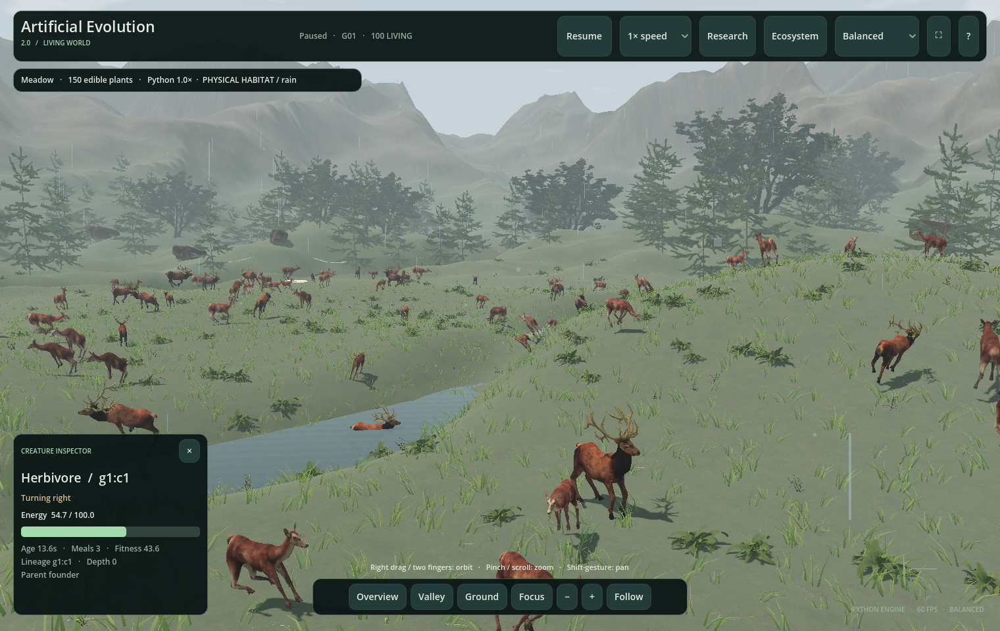

# Artificial Evolution 2.0

**A 3D desktop observatory for the original Artificial Evolution Python engine.** Explore evolving populations in a living landscape, inspect animals and their neural activity, and export reproducible experiments.

Python controls decisions, movement, food, energy, survival, reproduction and ecological interactions. Godot displays that state with detailed deer and wolves, skeletal animation, terrain, vegetation, atmospheric lighting and smooth cameras. The original [V1 application and README](../README.md), [V1 user guide](../docs/USER_GUIDE.md), tests and published results remain unchanged.



**[Complete documentation](docs/README.md)** · [Installation](docs/INSTALLATION.md) · [User guide](docs/USER_GUIDE.md) · [Simulation modes](docs/SIMULATION_MODES.md) · [Troubleshooting](docs/TROUBLESHOOTING.md)

## Start the application

On the prepared Mac, open **Finder → Go → Home → Applications**, then double-click **Artificial Evolution 2.0.app**. From Terminal:

```bash
open "$HOME/Applications/Artificial Evolution 2.0.app"
```

The installed app includes Python, dependencies, the numerical engine and art. It runs offline without Godot, Blender, Homebrew or the checkout. It opens in the immersive landscape; click **Research** for settings and plots.

To run from a prepared source checkout, use this command **from the repository root**:

```bash
./"v2/Run Artificial Evolution 2.command" -- --immersive --ground-view
```

To run the original 2D application independently:

```bash
./.venv/bin/python simulator.py
```

**Research → Connection → Open original 2D** can also launch the unchanged original interface with the bundled interpreter. It has its own process and remains open when the 3D viewer closes.

## Installation and distribution

The desktop package is **Apple Silicon / arm64**, locally ad-hoc signed and not Apple notarized. Native validation used macOS 27.0.1 on an M3. The bundle declares macOS 13 as its minimum, but its pinned NumPy wheel is tagged macOS 14; full macOS 13 compatibility is **not established**. See [compatibility](docs/INSTALLATION.md#requirements-and-compatibility).

V2 is implemented in this repository and builds as a standalone app. At this review, GitHub has V1 `v1.0.0` and `v1.0.1` releases; **no V2 GitHub release asset is published**. The generated desktop ZIP is an ignored local build artifact, not part of a fresh clone.

If you have the desktop ZIP, extract it and move the app to `~/Applications`. For a new development checkout:

```bash
git clone https://github.com/Maitham16/Artificial_Evolution.git
cd Artificial_Evolution
python3.13 -m venv .venv
./.venv/bin/python -m pip install -r requirements.txt
./v2/tools/setup_macos.sh
./"v2/Run Artificial Evolution 2.command" -- --immersive
```

Keep an existing working `.venv`; it does not need recreating. Setup requires macOS and Homebrew if Godot or Blender is missing. [Installation](docs/INSTALLATION.md) covers exact versions, ZIP installation, source paths, offline use and building.

## Implemented capabilities

| Area | Features | Guide |
| --- | --- | --- |
| Simulation | Food seeking, changing seasons, obstacles/hazards, brains/bodies, predator–prey, social groups, continuous ecosystems | [Modes](docs/SIMULATION_MODES.md) |
| Evolution | Selected neural controllers, neutral inheritance, random movement, greedy foraging, frozen founders where supported | [Evolution and brains](docs/EVOLUTION_AND_BRAINS.md) |
| Animals | Deer/stags and wolves, Python identities, coats, inherited sizes, eleven skeletal actions, nearby foot IK | [Animals](docs/ANIMALS_AND_ANIMATION.md) |
| Landscape | Grass, forests, flowers, rocks, mountains, water, wind, clouds, rain, fog, snow and day/night lighting | [Environments](docs/ENVIRONMENTS.md) |
| Physical habitat | Optional Python slope, river depth, wading, steep-bank and climate effects | [Physical rules](docs/PHYSICAL_HABITAT.md) |
| Interaction | Creature/plant inspection, confirmed event navigation, following, pause, speed and fixed-tick stepping | [User guide](docs/USER_GUIDE.md) |
| Observation | Population, food, fitness, ancestry, neural previews, hazard exposure, captures and sharing | [Measurements](docs/RESEARCH_AND_VALIDATION.md) |
| Reproduction | Synchronized cohorts or continuous energy-funded births | [Modes](docs/SIMULATION_MODES.md) |
| Data | JSON/CSV, numeric genomes, plots, screenshots, HTML reports, manifests and declared numerical replay | [Export/replay](docs/EXPORTS_AND_REPLAY.md) |
| Development | Godot editing, Blender authoring, asset hashes/licenses, tests and standalone macOS builds | [Development](docs/DEVELOPMENT.md) |

## First experiment

1. Click **Research**. Select **Food seeking**, **Meadow**, **Selected neural**.
2. Keep 100 founders and seed `2801`, then choose **Start new population**.
3. Return with **Landscape view** or **V**. Click an animal, then **Focus** or **F** to follow it.
4. Open **Ecosystem** or press **N** for confirmed events and scenery settings. Scroll **inside the drawer** to reach lower controls.
5. Pause with **Space**. In Research, inspect neural previews and charts or choose **Single physics tick**.
6. Press **E** or choose **Export run**. Use **Open export folder** to find the bundle.

Changing model settings normally archives the previous run before replacement. A live plot describes one run; it does not prove evolution beats a baseline. [Research and validation](docs/RESEARCH_AND_VALIDATION.md) explains independent seeds, matched controls and the preserved V1 studies.

## Controls at a glance

| Action | Control |
| --- | --- |
| Inspect animal / edible plant | Left click |
| Focus selection | Double click, **Focus**, or **I** |
| Follow / stop following | **Follow** or **F** |
| Orbit / pan | Right drag or two-finger gesture / middle drag or Shift + gesture |
| Zoom | Wheel, pinch, **− / +** |
| Overview / ground camera | **R / C**, or camera buttons; **Valley** has its own button |
| Pause / resume Python | **Space** or **Pause / Resume** |
| Simulation speed | **1× / 5× / 20×** menu |
| Landscape / Research | **V**; **Esc** returns from immersive to Research |
| Ecosystem drawer | **N** or **Ecosystem** |
| Fullscreen | **⛶** or Ctrl/Cmd + Enter |
| Export | **E** or **Export run** |

Gestures over a scrolling panel operate that panel instead of the camera behind it. V1 has [different shortcuts](../docs/USER_GUIDE.md#observe-and-control-the-run).

## Original rules and physical habitat

V2 defaults to the original Python model. Its height, distant water, plants, rain and lighting are presentation. Enable the separate Python extension with **Research → Physical habitat (v2 rules) → Start new population**, or:

```bash
./"v2/Launch 3D Application.command" --habitat
```

Grade, wading, excessive river depth, weather and nighttime costs can then affect movement and survival. The HUD identifies **PHYSICAL HABITAT**. It retains existing brains/evolution and uses its own export/replay helper.

This is a **2.5D** extension: horizontal trajectories still belong to Python. It adds no rigid-body animal physics, swimming, currents, tree collisions or terrain-specific neural inputs. Manual scenery overrides remain decorative. See [model boundaries](docs/ENVIRONMENTS.md#simulation-versus-presentation).

## Performance and evidence

Native Metal rendering, distant-animal batching, detailed-skeleton budgets and instanced vegetation target 60 FPS. Three recorded 100-founder Balanced trials on the M3 measured about **60 FPS**, with p95 frame times around **17.2 ms**. The OpenGL fallback measured about **40 FPS**. These are local engineering observations, not universal performance guarantees or evolutionary results.

The latest full V2 record contains **49 Python tests and 235 Godot checks**. Four native UI-pack runs test pointer routing at two window sizes, followed by a standalone release smoke test. The preceding habitat audit records **431 passing original tests** and 13 packaged native runs. [Evidence and limitations](docs/RESEARCH_AND_VALIDATION.md#engineering-evidence) link to exact records and archive hashes.

## Development quick start

```bash
./v2/tools/test.sh
python3 v2/tools/verify_original.py
./"v2/Open Godot Editor.command"
./v2/tools/build_macos.sh
python3 v2/tools/install_macos.py
```

Runtime assets are committed; do not run generators just to launch. The [development guide](docs/DEVELOPMENT.md) distinguishes current rigs from legacy generators and describes test scopes, native validators, package contents and contribution rules.

## Guides and licenses

Start at the [documentation index](docs/README.md). References include [settings/CLI](docs/CONFIGURATION.md), [architecture](docs/ARCHITECTURE.md), [troubleshooting](docs/TROUBLESHOOTING.md), [repository review](docs/REPOSITORY_REVIEW.md) and unchanged [V1 reproducibility](../docs/REPRODUCIBILITY.md).

Project code uses [MIT](LICENSE). Animal/landscape sources use their recorded CC0 licenses; Godot and runtime notices accompany the package. Blender is an external authoring tool. See [asset provenance](docs/ANIMALS_AND_ANIMATION.md#licenses-and-provenance), [Godot notices](THIRD_PARTY_NOTICES.txt) and [runtime provenance](docs/BUNDLED_RUNTIME.md).
