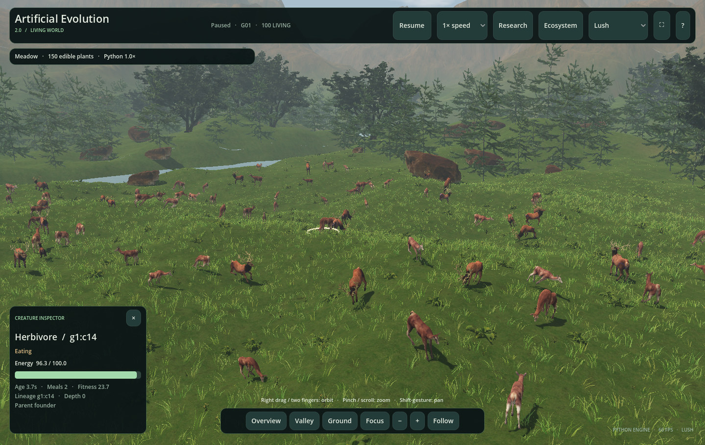
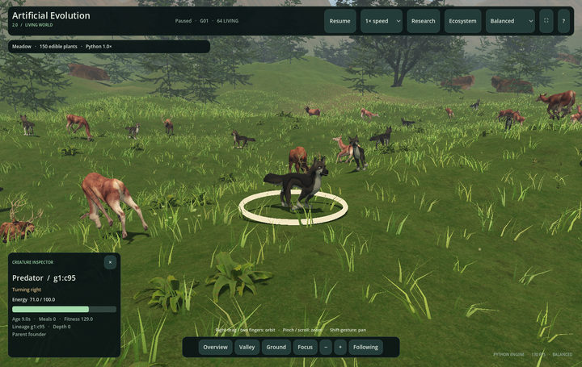
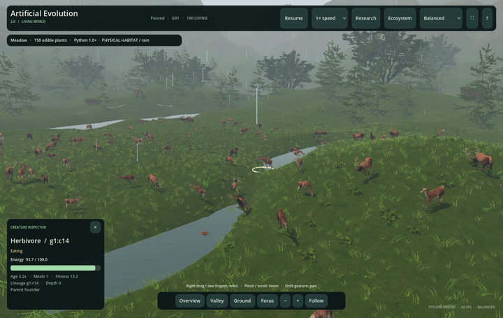
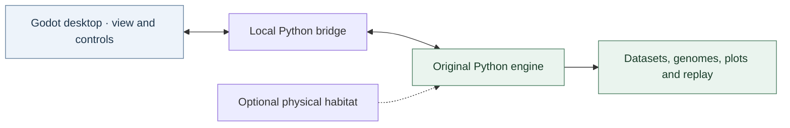

<div align="center">

# Artificial Evolution 2.0

### 3D Living World

Watch evolving populations inhabit a natural landscape.<br>
Inspect the animals. Follow their lives. Keep the science reproducible.

[](https://github.com/Maitham16/Artificial_Evolution/actions/workflows/tests.yml) [](project.godot) [](backend/engine_bridge.py) [](LICENSE)

**[Get started](#start-the-application)** · **[Visual gallery](docs/GALLERY.md)** · **[All guides](docs/README.md)** · **[Controls](#controls-at-a-glance)** · **[Original 2D simulator](../docs/USER_GUIDE.md)**

</div>



<p align="center"><sub>Actual application capture · 100 Python creatures · Ground camera · Lush quality</sub></p>

**[Open the visual gallery →](docs/GALLERY.md)** · [Animal movement · MP4](docs/media/gallery/animal-follow.mp4) · [Continuous growth · MP4](docs/media/gallery/continuous.mp4) · [Controls · MP4](docs/media/gallery/controls.mp4)

## A new view of artificial life

Artificial Evolution 2.0 brings the project's original Python simulation into a standalone 3D desktop application. Deer and wolves move through a forested landscape while the engine controls food, energy, brains, survival, reproduction and evolution.

Explore the world with smooth cameras, follow an individual, inspect its state and neural preview, or return to the research workbench for settings, plots and ancestry. Original simulation rules are the default. An optional physical habitat adds explicitly separate Python terrain, river and climate effects.

**The original 2D simulator remains available.** V2 adds a new interface and visual world without replacing V1's models, documentation or published research. [Project overview](../README.md) · [V1 guide](../docs/USER_GUIDE.md)

## Implemented capabilities

| **Living animals** | **Natural environments** | **Observable evolution** |
| --- | --- | --- |
| Detailed deer, stags and wolves | Rolling terrain, grass and forests | Seven original Python modes |
| Eleven skeletal actions and smooth blends | Flowers, rocks, mountains and water | Selection, mutation and heritable traits |
| Nearby terrain foot IK | Wind, clouds, daylight and weather | Continuous births and recorded ancestry |
| Stable source identities and appearance | Optional physical habitat rules | Configurations, datasets and numerical replay |

| **Interaction** | **Research tools** | **Desktop experience** |
| --- | --- | --- |
| Creature/edible-plant inspection | Population, fitness and meal curves | Standalone Apple Silicon application |
| Focus, follow, orbit, pan and zoom | Current-state neural previews | Bundled Python, dependencies and art |
| Confirmed event navigation | Mode-specific energy/interaction telemetry | Offline runtime and three quality profiles |
| Pause, 1×/5×/20× and fixed-tick stepping | JSON/CSV, numeric genomes, plots and HTML | Native Metal rendering and distant-animal batching |

## Inside the Living World

| Predators and prey | Terrain, water and source climate |
| --- | --- |
| [](docs/media/gallery/predator-prey.jpg) | [](docs/media/gallery/physical-habitat.jpg) |
| Separate evolving gene pools, confirmed captures and observed pursuit/escape. | Explicitly enabled slope/wading/climate costs; manual visual overrides remain cosmetic. |

Screenshots show actual application runs. **[The gallery](docs/GALLERY.md)** includes all seven modes, a V1/V2 comparison, five real recordings, captions and capture provenance. Art references and synthetic IK fixtures are identified in the [animation documentation](docs/ANIMALS_AND_ANIMATION.md).

## Start the application

### Installed desktop app

Open **Finder → Go → Home → Applications**, then double-click **Artificial Evolution 2.0.app**. Or:

```bash
open "$HOME/Applications/Artificial Evolution 2.0.app"
```

The installed app runs offline with its bundled Python, engine, dependencies and art. It needs no checkout, `.venv`, Godot, Blender or Homebrew at runtime.

### Run from source

From the repository root, prepare Python if no working `.venv` exists:

```bash
python3.13 -m venv .venv
./.venv/bin/python -m pip install -r requirements.txt
./v2/tools/setup_macos.sh
./"v2/Run Artificial Evolution 2.command" -- --immersive --ground-view
```

The Mac setup requires Homebrew when Godot/Blender is missing. Keep an existing prepared environment rather than recreating it. Godot options go before `--`; application options go after it. [Complete installation guide →](docs/INSTALLATION.md)

### Build and install the Mac app

With the source toolchain prepared:

```bash
./v2/tools/build_macos.sh
python3 v2/tools/install_macos.py
open "$HOME/Applications/Artificial Evolution 2.0.app"
```

### Keep using V1

```bash
./.venv/bin/python simulator.py
```

Or select **Research → Connection → Open original 2D** to launch the unchanged interface with the bundled interpreter. It runs independently when the 3D viewer closes.

## Installation and distribution

The current desktop package targets **Apple Silicon / arm64**, is locally ad-hoc signed and is not Apple notarized. Native validation used macOS 27.0.1 on an M3. Bundle metadata declares macOS 13, but the locked NumPy wheel is tagged macOS 14; full macOS 13 compatibility is not established. [Compatibility details](docs/INSTALLATION.md#requirements-and-compatibility)

V2 is available in source and as a locally generated desktop ZIP. There is no published V2 GitHub release asset yet; a fresh clone does not include ignored `v2/build/`. V1 releases remain [available separately](https://github.com/Maitham16/Artificial_Evolution/releases/tag/v1.0.1).

## First experiment

1. Open **Research**. Choose **Food seeking → Meadow → Selected neural**.
2. Keep 100 founders and seed `2801`, then **Start new population**.
3. Return with **Landscape view** or **V**. Click an animal, then **Focus** or **F**.
4. Open **Ecosystem** / **N** to inspect confirmed events and scenery controls. Scroll inside the drawer for its lower settings.
5. Pause with **Space**, inspect the workbench's neural preview, then export with **E**.

Model changes normally archive the previous run before replacement. A configuration reload starts fresh founders, not a saved population. A live plot describes one run; [controlled studies](docs/RESEARCH_AND_VALIDATION.md) provide the independent-seed evidence.

## Simulation modes

| Mode | Explore |
| --- | --- |
| **Food seeking** | Selected neural, neutral inheritance, random, greedy and frozen-founder baselines |
| **Changing seasons** | Seasonal food, moving clusters, maturity eligibility and extinction |
| **Obstacles & hazards** | Radius-aware barriers, damaging regions and risk sensing |
| **Brains & bodies** | Inherited speed, body size, sensory range and energy trade-offs |
| **Predator & prey** | Separate evolving populations, hunting/capture and escape observations |
| **Social behavior** | Isolated groups, optional signaling, stored-food sharing and survival strategies |
| **Continuous ecosystem** | Overlapping lifetimes, energy-funded births, finite regrowth and lineages |

[Mode rules](docs/SIMULATION_MODES.md) · [Brains and inheritance](docs/EVOLUTION_AND_BRAINS.md) · [Every setting](docs/CONFIGURATION.md)

## Controls at a glance

| Action | Input |
| --- | --- |
| Inspect animal / edible plant | Left click |
| Focus selected animal | Double click, **Focus**, or **I** |
| Follow / stop following | **Follow** or **F** |
| Orbit / pan | Right drag or two-finger gesture / middle drag or Shift + gesture |
| Zoom | Wheel, pinch, **− / +** |
| Overview / ground / valley | **R / C** or camera buttons; **Valley** button |
| Pause / resume Python | **Space** or top button |
| Target simulation rate | **1× / 5× / 20×** menu |
| Landscape / Research | **V**; **Esc** returns from immersive to Research |
| Ecosystem drawer / fullscreen | **N** / **⛶** or Ctrl/Cmd + Enter |
| Export a run | **E** or **Export run** |

Pointer gestures over panels operate the panel rather than the camera behind it. V1 has different shortcuts. [Full user guide →](docs/USER_GUIDE.md)

## Architecture



Python advances fixed `1/60 s` ticks. Godot receives snapshots at up to 30 Hz and interpolates poses with a 100 ms delay. Cameras, animation and foot IK do not send corrected creature positions back to the engine. [Architecture](docs/ARCHITECTURE.md) · [Protocol and recovery](docs/PYTHON_BRIDGE.md)

## Original rules and physical habitat

Original-rule scenery is visual: trees, outside-arena water, weather and lighting do not silently change the experiment. For actual Python slope, wading, excessive-depth barriers and climate costs, choose **Research → Physical habitat (v2 rules) → Start new population**, or:

```bash
./"v2/Launch 3D Application.command" --habitat
```

The HUD identifies **PHYSICAL HABITAT**. This is an explicit **2.5D extension** with separately recorded configuration and replay. It is not full rigid-body simulation, swimming, currents, tree collisions or new terrain-specific neural sensing. Manual visual overrides remain cosmetic. [Rules and combined-model limitations →](docs/PHYSICAL_HABITAT.md)

## Performance and evidence

Native Metal, vegetation budgets, shared distant skeletal draws and selective detailed animation target 60 FPS. Three recorded 100-founder Balanced trials on the local M3 measured about **60 FPS**, with p95 frame times around **17.2 ms**. The OpenGL fallback measured around **40 FPS**. These observations are not guarantees for every machine, population or quality setting.

The latest recorded complete V2 regression suite contains **49 Python tests + 235 Godot checks**. The preceding habitat audit also records **431 passing original tests** and 13 packaged native cases. CI badges above cover the original Python engine workflow, not native V2 graphics tests. [Exact audits and limitations →](docs/RESEARCH_AND_VALIDATION.md#engineering-evidence)

## Development quick start

```bash
./v2/tools/test.sh
python3 v2/tools/verify_original.py
./"v2/Open Godot Editor.command"
```

Runtime art is committed; launching does not require asset regeneration. Blender is an authoring tool. [Development and builds](docs/DEVELOPMENT.md) explains current rigs, tests, asset licenses, source preservation and native validation.

## Guides and licenses

| Use the application | Understand the implementation |
| --- | --- |
| [Visual gallery and demonstrations](docs/GALLERY.md) | [Capture method and reproduction](docs/GALLERY.md#capture-method-and-reproduction) |
| [Installation](docs/INSTALLATION.md) · [User guide](docs/USER_GUIDE.md) | [Architecture](docs/ARCHITECTURE.md) · [Python bridge](docs/PYTHON_BRIDGE.md) |
| [Animals and animation](docs/ANIMALS_AND_ANIMATION.md) | [Evolution and brains](docs/EVOLUTION_AND_BRAINS.md) |
| [Environments](docs/ENVIRONMENTS.md) · [Physical habitat](docs/PHYSICAL_HABITAT.md) | [Research and validation](docs/RESEARCH_AND_VALIDATION.md) |
| [Settings](docs/CONFIGURATION.md) · [Export/replay](docs/EXPORTS_AND_REPLAY.md) | [Development](docs/DEVELOPMENT.md) · [Repository review](docs/REPOSITORY_REVIEW.md) |
| [Troubleshooting](docs/TROUBLESHOOTING.md) | [Original V1 documentation](../docs/USER_GUIDE.md) |

**[Browse the complete documentation →](docs/README.md)**

Project code is [MIT licensed](LICENSE). Animal/landscape sources have recorded CC0 licenses; Godot and Python dependency notices accompany the app. [Art credits](docs/ANIMALS_AND_ANIMATION.md#licenses-and-provenance) · [Godot notices](THIRD_PARTY_NOTICES.txt) · [Bundled runtime provenance](docs/BUNDLED_RUNTIME.md)
