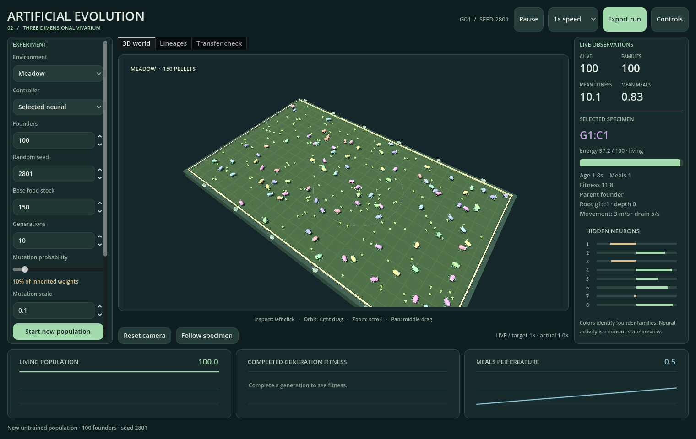

# Artificial Evolution 2.0 — 3D desktop vivarium

A separate Godot application with 100 procedurally modeled creatures, local food sensors, neural steering, natural selection, mutation, and visible founder families. The original Python/Pygame simulator and its research results remain in the repository root, unchanged.



## Run either version on this Mac

From Finder, double-click either launcher in this folder:

- **Run Artificial Evolution 2.command** — the new 3D application.
- **Run Original Simulator.command** — the original Python application, using its existing `.venv`.
- **Open Godot Editor.command** — edit the new Godot project.
- **Open Blender Models.command** — edit the creature's Blender source.

Or, from the repository root:

```bash
./"v2/Run Artificial Evolution 2.command"
./.venv/bin/python simulator.py
```

A standalone Mac application is also installed at `~/Applications/Artificial Evolution 2.0.app`. It runs without Python, Blender, or the Godot editor. Open it in Finder, or use:

```bash
open "$HOME/Applications/Artificial Evolution 2.0.app"
```

The standalone build is generated locally, ad-hoc signed, and not Apple-notarized. It is not a published GitHub release. The original 1.x releases are unchanged.

## Install on another Mac

The verified development toolchain is **Godot 4.7.2 standard**, **Blender 5.2.3 LTS**, and macOS on Apple Silicon. The project uses GDScript, Godot's Compatibility renderer, and bundled GLB models. No .NET, Python neural-network library, API key, asset download, or Godot plugin is needed to run v2.

With [Homebrew](https://brew.sh) installed:

```bash
./v2/tools/setup_macos.sh
./"v2/Run Artificial Evolution 2.command"
```

Setup installs missing Godot and Blender applications, imports the project, verifies the pinned macOS export template, and runs the v2 model tests. If Homebrew supplies a newer Godot, setup downloads the pinned version into ignored `v2/.tools/` without replacing the installed editor. Checksummed download versions are recorded in [toolchain.lock.json](toolchain.lock.json). Blender is used only to edit/rebuild assets; the current Blender version is reported by setup. The committed GLBs run independently of Blender.

To prepare the **original Python version** on a new checkout, run these commands from the repository root. Skip this if its existing environment already works:

```bash
python3.13 -m venv .venv
./.venv/bin/python -m pip install -r requirements.txt
./.venv/bin/python simulator.py
```

See the original [README](../README.md) and [user guide](../docs/USER_GUIDE.md) for the full Python research application. Its dependency pins and environment are separate from v2.

## Controls and workflow

| Action | Control |
| --- | --- |
| Inspect a creature | Left-click its body |
| Orbit camera | Right-button drag |
| Pan camera | Middle-button drag |
| Zoom | Scroll |
| Reset camera | R or **Reset camera** |
| Follow selected creature | F or **Follow specimen** |
| Pause/resume | Space or the top button |
| Change simulation rate | 1× / 4× / 12× selector |
| Export a run | E or **Export run** |

Choose an environment, controller, founder count, seed, food stock, generation limit, and mutation settings in the left panel. Scroll the panel to reach all controls on smaller windows. Press **Start new population** to apply changes. The previous run is archived first; normal window closure also saves a changed run. Starting a new population resets its training history.

The right panel shows the selected creature's energy, age, meals, fitness, parent, founding family, and eight hidden-neuron activations. Colors identify founding families. **Lineages** shows the largest 12 families across the last eight birth cohorts; complete individual ancestry is exported. Bottom charts show population, completed-generation fitness, and meals. Current-cohort fitness is provisional and resets with each birth cohort.

The simulator retains fixed physics steps when the requested speed exceeds the computer's capacity. The displayed actual speed can be below the target; simulation ticks are not skipped.

## Environments and controllers

| Environment | Conditions |
| --- | --- |
| Meadow (`uniform`) | Uniform food distribution |
| Food clusters (`clustered`) | Four concentrated food patches |
| Scarcity (`sparse`) | Food stock capped at 50 |
| Hazards & barriers (`hazards`) | Solid barriers, two damaging areas, extra obstacle/risk inputs |
| Changing seasons (`seasons`) | Stock cycles through 100%, 130%, 50%, 17%; clusters move between generations |
| Barren (`barren`) | No food; useful negative control |

Presets are in [presets/](presets/). **Load configuration** accepts a preset or exported `config.json`, then **Start new population** applies it.

All five controllers have identical speed, body radius, energy cost, sensory range, and lifespan distribution:

- **Selected neural:** top 20% of all completed lifetimes reproduce, with balanced shuffled offspring and independent weight mutations.
- **Neutral neural:** a random 20% reproduce with the same offspring counts and mutation rules; parent sampling has its own random stream.
- **Random movement:** persistent random turns, sampled every 0.75–2 seconds.
- **Greedy forager:** turns toward the nearest detected food; random turns when none is detected.
- **Frozen founders:** unchanged initial neural genomes across cohorts.

The **Transfer check** tab pauses training and tests the entire current birth cohort, random movement, greedy foraging, and the original founders on three new matched layouts for 30 simulated seconds each. It saves all 12 rows, including physical-start hashes. The brains stay frozen during testing. Cancellation preserves partial results.

These are descriptive layout repeats from one training run, not independent training replications or a statistical proof of learning. Before training, current and founder banks should match. Use the original Python study suite for the established multi-seed scientific protocols.

## Export, verify, and replay

V2 outputs are isolated at:

```text
~/Library/Application Support/ArtificialEvolution2/
  runs/run-.../
  transfer-checks/check-.../
```

Use **Open export folder** in the sidebar. Each run contains:

- `config.json`, `run.json`, and lossless `state.bin` with birth genomes and lifetimes.
- `individuals.csv`, `lineage.csv`, `population.csv`, `generations.csv`.
- `fitness.svg`, a self-contained `report.html`, and `application.png` for GUI exports.
- `manifest.json` with SHA-256 checksums.

A bundle is assembled in a `.pending` directory, checked, and renamed. Existing completed exports are never overwritten. Living individuals have `right_censored=true`; their age is not a completed lifespan. An export can stop mid-generation, so `generations.csv` may contain fewer completed cohorts than the current generation number.

For automated runs, from the repository root:

```bash
./"v2/Run Artificial Evolution 2.command" --headless --script tools/headless.gd -- \
  --config=presets/clustered.json --ticks=600 --out=/tmp/ae2-new-run

./"v2/Run Artificial Evolution 2.command" --headless --script tools/headless.gd -- \
  --verify=/tmp/ae2-new-run

./"v2/Run Artificial Evolution 2.command" --headless --script tools/headless.gd -- \
  --replay=/tmp/ae2-new-run
```

Use a fresh output directory each time. `--verify` checks hashes and readable/binary consistency; `--replay` additionally reconstructs the model from its seed and compares the full state exactly. Replay is verified with the pinned engine on this Mac, not promised bit-for-bit across engine versions or CPU architectures. Lossless binary state avoids the final-bit rounding that occurs when Godot parses JSON floats. The JSON copy is checked against it with an absolute tolerance of 1e-12 plus relative 1e-14.

`headless.gd` paths are relative to the Godot project (`v2/`), not the shell's working directory. Absolute paths also work. The headless tools are development sources and are excluded from the standalone app.

## Model and scope

This is an independent **ground-plane foraging model rendered in 3D**, not flying creatures or a bitwise port of the Python simulation. Bodies move across a 50 × 30 metre arena with 60 fixed steps per simulated second. All policies move at 3 m/s. Eight sensory inputs feed an 8-neuron hidden layer and two outputs; steering uses the first output, while throttle remains fixed. Hazard environments use 16 inputs. Food visibility is local within 8 metres and does not model optical occlusion.

Energy starts at 100, drains at 5/s, and gains 20 per meal up to capacity. Hazards drain an additional 12/s while occupied; barrier collisions cost 2 energy. Lifespans are uniformly sampled from 60–120 seconds. Fitness is survival seconds + 10 × meals − 5 × hazard seconds − 2 × barrier collisions. Food is continuously replenished after eating. Bodies do not block one another.

Generations are synchronized and replaced when all individuals die. A new cohort is generated from saved parents even if none survived, so barren conditions cause cohort failure, not permanent ecosystem extinction. Seasons change between cohorts. Continuous reproduction, predator–prey, cooperation, heritable morphology, and the full scientific study catalog remain features of the original Python application. The original saved populations/results are not imported into this different neural model.

The 3D world makes behavior observable. It does not establish general intelligence or transfer the original scientific conclusions to a new implementation.

## Develop and build

```bash
./"v2/Open Godot Editor.command"
./"v2/Open Blender Models.command"
./v2/tools/rebuild_assets.sh
./v2/tools/test.sh
./"v2/Run Artificial Evolution 2.command" --headless --script tests/ui_smoke.gd
./v2/tools/build_macos.sh
```

The Blender generator creates the editable `.blend` files and optimized `.glb` runtime assets. Rebuilding deliberately regenerates them; save hand edits elsewhere before running the generator. Godot does not automatically import the `.blend` source directory.

Use this dedicated v2 builder; the original root release builder remains a 1.x tool.

The build produces `v2/build/Artificial Evolution 2.zip`, a universal arm64/x86_64 Mac app. Only the Apple Silicon execution path has been tested. Extract it into `~/Applications` or `/Applications`. The build signs in a temporary directory because iCloud-managed Desktop folders can recreate Finder metadata that invalidates app signing. Build outputs, export data, tool downloads, import caches, and Blender backups stay out of Git.

For bounded native validation, the app accepts `-- --frames=120 --screenshot=/absolute/world.png --export=/absolute/new-bundle`, optionally `--environment=hazards`. These arguments also work with the source launcher. The regular interactive launch needs none of them.

## Preservation and validation

The original baseline is commit `f890b4f481a6659714dfae70e11f5b34f19a86f3`. The [inspection report](docs/INSPECTION.md) explains the source/data survey, architecture, and graph limitations. [Validation records](docs/validation/) contain the original test rerun, v2 tests, native build checks, and preservation hashes.

```bash
./.venv/bin/python -m unittest discover -v
python3 v2/tools/verify_original.py
# On the original working Mac, include all pre-existing local data:
python3 v2/tools/verify_original.py --all-existing
```

All implementation, documentation, assets, and launchers for this work live under `v2/`. No original tracked file, test, interface, result, root workflow, or release has been changed.

## Licenses

Project code and generated creature/food/rock assets use the copied [MIT license](LICENSE). Bundled engine copyrights and license texts are in [THIRD_PARTY_NOTICES.txt](THIRD_PARTY_NOTICES.txt). Godot is [MIT licensed](https://godotengine.org/license/); Blender is [GPL licensed](https://www.blender.org/about/license/). Blender is an external authoring tool and is not bundled in the app. Runtime assets are authored by this project's generator, with no third-party art dependencies. Tool setup follows the official [Godot macOS downloads](https://godotengine.org/download/macos/), [Blender LTS](https://www.blender.org/download/LTS/), and [Godot glTF import documentation](https://docs.godotengine.org/en/stable/tutorials/assets_pipeline/importing_3d_scenes/available_formats.html).
