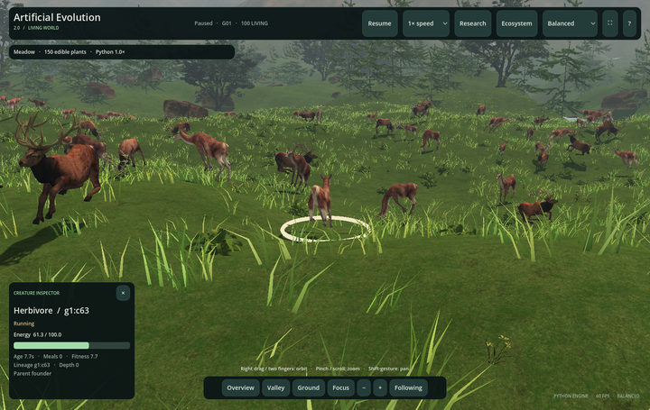

# Animals and animation

[Documentation](README.md) · [User guide](USER_GUIDE.md) · [Evolution](EVOLUTION_AND_BRAINS.md) · [Authoring](DEVELOPMENT.md#asset-authoring)

Animals represent existing Python agents. Their source identity, energy, decisions and interactions remain in the engine; Godot supplies anatomical meshes, materials, poses and terrain alignment.

[](media/gallery/animal-follow.jpg)

*Live application capture. [Watch actual movement, predator–prey and continuous growth recordings](GALLERY.md#animals-in-motion).*

<details>
<summary>Model asset reference · separate from the live simulation captures</summary>


</details>

## Models and appearance

| Python role | Display model | Details |
| --- | --- | --- |
| `species == "predator"` | Wolf | Head/muzzle, eyes/ears, teeth, articulated legs/paws, long tail |
| Other agents, including prey | Doe or antlered deer | Head/eyes/ears, four legs, hooves, short tail; branching antlers on the stag variation |

A stable founder-root hash selects deer variation and natural coat tint. A stable per-identity size factor from 0.94 to 1.06 adds cosmetic variation. Authoritative Python radius controls root scale; inherited body-size changes therefore remain visible. A model retains metadata for Python ID, founder root and species.

Antlers do **not** imply simulated sex, mating or sex-linked inheritance. Coat color, deer/wolf artistic anatomy and cosmetic size variation do not add genes, diets or fitness bonuses. In a non-predator mode the HUD may call an animal a herbivore for presentation; the engine remains its generic agent model.

The source meshes are approximately 4,800–5,400 triangles each. Their heads/tails/antlers can exceed Python's circular collision footprint. Display-bound picking and terrain-conforming poses do not redefine collision or sensor origins.

## Animation evidence

Eleven skeletal clips are available: `Rest`, `Walk`, `Run`, `TurnLeft`, `TurnRight`, `Eat`, `Hunt`, `Escape`, `Reproduce`, `Grow`, `Die`.

| Animation | What must actually be observed |
| --- | --- |
| Walk/run | Python XZ displacement, speed and scale; gait phase follows travel distance |
| Turn | Shortest-angle heading change layered over locomotion |
| Eat | Increase in the actor's meal counter; proximity alone is insufficient |
| Rest | Near-zero displacement and source speed; pause does not invent resting |
| Hunt | Predator directional movement toward a visible opponent, or confirmed capture response |
| Escape | Prey directional movement away from a visible opponent |
| Reproduce | A real continuous birth linked to its living parent |
| Grow | Actual continuous offspring age relative to maturity age |
| Die | Confirmed biological death with Python cause/final pose |

Reproduction is a brief upper-body brace, not sexual behavior or gestation. Continuous offspring visually grow from 65% to adult scale; their complete collision radius and energy rules already exist at birth. Founders and replacement cohorts start at adult display scale. Hunting/escaping are descriptive labels, not proof of neural intention.

Locomotion crossfades over 0.22 s; feeding/reproduction/turn layers preserve leg movement. Python does not stop an agent to accommodate eating animation. Death blends into collapse, followed by a three-presentation-second noninteractive remnant/fade. Alive cohort retirement does not play death. Unexplained disappearance is not converted into a fictional death.

## Skeletal performance and foot contact

Selected and nearby animals evaluate actual `Skeleton3D` local poses. Other living animals use the same mesh bone indices/weights with shared GPU bone matrices and per-instance pose state. They remain skeletally animated; batching does not replace them with static sliding meshes.

Performance/Balanced/Lush allocate 2/4/6 nearby detailed animals plus the selection. Detailed animals within 12 display units can update poses at up to 60 Hz; other paths use reduced pose rates. Distant animals stop spending shadow passes. Paused/disconnected creature animation does not advance.

Nearby foot IK uses four explicit two-bone leg chains, stance anchors, preserved limb lengths and the displayed triangle surface. It changes visual bone poses only. Reachable-slope tests measured worst target residual around 1.45 cm; constrained native endpoint samples reached about 4.4 cm. These are joint-target errors, not a hoof-volume guarantee. Sharp reflections, large speed multipliers, swing transitions and finite reach can still show sliding or separation.

No root-motion trajectory replaces Python movement, and no full-body collision or rigid-body locomotion system is implemented. [Creature animation](CREATURE_ANIMATION.md) and [physical habitat](PHYSICAL_HABITAT.md#foot-contact) describe the algorithms and records.

## Real observations and decorative effects

Numbered receipts carry real births, meals, captures, reproduction, death, retirement and seasonal transitions. The bounded journal retains events across superseded display snapshots. Initial connection does not replay old actions. Receipts are deduplicated and delayed to match interpolation; gaps are reported.

Counter increases can aggregate several physics events between snapshots. The displayed meal timestamp/location is an observation point, not a new exact per-food collision record. Decorative pollen, grass wind, ripples, particles and clouds do not create events or energy.

## Observe a lifecycle

```bash
./"v2/Run Artificial Evolution 2.command" -- --immersive --ground-view \
  --config="$(pwd)/v2/configs/animation_lifecycle.json"
```

Select an animal and press **F**. The preset makes births easier to encounter through explicit food/maturity/cooldown settings. Event occurrence still depends on Python. Try Predator & prey for wolves and source-based pursuit/retreat; use the Ecosystem event list to locate confirmed participants.

## Current rigs and authoring

Current skeletal rigs are `v2/art_source/animation/doe.blend`, `stag.blend`, `wolf.blend`; runtime scenes and pose resources are in `v2/assets/animals/skeletal/`.

```bash
/Applications/Blender.app/Contents/MacOS/Blender v2/art_source/animation/doe.blend
```

`Open Blender Models.command` currently opens the older prototype `art_source/creature.blend`. `rebuild_assets.sh` also rebuilds prototype art. Use the explicit current rig path and the [current authoring pipeline](DEVELOPMENT.md#asset-authoring) for these animals. `art_source/animals/` and earlier vertex-animation outputs are retained authoring history, not the active skeletal renderer.

Asset galleries intentionally pose models without a Python simulation. Their pictures are useful for art review and are labeled fixtures, not scientific events. Preserve hand edits before running generators, then review source/license/runtime hashes.

## Licenses and provenance

| Asset | Original creator | Recorded source |
| --- | --- | --- |
| Deer Female | CDmir / TinyWorlds collaboration | [OpenGameArt](https://opengameart.org/content/deer-female) |
| Old Deer Male | CDmir / TinyWorlds collaboration | [OpenGameArt](https://opengameart.org/content/old-deer-male) |
| 3d wolf | NewDLC | [OpenGameArt](https://opengameart.org/content/3d-wolf) |

These sources and derived animal art/animations are recorded as CC0 in [animal licenses](../assets/animals/LICENSE.md), with original-download and derived-file hashes in [ASSET_SOURCES.json](../assets/animals/ASSET_SOURCES.json). The landscape uses recorded [Poly Haven CC0 sources](../assets/nature/LICENSE.md) and its own [source manifest](../assets/nature/ASSET_SOURCES.json).

Code is [MIT](../LICENSE). Godot notices are [bundled](../THIRD_PARTY_NOTICES.txt). The independent Blender authoring application is not shipped as part of the desktop runtime. CPython/dependency license texts are documented in [runtime provenance](BUNDLED_RUNTIME.md).
