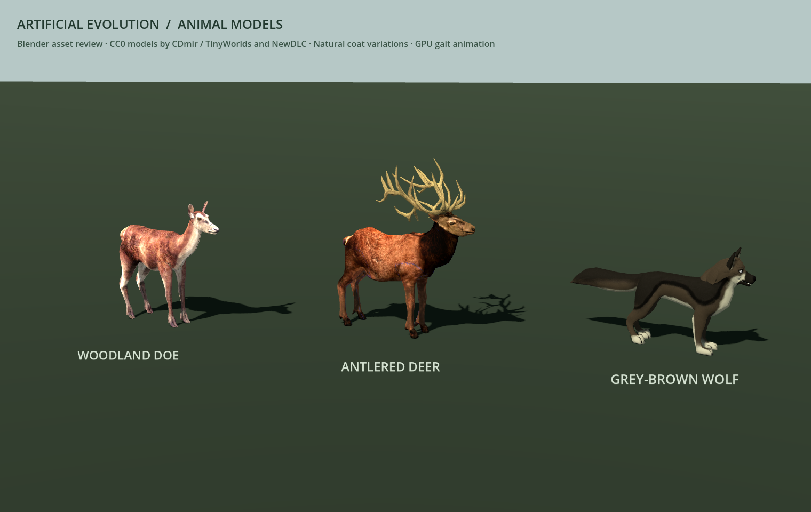
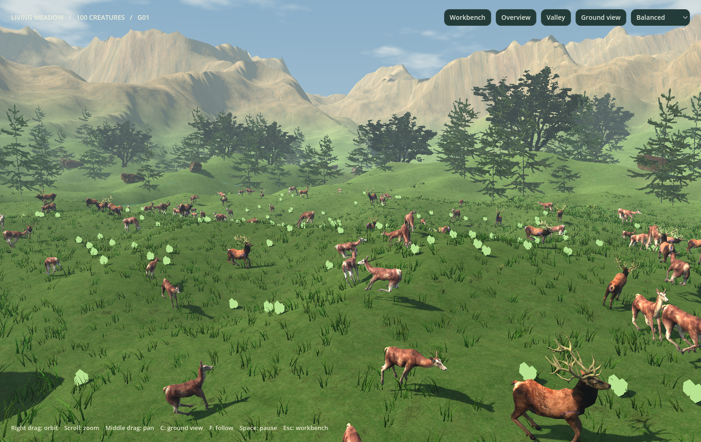

# Detailed animal models

[Documentation](README.md) · [User guide](USER_GUIDE.md) · [Development](DEVELOPMENT.md)

The Godot viewer uses textured, anatomically recognizable deer and wolves in place of the original creature placeholders. The deer have narrow heads, ears, dark eyes, four jointed legs, split hooves and short tails; the antlered variation has a separate branching antler mesh. Wolves have a muzzle, nose, eyes, ears, teeth, four jointed legs, paws and a long tail. Materials retain the source coat detail, with normal maps where provided.





## Appearance and identity

- Python agents with `species == "predator"` use the wolf. Other agents use a doe or antlered deer. Wolves appear in the existing **Predator & prey** simulation mode.
- Every displayed animal retains its exact Python lifetime ID, lineage root and species. Births create a model for the new ID; deaths remove that model; a new run clears the previous models. Clicking the animal's display bounds selects the same Python specimen, energy, neural preview and ancestry as before.
- A stable hash of the lineage root chooses a natural coat tint and deer variation. Warm brown/tan deer and muted grey/brown wolves replace the previous bright body colors. Detailed lineage colors remain in the ancestry chart and selected specimen ID.
- Python's existing radius determines the root scale. A stable per-identity cosmetic size factor between 0.94 and 1.06 adds modest individual variation. The body-trait mode continues to show Python's inherited size differences. Proportions remain uniform under scaling.

These animal names, antlers, coats and the small visual size variation are artistic choices. They do not add biological species, sexes, age classes, sexual reproduction, fitness bonuses, new diets or inherited traits to the Python engine. The models are illustrations of generic simulated agents. Their elongated heads, tails and antlers can extend beyond the original circular collision radius; Python's established collisions and sensor origins remain authoritative.

## Animation and performance

The editable Blender models retain their skeletons. The deer retain the source idle/run poses; the wolf has newly authored in-place idle and quadruped gait cycles. Each model is approximately 4,800–5,400 source triangles.

The current runtime uses [event-driven skeletal animation](CREATURE_ANIMATION.md): actual `Skeleton3D` poses nearby and shared GPU bone matrices for the rest of the population. Walking/running phases follow real displacement, with smooth pose blends and observed feeding/lifecycle events. The earlier two-clip vertex-animation assets remain as historical authoring outputs; they are no longer the active animal renderer.

The Blender rigs are retained in `v2/art_source/animation/`. Current package tests and timings are in [animation-validation](animation-validation/README.md). The older [animal-validation](animal-validation/README.md) records describe the previous two-clip renderer.

## Run and inspect

```bash
# Existing Python engine with the new animals:
./"v2/Run Artificial Evolution 2.command"

# Original 2D application, unchanged:
./.venv/bin/python simulator.py
```

Press **V** for the landscape, then choose **Ground view** or **Valley**. Use the sidebar to start **Predator & prey** to see wolves alongside deer. Left-click an animal and press **F** to follow it.

Native asset close-up review, independent of any simulation:

```bash
./"v2/Run Artificial Evolution 2.command" --script tools/animal_gallery.gd \
  -- --screenshot=/tmp/animal-models.png
# Add --run to inspect a sampled gait pose.
```

## Blender editing and licenses

All three source assets are CC0: [Deer Female](https://opengameart.org/content/deer-female) and [Old Deer Male](https://opengameart.org/content/old-deer-male) by CDmir with collaborator TinyWorlds; [3d wolf](https://opengameart.org/content/3d-wolf) by NewDLC. Attribution, source links and the full dedication are bundled in [assets/animals](../assets/animals/LICENSE.md). [ASSET_SOURCES.json](../assets/animals/ASSET_SOURCES.json) records original download checksums and hashes of the derived runtime and editable files. No art downloads occur during simulation.

Current skeletal actions are edited in `v2/art_source/animation/{doe,stag,wolf}.blend`; see [current authoring](DEVELOPMENT.md#asset-authoring). The earlier source-conversion files remain at `v2/art_source/animals/{doe,stag,wolf}.blend`. Each file includes its rig, actions and packed textures. To regenerate from the checksum-pinned originals:

```bash
python3 v2/tools/fetch_animal_assets.py
/Applications/Blender.app/Contents/MacOS/Blender --background --factory-startup \
  --python v2/tools/prepare_animal_assets.py
./"v2/Run Artificial Evolution 2.command" --headless --editor --import
python3 v2/tools/fetch_animal_assets.py --verify-runtime
```

The generator overwrites the editable files and runtime meshes/pose textures. Preserve hand edits before using it. Review intentional changes and update the manifest hashes after authoring; the hash verifier should reject unrecorded changes. Keep the committed `.import` settings with the assets. Blender is required for authoring only; the running Godot app uses the existing Python environment without additional Python dependencies. The older `rebuild_assets.sh` rebuilds the original prototype art, not these new animals.
