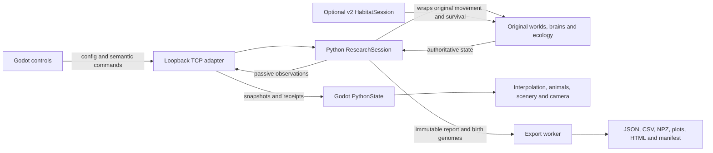

# Architecture

[Documentation](README.md) · [Python protocol](PYTHON_BRIDGE.md) · [Development](DEVELOPMENT.md)

V2 is a separate presentation/application layer inside `v2/`. The original numerical model remains Python. A local process boundary separates fixed-step simulation from render-rate interpolation and animation.

## Ownership and data flow

| Owner | Responsibilities |
| --- | --- |
| Python original model | Neural decisions, positions/headings, sensing, energy, food ownership, survival, fitness, inheritance and mode interactions |
| Python session | RunConfig validation, fixed ticks, controls, budgets, lifetime/birth ledger, passive metrics, snapshot/export/replay |
| Python V2 bridge | Process-local protocol, observation identities, event receipts, queued transport, export dispatch |
| Python physical extension | Opt-in seeded surface, deterministic climate, motion/cost mixin, physical record/replay |
| Godot | Command UI, received-state storage, interpolation, camera/picking, anatomy, animation, foot IK, landscape and visual overlays |

Godot sends no per-creature poses or calculated neural decisions to Python. There is no active fallback GDScript simulation. The initial independent Godot prototype was superseded; its documentation/early outputs remain historical.

## Source map

| File / area | Responsibility |
| --- | --- |
| Root `research_session.py` | RunConfig, world factory, session, metrics, bundle export/verification/replay |
| Root `world.py`, `creature.py`, `food.py` | Base ecology, movement, survival and food |
| Root `brain.py`, `perception.py`, `selection.py`, `reproduction.py` | Neural controller, senses and generational inheritance |
| Root `seasons.py`, `obstacles.py`, `body_traits.py` | Seasonal, risk and inherited-body models |
| Root `predator_prey.py`, `social.py`, `ecosystem.py` | Additional ecological modes |
| Root `simulator.py`, `research_app.py`, `research_catalog.py` | Preserved V1 CLI/workbench/study jobs |
| [`backend/engine_bridge.py`](../backend/engine_bridge.py) | `EngineAdapter`, `BridgeServer`, frames, receipts and commands |
| [`backend/habitat.py`](../backend/habitat.py) | Opt-in `HabitatSession`, surface, costs, export/replay |
| [`scripts/main.gd`](../scripts/main.gd) | UI composition, configuration drafts, command acknowledgements, shortcuts and bounded captures |
| [`scripts/desktop_hud.gd`](../scripts/desktop_hud.gd) | Landscape header, camera dock and specimen card |
| [`scripts/python_bridge.gd`](../scripts/python_bridge.gd) | Process launch/discovery, authenticated TCP, partial reads/writes and recovery |
| [`scripts/python_state.gd`](../scripts/python_state.gd) | Authoritative frame storage, ancestry, food revisions, event queue and interpolation |
| [`scripts/world_view.gd`](../scripts/world_view.gd) | Scene bodies, terrain alignment, picking, guides, event effects and camera |
| [`scripts/animal_view.gd`](../scripts/animal_view.gd) | Model appearance, poses, layers, growth and death remnant |
| [`scripts/skeletal_pose_library.gd`](../scripts/skeletal_pose_library.gd) | Baked clip/stride/bone resources |
| [`scripts/animal_batches.gd`](../scripts/animal_batches.gd) | MultiMesh distant skeletal batches and per-instance pose texture |
| [`scripts/terrain_feet.gd`](../scripts/terrain_feet.gd) | Nearby two-bone foot IK and stance anchors |
| [`scripts/nature_scene.gd`](../scripts/nature_scene.gd) | Terrain, water, forest, vegetation, assets and quality budgets |
| [`scripts/environment_director.gd`](../scripts/environment_director.gd) | Auto/source climate presentation, visual overrides, sky/light/particles |
| [`scripts/visuals.gd`](../scripts/visuals.gd) | Live plots, hidden-neuron bars and family chart |

## Timing and coordinate systems

Python advances exact **1/60-second** physics ticks. The bridge's wall-time update has a bounded tick workload (32 per adapter update) and a target playback factor of 1, 5 or 20. If capacity is insufficient, achieved speed falls; physics does not take larger steps to hide rendering cost.

Snapshots arrive at up to **30 wall-clock Hz**. Godot keeps a bounded presentation history and samples with **100 ms delay**, interpolating XZ and shortest-angle headings. It clamps to available poses when updates stop, rather than extrapolating new decisions. Stream/run/time guards reject stale data. Source energy, age, fitness and births are not interpolated into new biological outcomes.

Python `(x,y)` maps to Godot `(X,Z)` centered on the arena, divided by 20. Display Y comes from the rendered terrain. Original-mode terrain is cosmetic; physical mode loads a deterministic Python heightfield with matching triangle interpolation. The extension still retains original planar actors.

## Protocol and backpressure

Protocol 1 is newline-delimited UTF-8 JSON over `127.0.0.1` on an ephemeral port. A mode-0600 endpoint file holds PID/port/protocol/token. The first request authenticates with `hello`; only one controlling viewer can own a backend. The protocol is not a remote multiplayer API.

Requests carry an ID/command; responses carry the matching ID and success/error. Commands cover catalog handshake, validation/configuration, pause/speed/automatic controls, advance/step, selection/state/export/shutdown, ping and acknowledgements. Python rejects nonobject/nonfinite JSON and unknown configuration fields. Exact seeds travel as decimal text or raw JSON rather than rounded Godot numbers.

An unsent presentation frame can be replaced by newer state. Unsent chart/surface updates needed by the client are retained, and in-flight frames are never truncated. Command replies are retained separately. Bounded buffers prevent a slow renderer from becoming an unbounded simulation history store.

The [protocol reference](PYTHON_BRIDGE.md) explains command and lifecycle semantics. It is an internal versioned adapter, not a promise that arbitrary external clients may control a running viewer's session.

## Passive observations and event identity

Generational actors use generation plus creature ID; continuous IDs are globally unique within the run. Source parent/root/depth determines ancestry. Current Food objects receive stable observer IDs while alive; these IDs do not add exact meal-to-food matching to the original engine.

The bridge watches meal/capture counters, source births, death state, retirement and season history. Its 4096-receipt journal is acknowledged and deduplicated; events can survive dropped superseded snapshots. The recent visible event list is capped separately. Initial connections do not replay all prior actions. Counter receipts record observation time/pose, possibly aggregating several physics events. Gaps are exposed rather than fabricated.

Neural preview is passive NumPy inference from current sensors and weights. No preview output is reapplied. Drawing or inspecting cannot call the numerical decision loop a second time or consume model RNG.

## Rendering and animation

The window contains a SubViewport for 3D with normal Godot Controls for UI. Performance reduces only 3D resolution; picking maps into actual viewport pixels. Research and immersive layouts reparent the same viewport. The Ecosystem drawer remains last in tree order after layout changes so its visible controls also receive pointer input; drawing Z alone does not establish that order.

Near/selected animals use local bone transforms and two-bone terrain foot IK. Distant living actors share GPU pose palettes and MultiMesh draws grouped by model/anatomical part/shadow flag. Per-instance pose/tint data retain identity and animation phase. Confirmed death leaves living batches and plays a noninteractive remnant. Ordinary cohort retirement creates no death.

Terrain queries match rendered triangles. Cached stationary transforms, food revisions, chunked vegetation, grass fade, distant impostors, shadow distance and detailed-skeleton budgets limit work. Nature's own seeds do not touch model RNG. Mobile/Metal uses sky water reflections; Compatibility retains the earlier reflection probe.

## Physical extension boundary

Disabled habitat creates the original `ResearchSession` directly. Enabled habitat creates a V2 subclass and per-instance movement/survival mixin; root class definitions and files stay unmodified. It binds births, rejects wet food placements, finds safe initial/birth positions, applies deterministic climate/traction/power and records physical ledgers.

This changes experiment outcomes and random food-placement draws. It is not equivalent to a passive original-mode viewer. It preserves controller dimensions and existing interaction solvers, including the [physical predator capture-path limitation](PHYSICAL_HABITAT.md#combined-model-limitations). Its separate exporter/replayer declares version/source/surface/config and compares habitat telemetry.

## Export, recovery and desktop isolation

Only the Python owner thread mutates the live session. Export receives copied reports/genomes and writes a private staging directory before publishing a unique bundle. Run replacement validates/builds the candidate first, archives the previous run and swaps only after successful archiving. Error paths retain the existing run.

A disconnected viewer pauses Python; reconnect can retain a still-living backend. A dead backend has no in-memory session to reconnect. Parent-process monitoring attempts a final save after unexpected viewer loss. Normal close waits for export acknowledgement. This is not a crash-proof checkpoint database.

The standalone app embeds its own runtime and unchanged original source/preset snapshot. `engine-manifest.json` identifies payload hashes; `runtime.lock.json` identifies downloads/dependencies. Godot launches owned Python with `-E -s -B`; caches, endpoints and exports live outside the signed app. Source launches instead use the checkout's existing `.venv`.

The independent original 2D launch is not the viewer's owned backend; closing Godot leaves it alive. [Runtime provenance](BUNDLED_RUNTIME.md) and [Development](DEVELOPMENT.md) detail assembly, signing and verification.
