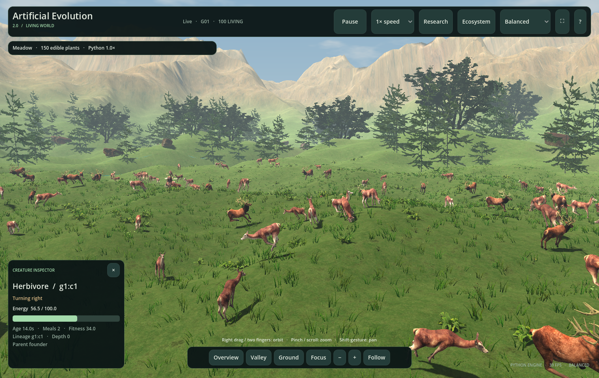

# Artificial Evolution 2.0 desktop app

The standalone Apple Silicon app opens directly into the 3D landscape, with a quiet translucent header, camera dock and live creature inspector. **Research** provides the complete existing v2 workbench. The original Python simulation and 2D interface are unchanged.



## Launch

On this Mac, double-click `~/Applications/Artificial Evolution 2.0.app` or `v2/Launch 3D Application.command`. The desktop app includes Python and the engine, works offline, and needs no checkout, virtual environment, Godot, Blender or Homebrew at runtime. The current build is arm64/macOS 13+, locally ad-hoc signed. It is not an Intel build or Apple-notarized distribution.

To install from a ZIP without developer tools, double-click the ZIP and drag **Artificial Evolution 2.0.app** into `~/Applications`.

To build and install from source:

```bash
./v2/tools/build_macos.sh
python3 v2/tools/install_macos.py
open "$HOME/Applications/Artificial Evolution 2.0.app"
```

Building requires the existing Godot export toolchain and network access for the first pinned runtime/wheel download. Subsequent builds reuse verified downloads. **Install Desktop App.command** provides the same checked installation through Finder. The ZIP and build checksum are under ignored `v2/build/`; the installer preserves the old application if final validation fails.

For source development run `./"v2/Run Artificial Evolution 2.command"`, which continues to use the checkout's `.venv`. Blender is an authoring tool only. The app's **Connection** panel supports explicit development overrides; packaged launches prefer the bundled snapshot and do not overwrite your saved development paths.

## Explore and inspect

| Action | Mouse / trackpad / keyboard |
| --- | --- |
| Select a creature | Left click its displayed body |
| Focus selection | Double-click, **Focus**, or I |
| Follow selection | **Follow** / F; button shows **Following** |
| Orbit | Right drag or two-finger gesture |
| Pan | Middle drag or Shift + two-finger gesture; releases follow |
| Zoom | Scroll, pinch, or **− / +** |
| Wide arena / river landscape / low meadow | **Overview**, **Valley**, **Ground**; R / C shortcuts |
| Pause Python | **Pause / Resume** or Space |
| Python speed | **1× / 5× / 20×** |
| Research / landscape | **Research**, **Landscape view**, V / Esc |
| Events and scenery | **Ecosystem** / N |
| Fullscreen | ⛶ or Ctrl/Cmd + Enter |
| Export original Python bundle | E or **Research → Export run** |

Focus and overview move smoothly; zoom/orbit ease toward the requested camera pose. Pitch and distance are bounded and camera height remains above display terrain. Following tracks the already interpolated pose with responsive easing at high simulation speeds, and stops if the selection is no longer active. It never chooses another animal automatically. The inspector shows source ID, energy, age, food, fitness, ancestry and observed animation state. Close it with **×** and click an animal to reopen it. A thin selection ring remains visible; scientific sensor rings and trails are confined to the workbench.

The HUD's simulation controls wait for Python acknowledgements. Speed affects original fixed physics ticks; camera movement and decorative scenery are independent. A disconnect freezes creature state and disables commands. Eating, births, growth, predation and death retain their existing source-event semantics. Weather and lighting remain explicitly decorative in **Ecosystem**; see [interactive ecosystem](INTERACTIVE_ECOSYSTEM.md).

## Rendering

The three quality profiles affect the view only. **Performance** uses fewer plants, shorter shadow range, and half-resolution 3D with full-resolution interface text. Picking scales into the actual render viewport. **Balanced** and **Lush** retain full-resolution 3D with their existing vegetation budgets.

Selected and nearby animals use actual `Skeleton3D` poses with [terrain foot IK](PHYSICAL_HABITAT.md). Distant animals share GPU skeletal draw batches with existing blend/stride rules. Native Metal Mobile rendering now targets 60 FPS on this Mac. Individual animal shadows stop beyond 34 m and resume inside 30 m to avoid threshold flicker. Repeated stationary poses reuse terrain alignment. Static food transforms are uploaded only when source food changes or appearance easing is active, while shader wind remains animated. Hidden research charts and landscape trails do not redraw in landscape mode. These budgets affect presentation, not simulation, sensors or numerical fidelity.

[Measured native profiles](desktop-validation/README.md) include all seven modes, the performance profile and a small window. They are local timings, not guarantees for every Mac.

## Original 2D application

The repository's original version is still independently accessible:

```bash
./"v2/Run Original Simulator.command"
# equivalent:
./.venv/bin/python simulator.py
```

The standalone package can also start the original interface through **Research → Connection → Open original 2D**. This is a separate process using the unchanged bundled `simulator.py`; closing the 3D viewer does not close it. Both applications run separate simulation sessions. Original checkout files, results, published releases and `.venv` remain untouched.

## Data and reproducibility

The 3D app writes exports to `~/Library/Application Support/ArtificialEvolution2/python-runs/`. **Research → Open export folder** opens them. Exports use the original engine's config, run report, genomes, plots, CSVs, HTML and manifests. Existing `simulator.py --verify-bundle` and `--replay … --headless` work on these exports. The bundled original Python CLI can perform those checks too.

`Contents/Resources/engine-manifest.json` identifies every copied source/preset with SHA-256. The bundled runtime is separately locked, licensed and isolated from user `PYTHONHOME`, `PYTHONPATH` and site packages. Caches and endpoints live in user data, not in the signed bundle. The original 431 tests were run with both the original `.venv` and the separate bundled-runtime interpreter. See [runtime provenance](BUNDLED_RUNTIME.md) and [validation](desktop-validation/README.md).

## Physical terrain and climate

[Physical habitat](PHYSICAL_HABITAT.md) is an opt-in v2 rule extension. Choose **Research → Physical habitat (v2 rules) → Start new population**, or launch with `--habitat`. Python applies uphill, wading, bank and weather effects; manual scenery overrides remain cosmetic. These exports declare the changed rules and use the separate bundled v2 habitat replay. Original research mode and the original 2D application remain unchanged. See [current validation](habitat-validation/README.md).
