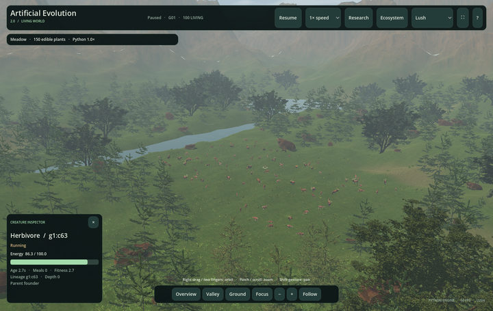
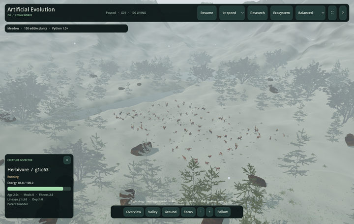

# Environments, seasons and weather

[Documentation](README.md) · [Modes](SIMULATION_MODES.md) · [Physical habitat](PHYSICAL_HABITAT.md)

There are three distinct layers: the Python food/interaction arena, the Godot landscape around it, and the optional physical-habitat extension. Choosing a camera or a weather effect does not silently change the numerical model.

| Living valley | Decorative winter |
| --- | --- |
| [](media/gallery/valley.jpg) | [](media/gallery/winter-weather.jpg) |

*Real application captures. Winter here is a visual override. [See the gallery for automatic Python habitat rain and capture settings](GALLERY.md#landscapes-and-weather).*

## Python food environments

| Interface label | `environment` | Arena, Python px | Display size | Food layout | Default stock |
| --- | --- | --- | --- | --- | ---: |
| Meadow | `uniform` | 1000 × 600 | 50 × 30 units | Uniform | 150 |
| Food clusters | `clustered` | 1000 × 600 | 50 × 30 | Clustered | 150 |
| Scarcity | `sparse` | 1000 × 600 | 50 × 30 | Uniform | 50 |
| Wide clusters | `wide_clustered` | 1200 × 500 | 60 × 25 | Clustered | 150 |
| Barren | `barren` | 1000 × 600 | 50 × 30 | Uniform | 0 |
| Seasonal food | `seasonal` | 1000 × 600 | 50 × 30 | Moving seasonal clusters | Controlled by `season_food` |

One displayed metre/unit corresponds to **20 original Python pixels**. This is a presentation scale, not a calibration to a real ecosystem.

All non-seasonal modes can use the first five layouts except social, which supports uniform, sparse and barren. Seasons requires `seasonal`. An explicit `food_count` overrides the non-seasonal default, so selecting Barren and then supplying positive stock is not a zero-food condition. Sidebar `−1` means JSON `null`, using the default.

Most generational modes immediately replenish consumed food to their stock target. Continuous mode instead regrows food at a finite configured rate up to capacity. Source placement excludes occupied/invalid locations according to the original mode. A sparse arena can be a substantial challenge even when the surrounding forest looks lush.

## Simulation versus presentation

| Feature | Original-rule run | Physical-habitat run |
| --- | --- | --- |
| Food, hunger, lifespan and meals | Python | Python |
| Mode barriers/hazards | Python collisions/costs | Same mode rules plus extension costs |
| Seasonal food stock/cluster movement | Python in Seasons | Same seasonal mode; auto climate colors can follow it |
| Ordinary terrain height | Visual alignment only | Seeded Python surface affects speed, work and bank blocking |
| River/lake outside the arena | Decorative | Still decorative |
| Additional arena river/ford | Absent as a Python rule | Wading, depth limit and dry-food placement |
| Automatic weather/daylight | Decorative clock/pattern | Follows recorded Python climate with motion/energy effects |
| Manual weather/hour/season choice | Cosmetic | Still cosmetic; does not change source climate |
| Trees, grass, flowers, distant rocks/mountains | Decorative | Still decorative |
| Foot IK | Visual skeleton correction | Visual skeleton correction; same shared terrain surface |

The physical extension is **2.5D** and opt-in. It does not simulate swimming, currents, tree collisions, erosion, dynamic river levels, real plant growth, 3D neural vision or whole-animal rigid bodies. Combined predator captures retain a [planar-path limitation](PHYSICAL_HABITAT.md#combined-model-limitations).

## Landscape and edible plants

Godot builds a rolling meadow, mixed forest, river/lake, mountains, rocks, flowers, ferns and dense grass. Scanned meshes/textures are bundled; no runtime art download is needed. The scene uses sunlight/moonlight, day shadows, haze, clouds, water shading, wind motion, distant tree impostors and instanced vegetation.

**Edible ferns** correspond to actual current Python Food objects and have stable observer identities. Scattered decorative ferns/grass do not. Food appearance can grow in briefly after a new object arrives; this cosmetic scale does not delay the original food's availability. The engine records meals, not the exact food ID that a particular creature consumed.

Scenery noise/scatter uses independent fixed seeds. Camera movement and quality settings do not draw from the Python model RNG. Arena dimensions or a physical-surface change rebuild geometry; ordinary observation reuses cached scenery.

## Seasons

In original **Changing seasons**, the biological season advances by generation. Default seasonal targets are 150/200/75/25 and cluster centers move between generations. The Ecosystem summary identifies the actual source season. It is possible for a lineage to become extinct when no parent reaches maturity.

In other original modes there is no simulated season. Automatic colors use a summer fallback and the drawer labels them decorative. Selecting Spring/Autumn/Winter colors only recolors the scene.

Physical habitat adds a deterministic simulated climate clock: by default weather stages last 40 s and the season changes every three stages. In Seasons mode the actual generation-based biological season overrides the physical climate's season label. These two clocks are not interchangeable; food stock continues following the original seasonal model.

## Weather and day/night controls

Open **Ecosystem**, then scroll down. Available weather choices are automatic, clear, cloudy, rain, fog and snow. Season choices are Python/automatic fallback or spring/summer/autumn/winter colors. The hour slider spans the day, with an optional day/night cycle and a separate scenery-motion switch.

Original decorative automatic weather cycles through clear, cloudy, rain (snow in winter), fog and clear stages of 55 presentation seconds. The decorative day is four presentation minutes. Wind, clouds, camera-following particles and ground wetness/frost support the effect; they do not consume creature energy.

In physical mode, **Auto weather**, **Auto season** and **Follow Python daylight** use the source climate, including simulation speed and pause. Physical weather is clear/rain/snow; cloudy/fog can still be chosen as manual display overrides. Changing a visual override never changes the recorded Python weather or its costs. Turning off scenery motion freezes decorative animation/particles; it does not stop a running Python climate. Pause Python separately when needed.

## Quality profiles

| Profile | Forest placements | Attempted grass clumps | Flower placements | Day-shadow range | 3D resolution |
| --- | ---: | ---: | ---: | ---: | --- |
| Performance | 222 | 14,000 | 160 | 75 | Half linear resolution; full-resolution UI |
| Balanced | 398 | 30,000 | 500 | 105 | Full |
| Lush | 615 | 52,000 | 800 | 130 | Full |

Placement masks reject water/steep/invalid locations; actual counts are in profiles. Grass fades with distance and does not cast shadows. Plants are chunked; distant trees use impostors. Rain/snow particle budgets also follow quality. Nearby detailed skeleton budgets are 2/4/6 plus the selection, with cheaper distant skeletal batches.

Native Metal Mobile is the current Mac renderer. Water uses sky reflections there; static river reflection capture is retained only in the slower Compatibility fallback. The [nature reference](NATURAL_WORLD.md) describes asset preparation and shaders.

The recorded 60 FPS result applies to particular local Balanced runs, not all population caps or Lush scenes. [Performance troubleshooting](TROUBLESHOOTING.md#low-fps-or-slow-simulation) separates rendering from Python speed.

## Examples

```bash
# Clustered food; original rules; decorative clear daylight:
./"v2/Run Artificial Evolution 2.command" -- --immersive \
  --environment=clustered --visual-weather=clear --visual-hour=11 --visual-cycle=off

# Real seasonal food and source-driven seasonal colors:
./"v2/Run Artificial Evolution 2.command" -- --immersive --mode=seasons

# Explicitly changed habitat rules:
./"v2/Run Artificial Evolution 2.command" -- --immersive \
  --habitat-config="$(pwd)/v2/configs/physical_habitat.json"
```

The physical settings and reproducibility contract are in [Physical habitat](PHYSICAL_HABITAT.md). To preserve experimental meaning, hold layout, stock, model, habitat settings and budget constant when comparing controllers.
