# The Living World in pictures

[V2 overview](../README.md) · [All guides](README.md) · [Controls](USER_GUIDE.md) · [Modes](SIMULATION_MODES.md) · [Capture manifest](media/gallery/captures.json)

Explore the actual desktop application: a meadow at animal height, a forested valley, individual creatures and the research tools behind them. **All 14 screenshots and five recordings come from running applications with real Python populations.** No generated screenshots or staged animal scenes are used.

[Two versions](#one-engine-two-views) · [Landscapes](#landscapes-and-weather) · [Animals in motion](#animals-in-motion) · [Controls](#explore-and-inspect) · [Seven modes](#seven-simulation-modes) · [Capture method](#capture-method-and-reproduction)

[](media/gallery/living-world.jpg)

*Ground camera · 100 living founders · seed 2801 · original foraging rules · Lush quality. The inspector identifies a real Python creature; the selected animal's eating state follows its observed meal counter.*

Click a screenshot for the larger image. Animated previews are small, silent excerpts; **H.264 MP4 links provide the larger recordings**. A looping preview repeats the same recorded events.

## One engine, two views

| V1 · Original 2D research simulator | V2 · 3D Living World |
| --- | --- |
| [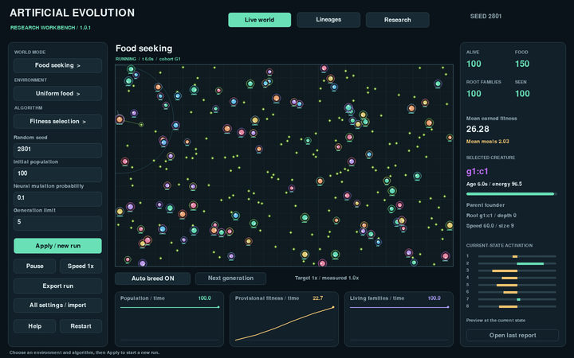](media/gallery/v1-original.jpg) | [](media/gallery/workbench.jpg) |
| The original Pygame workbench: circular agents, food, source controls and scientific plots. | The Godot workbench: skeletal animals and terrain alongside source controls, telemetry and plots. |
| [V1 user guide](../../docs/USER_GUIDE.md) · [5-second recording](media/gallery/v1-original.mp4) | [V2 user guide](USER_GUIDE.md) · [Interactive controls recording](media/gallery/controls.mp4) |

Both runs use foraging, uniform food, 100 founders, selection and seed **2801**. They were captured at different ticks: this compares interfaces, rather than providing a synchronized performance or fitness experiment. V1's files, behavior and documentation remain preserved.

```bash
# Run either version from the prepared repository root.
./.venv/bin/python simulator.py
./"v2/Run Artificial Evolution 2.command" -- --immersive --ground-view
```

## Landscapes and weather

| Forested valley | Winter scenery |
| --- | --- |
| [](media/gallery/valley.jpg) | [](media/gallery/winter-weather.jpg) |
| Valley camera, Lush quality: the bounded Python arena sits within a larger decorative landscape. | Manual winter colors and snow, at a decorative 13:00. This is ordinary foraging; the winter treatment does not change food or metabolism. |

[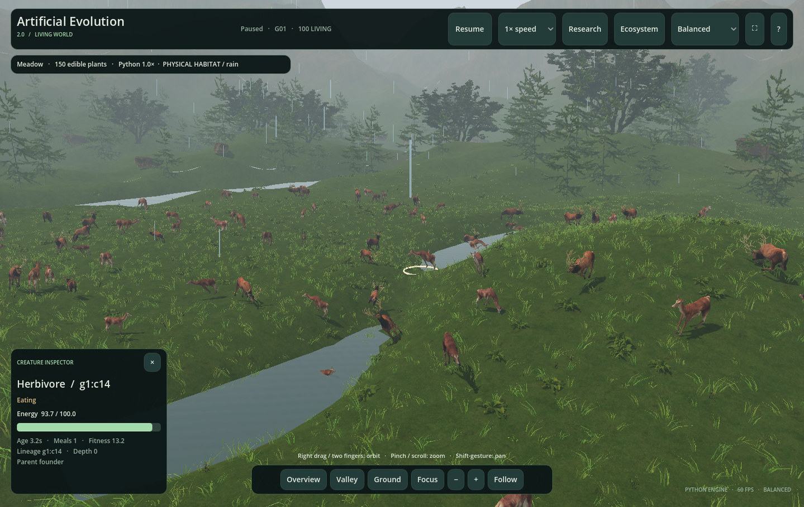](media/gallery/physical-habitat.jpg)

*Physical habitat enabled · automatic Python spring/rain/daylight · Balanced quality. Terrain, wading and climate costs belong to the recorded V2 extension. The demonstration uses a two-second weather period, shortened from the default 40 seconds; manual visual overrides are disabled.*

Grass, trees, flowers, rocks, mountains, water and atmospheric effects are visible in the running scene. In original-rule modes, landscape and weather remain decorative. In the opt-in habitat, only the [documented Python terrain, river and climate rules](PHYSICAL_HABITAT.md) affect creatures. See [environments](ENVIRONMENTS.md) for food layouts and the distinction between simulated seasons and seasonal colors.

## Animals in motion

### Follow an individual

[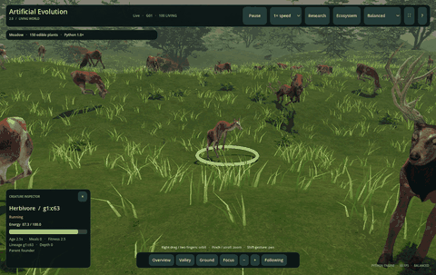](media/gallery/animal-follow.mp4)

*Three-second preview · [full five-second MP4](media/gallery/animal-follow.mp4) · [larger still](media/gallery/animal-follow.jpg). The selected deer is `g1:c63`. Running and turning follow measured movement; the follow camera tracks the same identity throughout.*

Detailed deer, antlers, wolves and coats are presentation choices over Python agents. These first-generation animals have randomly initialized neural controllers. Their movement is not a demonstration of a trained food-seeking strategy. Nearby skeletal animation and terrain foot IK are visible as implemented, including any residual slipping or imperfect contact.

### Predators and prey

[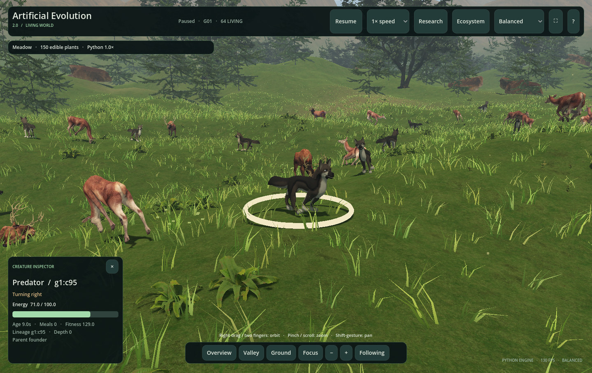](media/gallery/predator-prey.jpg)

*[Five-second MP4](media/gallery/predator-prey.mp4) · [animated preview](media/gallery/predator-prey.gif). A real wolf identity in the original-rule predator–prey model. The run starts with 20 predators and 80 prey; the exported endpoint records 36 captures and 36 deaths across the whole population.*

Hunting and escaping labels reflect directional observations from the engine, rather than a newly assigned Godot target. Capture/death effects require confirmed Python events. The recording does not imply that every population event happened in the camera's view. [Animation and event semantics →](ANIMALS_AND_ANIMATION.md#animation-evidence)

### Continuous births and growth

[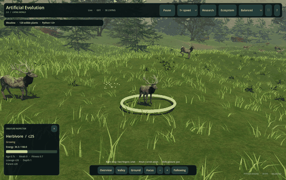](media/gallery/continuous.mp4)

*Three-second preview · [full six-second MP4](media/gallery/continuous.mp4) · [larger still](media/gallery/continuous.jpg). The follow camera tracks actual offspring `c25`, parent `c20`. Its recorded age increases from about 0.72 to 6.65 seconds during the full clip, and its visual growth scale increases from about 66% to 100%.*

This demonstration starts with 24 founders and uses six-second maturity, a four-second birth cooldown, 120 food capacity, regrowth of 60 food/second and a 60-creature cap. At export it has **18 actual offspring and three deaths**. Growth is a visual age treatment; Python's collision radius is already present at birth. These few seconds illustrate overlapping lifetimes, rather than establish long-term sustainability or an evolutionary arms race.

The captured continuous run observed eating, growing, reproduction and confirmed death states, as well as locomotion. The camera does not isolate every action. No poses or biological events were forced to make a showcase. [Full action reference →](CREATURE_ANIMATION.md)

## Explore and inspect

| Landscape controls | Research workbench |
| --- | --- |
| [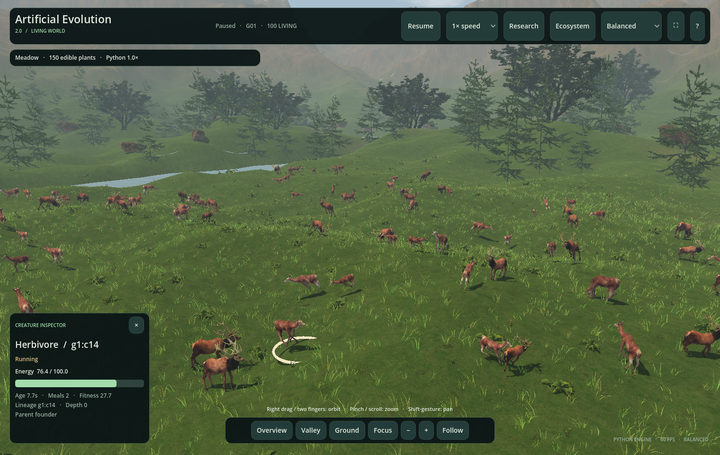](media/gallery/controls.jpg) | [](media/gallery/workbench.jpg) |
| Pause/speed at the top; camera presets, zoom and follow below; selected creature state at left. | Experiment configuration at left, live population/individual state at right and source curves below. |

[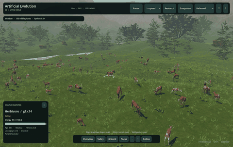](media/gallery/controls.mp4)

*Six-second controls demonstration: open **Ecosystem**, pause the actual Python session, scroll inside the drawer, close it and resume. Python is paused for approximately seconds 2–4; decorative vegetation can continue moving. The capture driver invokes the same application handlers rather than synthesizing pointer clicks.*

Try it yourself: click an animal, choose **Focus**, then **Follow**. Use **N** for Ecosystem, **Space** for pause/resume and **V** to switch landscape/workbench. [Complete controls and trackpad gestures →](USER_GUIDE.md)

## Seven simulation modes

Each image is a live Python run paused after warm-up for a readable screenshot. The larger images retain the whole viewport, including the actual controls and inspector. Generation two in the seasons and traits cases was reached through real reproduction at 20× during warm-up; those cases use 40 founders and return to 1× before capture.

| Mode and actual view | What the capture shows |
| --- | --- |
| [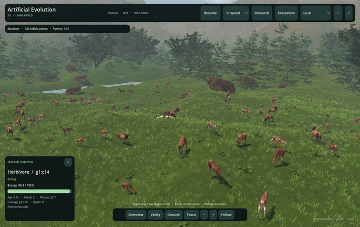](media/gallery/living-world.jpg)<br>**Food seeking** | 100 founders and 150 replenished food items. Selected neural controllers; no retraining or pretrained population is inserted. |
| [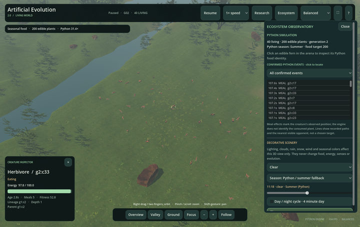](media/gallery/seasons.jpg)<br>**Changing seasons** | Generation 2, Python summer and 200 food items; the open drawer distinguishes the source season from decorative controls. |
| [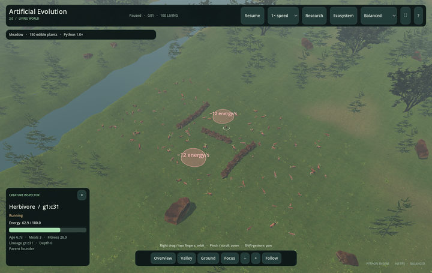](media/gallery/obstacles.jpg)<br>**Obstacles & hazards** | Source barrier and hazard geometry rendered in the arena. These hazards belong to the Python obstacle model and carry collision/damage rules. |
| [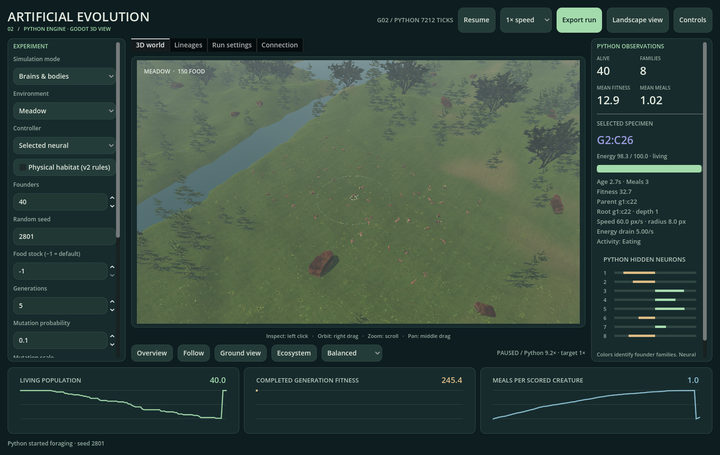](media/gallery/traits.jpg)<br>**Brains & bodies** | Generation 2, source curves and individual energy. The export confirms inherited body variation; a single image does not measure improvement. |
| [](media/gallery/predator-prey.jpg)<br>**Predator & prey** | Separate predator/prey populations, a selected wolf, observed hunting and confirmed population captures. |
| [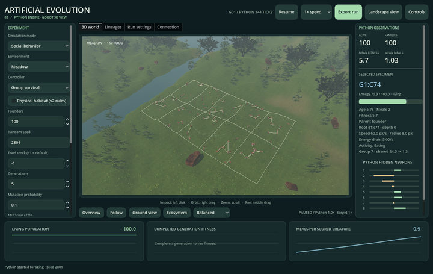](media/gallery/social.jpg)<br>**Social behavior** | 100 founders in ten groups, group boundaries and social telemetry. Visible grouping alone does not establish evolved cooperation. |
| [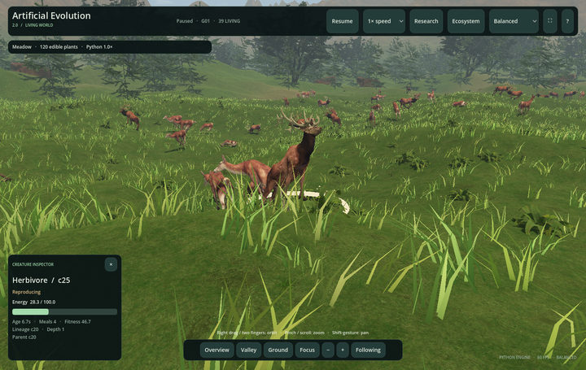](media/gallery/continuous.jpg)<br>**Continuous ecosystem** | Overlapping births/deaths, parent identity, ancestry depth and age-based visual growth. The world header can remain `G01` while individual lineages deepen. |

[Mode rules and algorithms →](SIMULATION_MODES.md) · [Evolution and brains →](EVOLUTION_AND_BRAINS.md) · [Research methods and limitations →](RESEARCH_AND_VALIDATION.md)

## Capture method and reproduction

The source application is based on commit [`e0760bf`](https://github.com/Maitham16/Artificial_Evolution/commit/e0760bfb91da63960350fb33142b5bcaad5314f3). V2 captures instantiate the real `scenes/main.tscn`, connect to the existing Python bridge and read the native Godot viewport on an Apple M3 using Godot 4.7.2 / Metal Mobile. They are source launches, rather than screenshots of a different installed release. V1 captures read the unchanged `ResearchApp` canvas in a native Pygame/Cocoa window. Headless/dummy-display capture is rejected.

The capture tools select real individuals and use application camera/control APIs. They do not write creature positions, weights, food contacts, survival outcomes or animation poses. Every capture's exported Python run passed its declared numerical replay: 13 original-rule runs and one physical-habitat run. All V2 captures reported zero observation-event gaps.

| Published asset | Processing |
| --- | --- |
| Larger screenshots | Full viewport, approximately 1440 px wide; progressive JPEG, quality 88 |
| Gallery thumbnails | Full viewport, up to 720 px wide; JPEG, quality 82 |
| GIF previews | 400–480 px wide, 128 colors, sampled at approximately 6 FPS; each below 2.5 MB |
| MP4 recordings | Full viewport, up to 1280 px wide; silent H.264; every captured frame at its measured timestamp |

Only resizing and compression are applied. There is no cropping, retouching, compositing, added annotation or generated/interpolated frame content. Original recordings target approximately **12 captured frames/second**; they are demonstrations, not 60 FPS rendering benchmarks. The [capture manifest](media/gallery/captures.json) records configurations, presentation settings, ticks, source-frame hashes, exported metrics, image/video hashes, dimensions and durations. Decoded video endpoints were checked against the actual source frames.

To capture a new gallery on a prepared Mac, run from the repository root with a native display and the existing Python/Godot toolchain. Video publishing also uses Apple's Swift compiler and AVFoundation; no extra Python packages are needed beyond the project's requirements. Lossless temporary frames require roughly 2 GB for this collection.

```bash
# Capture the real applications and verify/replay every exported run.
./.venv/bin/python -B v2/tools/capture_gallery.py \
  --raw .cache/documentation-media/new-capture

# Compress into a separate review directory before replacing published assets.
./.venv/bin/python -B v2/tools/publish_gallery.py \
  --raw .cache/documentation-media/new-capture \
  --output .cache/documentation-media/new-gallery
```

For a smaller capture, add `--cases animal-follow controls` to the first command. The publisher discovers completed cases from that directory. Timing, visible poses and the exact screenshot tick can differ between runs; seeded numerical replay verifies the exported simulation, rather than pixel-identical rendering. Raw frames and export bundles stay outside Git. The original engine, interface and V1 documentation are unchanged.

[Back to V2](../README.md) · [Documentation index](README.md) · [Install and launch](INSTALLATION.md)
