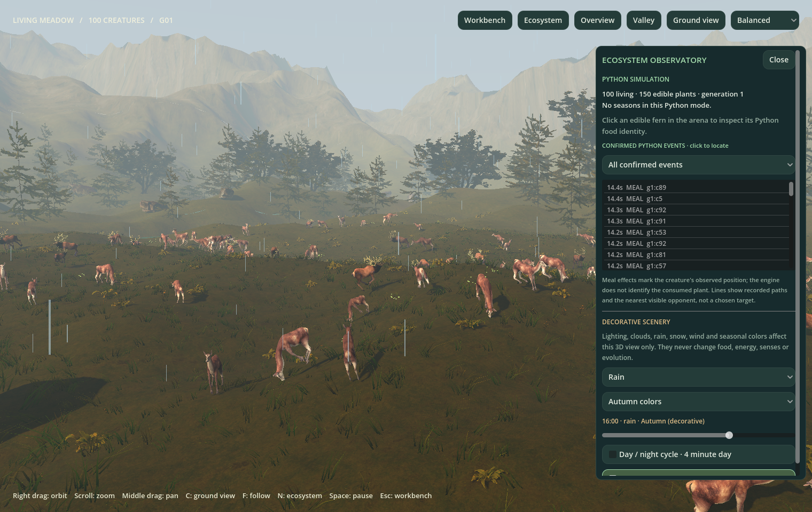

# Interactive ecosystem observatory

[Documentation](README.md) · [User guide](USER_GUIDE.md) · [Development](DEVELOPMENT.md)

The later [physical-habitat update](PHYSICAL_HABITAT.md) adds optional actual terrain/wading/climate effects and nearby foot IK. The decorative/source boundary described here remains the default original research mode.

The 3D view now combines the existing event-driven animal animation with edible plants, a clickable Python event journal, recorded movement trails, and a separate decorative environment director. Every change is under `v2/`; the original Python application and numerical engine remain unchanged.



## Try it

From the repository root:

```bash
./"v2/Run Artificial Evolution 2.command"
```

Choose **Landscape view**, then **Ground view** or **Valley**. Press **N** or click **Ecosystem** in either interface to open the observatory. Right drag orbits, middle drag pans, scroll zooms. Click an animal to inspect its Python identity, then press **F** to follow it. Click an edible fern in the arena to inspect its source food identity, energy and collision radius. Ornamental plants outside the simulation are not food.

The **Confirmed Python events** list locates a living participant, or the recorded observation position if it no longer lives. Its filter isolates births, reproduction, deaths, captures and season changes from frequent meals. It keeps the latest 256 receipts and shows at most 64 matching rows. Navigation never spawns animals or changes their decisions. Generation replacement is not shown as death.

Use **Predator & prey** to observe the original co-evolution engine; wolves follow Python movement and deer follow actual escape movement. Use **Changing seasons** for the original seasonal food schedule and moving clusters. Use **Continuous ecosystem** for funded simultaneous births and age-based visual growth. **Run settings → Load configuration → `v2/configs/animation_lifecycle.json` → Start new population** provides the existing small, productive reproduction demonstration. Its shorter maturity/cooldown and higher regrowth are explicit Python configuration choices, not guaranteed or scripted births. Other conditions can lead to extinction.

## What is simulated, and what is decoration?

| Display | Authoritative source / limits |
| --- | --- |
| Animal position, heading, speed, identity, energy, age and death | Existing Python creatures and fixed physics ticks; Godot interpolates poses only. |
| Eating animation and small leaf fragments | Actual increases in Python's meal counter. Fragment origin is the creature's observation position, not an asserted plant contact point. Several meals between observations may be one aggregated receipt. |
| Edible ferns | One instance per current Python food object, at its exact XZ position. Removal and replacement follow Python. Stable `fN` IDs are observer-local labels, not new engine data. Fern geometry, rotation, wind and a 0.35-second appearance easing are cosmetic. |
| Specific consumed plant | **Unknown:** the original engine exposes meal counters but no meal-to-food identity ledger. No nearest fern is falsely assigned to a meal. |
| Hunting / escaping animation | Actual movement and original toward/away opponent telemetry; no Godot steering or avoidance. |
| Captures | Confirmed Python capture counter and prey IDs from its capture ledger. Missing identities are left unknown. |
| Research lines in workbench | Recent source positions for the selected animal and nearest currently visible opponent. The connector uses the original sensor calculation; it does not identify an intended target. It is hidden in landscape mode. Hidden opponent-input interventions do not hide this display observation; it is not a statement about what the neural network receives. |
| Birth, reproduction, growth and death | Existing journal: continuous reproduction follows actual funded offspring; young bodies scale from real age/maturity. Three-second death remnants are presentation only. No mating, pregnancy, resurrection or extra collisions. |
| Python seasonal context | Actual `SeasonalWorld.environment_history`, food target, stock and cluster centers. The auto season follows this context; other modes use decorative summer. A season receipt records the observed transition, not every skipped generation. |
| Manual seasonal colors | Decorative override. The Python source season remains displayed separately and food does not change. |
| Day/night, moonlight, stars, clouds, rain, snow, fog, wet ground, frost, pollen and vegetation motion | **Original-rule default:** decorative; no source weather/daylight cost. In opt-in physical mode, auto climate follows the recorded Python model; manual effects remain decorative and snow does not hide food from Python. |

Python **Pause / Space** freezes physics and creature animation. **Scenery motion** independently pauses the decorative clock, wind, water and precipitation motion. Scenery may continue while Python is paused or disconnected; this does not represent continuing ecology. The **day/night cycle** checkbox controls its clock separately. The default decorative day lasts 240 wall-clock seconds. Automatic weather cycles clear, cloudy, rain (snow in visual winter), fog, clear in 55-second stages, with gradual precipitation/cloud transitions. The hour slider, weather menu and color overrides are view controls only.

In physical mode, auto weather/season and **Follow Python daylight** instead use the simulated climate, including pause and speed. Manual overrides still do not change that climate or its costs. See [physical rules](PHYSICAL_HABITAT.md) and [environment clocks](ENVIRONMENTS.md#weather-and-daynight-controls). Scroll inside the drawer for its lower controls; the current [pointer-routing fix](panel-input-validation/README.md) preserves input across view switches.

## Implementation

`backend/engine_bridge.py` passively reads existing food, seasonal history, captures and the original opponent perception. It neither advances extra decisions nor consumes engine randomness. Food identities hold references only to currently observed food, so a replacement at identical coordinates gets a new identity. Existing snapshot food rows and the original export/replay format remain available unchanged.

`python_state.gd` retains authoritative food and environment records alongside the existing interpolated creature poses and acknowledged event journal. `world_view.gd` draws actual food with the existing locally bundled CC0 fern scan, handles picking and event navigation, and bounds particle bursts and trails. `environment_director.gd` has no bridge command or simulation mutation capability; it updates lights, a low-resolution incremental sky, shader globals and quality-scaled local CPU particles. Wind/water share its independent visual clock. Sky/fog/light parameters update at 5 Hz, reflection intensity follows daylight, and rain/snow emit only when needed. The existing shared GPU bone animation and nearby skeleton limits remain in use.

No new external art or license dependencies were added. The existing [nature asset provenance](../assets/nature/ASSET_SOURCES.json) covers the food fern, and existing animal licenses still apply.

## Reproduce the view and checks

```bash
# Cosmetic overrides are deliberately separate from RunConfig:
./"v2/Run Artificial Evolution 2.command" -- \
  --immersive --ground-view --visual-weather=rain --visual-season=autumn \
  --visual-hour=16 --visual-cycle=off --ecosystem-panel

./v2/tools/test.sh
./.venv/bin/python -m unittest discover -v
python3 v2/tools/verify_original.py --all-existing

./v2/tools/build_macos.sh
./.venv/bin/python v2/tools/validate_ecosystem_macos.py
./.venv/bin/python v2/tools/validate_macos.py
```

Allowed visual weather values: `auto`, `clear`, `cloudy`, `rain`, `fog`, `snow`. Visual seasons: `auto`, `spring`, `summer`, `autumn`, `winter`. `--profile=/absolute/file.json` includes a separate `ecosystem.scenery` record identifying decorative weather/daylight, displayed season source, and the Python environment context. The original scientific `run.json` is not modified to include invented weather.

[Current validation evidence](ecosystem-validation/README.md) includes six signed-package native scenes and exact Python replay. The tests exercise food identity/replacement, exact capture participants, seasonal observations, original sensor visibility, all seven modes' scientific equivalence, picking, navigation, both interfaces and scenery controls against a live paused backend. These are local validations, not an independent scientific reproduction or a claim that visual realism adds intelligence.
