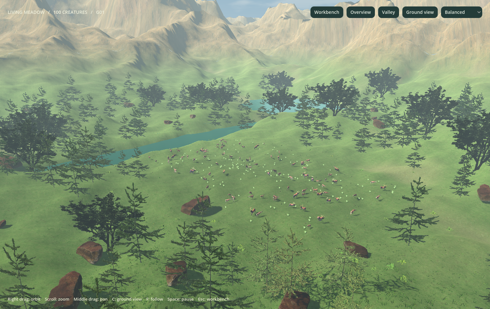

# Living landscape

Godot displays a rolling meadow surrounded by mixed woodland, a meandering river, a small lake and layered mountains. Scanned rocks, ferns and flowers supplement photographic ground materials. Grass blades, leaves and tree crowns move in shader-driven wind. A cloud sky, warm directional sunlight, cascaded shadows, a static reflection capture and distance haze provide outdoor lighting.




## Explore

Start `v2/Run Artificial Evolution 2.command`. Click **Landscape view** or press **V** to expand the existing simulation viewport. **Valley** frames the river and surrounding hills; **Ground view** / **C** takes the camera into the meadow. **Overview** / **R** fits the Python arena. **F** follows the selected creature. Right drag orbits, middle drag pans and the scroll wheel zooms. Camera movement eases smoothly even while Python is paused. The camera stays above the display terrain. **Esc** or **Workbench** restores the research interface. Research sensor rings and social group guides are hidden in landscape view.

Select **Performance**, **Balanced** or **Lush** in either view. This changes vegetation density and shadow distance. It does not restart or reconfigure Python. Existing research controls, live lineage visualization, exports and all seven original simulation modes remain available.

A reproducible view capture from the repository root:

```bash
./"v2/Run Artificial Evolution 2.command" -- --frames=360 --immersive \
  --valley-view --quality=1 --screenshot=/tmp/ae-valley.png \
  --profile=/tmp/ae-valley-profile.json --no-auto-save
```

Replace `--valley-view` with `--ground-view` for the meadow. Capture paths must be absolute. Frame timings exclude the first 90 displayed frames; they include Python communication and the visible interface. They are local measurements, not cross-platform guarantees.

## Scientific boundary

The original Python engine, bridge and Python tests are unchanged. Python continues to own every creature's 2D position, movement, energy, food, perception, reproduction, evolution and interactions. Godot maps Python X/Y to world X/Z at 20 pixels per metre. Only visual Y-height, slope alignment and cosmetic animal poses are added. Food uses the same height function. Picking intersects each animal’s display bounds and selects the original creature identity.

Terrain, river, lake, trees, flowers and rocks are **scenery**. They add no collision objects, obstacles, food, costs or resources to Python. Creatures do not learn mountain climbing, swimming or plant avoidance from this view. Python's actual barrier extents and hazard radii are retained; scanned stones depict barriers and terrain-conforming overlays show hazards. These remain the existing Python interactions.

Scenery uses its own fixed noise and scatter seeds, independent of all Python random generators. Arena dimensions invalidate the landscape cache; ordinary snapshots and generations do not. Quality changes rebuild only that cache. Re-rendering a paused session and changing cameras, quality and immersive layout are tested to leave Python's report unchanged.

## Rendering budgets

| Profile | Forest trees | Attempted grass clumps | Flower placements | Shadow distance |
| --- | ---: | ---: | ---: | ---: |
| Performance | 222 | 14,000 | 160 | 75 m |
| Balanced | 398 | 30,000 | 500 | 105 m |
| Lush | 615 | 52,000 | 800 | 130 m |

Water, slopes and placement masks reject some plants; the profile JSON records actual counts. Grass is seven curved, tapered blades per clump, instanced in 16 m chunks. It has no shadows and shrinks into the ground between 28–55 m. Other plants use 32 m chunks and distance culling. Textures use mipmaps and GPU compression to reduce aliasing and bandwidth.

Four conifers and one broadleaf tree near the camera-facing clearing retain detailed 3D meshes and cast shadows. Other forest trees use alpha-cutout, camera-facing images baked from the full original scans in Blender. This avoids rendering hundreds of dense scan meshes. These background crowns have baked lighting and no dynamic shadow; close inspection from every direction is less accurate than the hero meshes. Historical landscape profiles with the former placeholders are recorded in [nature-validation](nature-validation/README.md); current animal measurements are in [animal-validation](animal-validation/README.md).

Terrain uses three mesh resolutions, with the finest geometry near creatures. The river surface is shaded with small moving ripples; one reflection probe captures scenery once per landscape build and affects only the water. The static cloud sky avoids continuous reflection-cubemap updates. Screen-space reflection, dynamic global illumination and volumetric fog are not required by the Compatibility renderer.

## Art sources and authoring

The runtime is offline. All required art is committed under `v2/assets/nature/`. Sources are [CC0 Poly Haven assets](https://polyhaven.com/license); attribution, download hashes and derived asset hashes are in [ASSET_SOURCES.json](../assets/nature/ASSET_SOURCES.json) and [the asset license](../assets/nature/LICENSE.md).

```bash
# Verify committed runtime assets without network access:
python3 v2/tools/fetch_nature_assets.py --verify-runtime

# Optional: fetch checksum-pinned original scans into ignored .cache/nature/:
python3 v2/tools/fetch_nature_assets.py

# Regenerate optimized meshes and tree images; Blender is authoring-only:
/Applications/Blender.app/Contents/MacOS/Blender --background --python v2/tools/prepare_nature_assets.py
/Applications/Blender.app/Contents/MacOS/Blender --background --python v2/tools/bake_forest_impostors.py
```

Regeneration overwrites derived art. Blender versions, decimation and render settings can change output hashes; review regenerated assets and update `runtime_files` in the provenance manifest deliberately. Keep texture `.import` settings (including mipmaps) with the art. Raw scans, Blender caches and exported builds remain outside Git.
