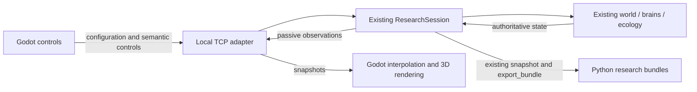

# Python–Godot connection

The active simulation is the existing root `research_session.ResearchSession`. The 3D application is an observer and controller of a separate Python process. No root implementation file was modified.

`backend/engine_bridge.py` imports the original Python classes and export functions using the repository root. `EngineAdapter.frame` reads actual creature objects, food, dimensions, hazards, group bounds, neural previews, metrics, and the birth ledger. `ResearchSession.update`, `step`, `advance`, and `set_control` perform every simulation change. `ResearchSession.snapshot` and `export_bundle` provide the established scientific data and replay contract.

`python_bridge.gd` starts the configured interpreter, reads a private endpoint file, authenticates a loopback TCP connection, and handles partial reads/writes without blocking Godot's render loop. It sends configuration and control requests, not creature poses. A single Python thread owns all mutable session state; a worker writes copied export reports/genomes using the original exporter.

`python_state.gd` stores received authority separately from a bounded presentation buffer. It maps coordinates at 20 Python pixels per Godot unit and samples two snapshots at a 100 ms delay. Heading interpolation follows the shortest angle. The display clamps to the newest available pose when packets stop; it never extrapolates additional simulation. Dead or retired actors disappear, new lifetimes snap to their Python positions, and a stream/time guard rejects stale snapshots across cohort/run changes. Only the presentation transforms are interpolated. Godot does not advance age, energy, food, fitness, sensors, or genetics.

## Protocol 1

The protocol is UTF-8 JSON delimited by newlines. The server binds an ephemeral port on `127.0.0.1`; its endpoint JSON contains the port, protocol, PID, and random token and is created atomically with mode 0600. The first command is `hello` with the protocol and token. No server is exposed on the external network.

Requests contain `id`, `cmd`, and parameters. Replies contain `type=response`, the matching `id`, and `ok`; errors retain the current session. Supported commands are `configure`, `validate_config`, `control`, `advance`, `step` (paused only), `select`, `state`, `export`, `shutdown`, `ping`, and birth-ledger acknowledgement `seen`. Large seeds can travel as exact `seed_text` or within unparsed `config_json`, avoiding Godot JSON's floating-point integer limit. Only Python validates experiment configurations.

Frames contain a stream ID, increasing sequence, server wall time, run identity, physics ticks, engine configuration, live/selected bodies, food, geometry, metrics, selected neural activity, recent sharing edges, and incremental ancestry. Birth entries are repeated until acknowledged. Charts update at sampling/cohort boundaries. A pending unsent frame can be superseded; its unsent chart update is carried forward. An in-flight frame is never truncated, and command replies are retained. Frame queues and message sizes are bounded.

New-run configuration clears obsolete queued presentation frames. A previous run is snapshotted and exported before replacement; an archive error retains it. Export data are copied on the simulation thread and written by one worker, so exporting never reads concurrently mutating creature objects. The UI remains responsive and sends heartbeats while exports finish. A disconnect pauses Python and allows a connection to the same process to resume safely. A new process requires a new session; this bridge does not invent an arbitrary resume checkpoint from display data.

Normal closure requests shutdown, pauses Python, saves the changed run, waits for its acknowledgement, and closes the connection. A save failure leaves the run paused for correction. An owner-PID check stops an orphan process after attempting to save. Finder launches may wait for macOS Desktop-folder approval before Python can initialize a Desktop-based virtual environment. Startup keeps polling rather than treating a delayed privacy prompt as a permanent failure. The exported app includes `NSDesktopFolderUsageDescription`, and closing an uninitialized viewer terminates its blocked child process.

The automatic-save bypass exists for disposable test sessions and is not used by regular launches.

## Preservation and reproducibility

The original baseline remains `f890b4f481a6659714dfae70e11f5b34f19a86f3`; the initial 3D prototype was commit `81782f1`. This connection replaces that prototype's GDScript simulation, brain, transfer checker, and exporter with the Python adapter. Existing research algorithms and results remain in the root Python application. Current exports are ordinary Python bundles verified and replayed by `simulator.py`.

The existing Graphify map guided the session boundary: ResearchSession (`research_session.py:229`), its step method (`:319`), and snapshot (`:380`) connect the numerical engine to the separate ResearchApp. The query used existing vocabulary: research, session, world, snapshot, sensory, export, control, step. It was checked against the actual source. The historical graph's unresolved edges remain documented in the original inspection; no graph edge substitutes for the direct-state parity tests.

[StreamPeerTCP](https://docs.godotengine.org/en/stable/classes/class_streampeertcp.html), [Godot OS process APIs](https://docs.godotengine.org/en/stable/classes/class_os.html), and Python [selectors](https://docs.python.org/3/library/selectors.html) supply transport/process primitives. They do not supply replacement model logic. See [current validation](bridge-validation/README.md) for tests and limitations.

## Interactive ecosystem observations

The [ecosystem observatory](INTERACTIVE_ECOSYSTEM.md) adds current food records with stable observer IDs, exact seasonal history, confirmed capture participants and passive nearest-visible-opponent observations. The original `food` rows and numerical state remain unchanged. Cosmetic settings live only in Godot; they are not Python configuration fields or commands. `environment_director.gd` cannot send simulation commands. See [current ecosystem validation](ecosystem-validation/README.md) for native scene profiles and preservation checks.

## Standalone desktop payload

The current [desktop application](DESKTOP_APP.md) bundles a relocatable interpreter, pinned dependencies and byte-for-byte original source/preset copies. Exported launches prefer that payload; source launches keep the original `.venv`. Remembered development settings are saved atomically and are never truncated or replaced by bundled launches. See [runtime provenance](BUNDLED_RUNTIME.md) and [current standalone validation](desktop-validation/README.md).

## Optional physical habitat

`habitat.py` subclasses the original session and wraps its existing creature survival/move methods only when the explicit v2 option is enabled. It records a deterministic heightfield, climate and physical-cost/contact ledger, with its own declared export/replay. The original session is used unchanged when disabled. [Rules and replay](PHYSICAL_HABITAT.md), [current validation](habitat-validation/README.md).
