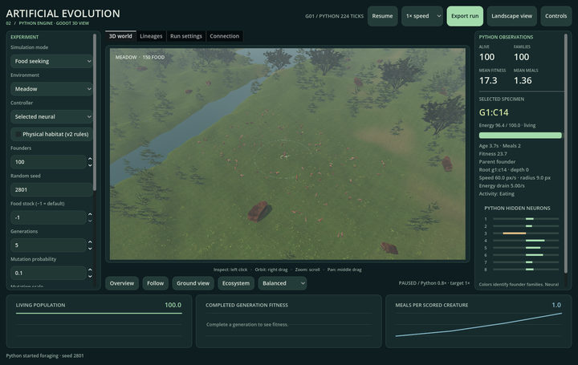

# User guide

[Documentation](README.md) · [Installation](INSTALLATION.md) · [Modes](SIMULATION_MODES.md) · [Settings](CONFIGURATION.md)

V2 offers an immersive animal landscape and a research workbench over the same Python session. Switching views changes presentation, not the experiment.

*Actual application capture. [Watch the Ecosystem drawer, scrolling and pause/resume demonstration](GALLERY.md#explore-and-inspect).*

## A first session

Open **Artificial Evolution 2.0.app** from `~/Applications`. Wait for **PYTHON ENGINE** and a living population. The header shows run state, generation and living count; the badge below shows environment, edible plants and measured Python rate.

Choose **Ground** for a low meadow view or **Overview** to frame the active arena. Click an animal, choose **Focus**, then **Follow**. The inspector shows its exact Python ID and current state. The animal model is an illustration of that agent, not an additional physics object.

Open **Research** to choose a different experiment. Settings remain pending until **Start new population**. The previous run is normally archived before replacement. If configuration or archiving fails, read the status message; the old run remains available.

## Views and panels

| Surface | Purpose |
| --- | --- |
| Immersive landscape | Full-window 3D, population header, pause/speed, cameras and specimen inspector |
| Research workbench | Model settings, source telemetry, live curves and four center tabs |
| **3D world** tab | Bounded arena, scientific sensor/group guides and same animals |
| **Lineages** tab | Largest 12 living founder families over the last eight ancestry generations |
| **Run settings** tab | Presets and complete original Python RunConfig JSON |
| **Connection** tab | Engine location, interpreter, connection/recovery and independent original 2D launch |
| **Ecosystem** drawer | Python environment summary, edible-plant inspection, confirmed events and scenery overrides |

**Research** in V2 is the workbench button. V1's study catalog is a separate interface; open **Connection → Open original 2D** for its full study launcher. V2's live plots do not launch controlled multi-seed experiments.

## Camera controls

| Action | Input |
| --- | --- |
| Orbit | Right mouse drag, or two-finger pan gesture over the landscape |
| Pan | Middle mouse drag, or Shift + two-finger gesture |
| Zoom | Mouse wheel, trackpad pinch, or **− / +** |
| Select | Left click an animal's displayed bounds |
| Focus selection | Double click, **Focus**, or **I** |
| Follow selection | **Follow** / **F**; click again to stop |
| Arena overview | **Overview** / **R** |
| River/landscape framing | **Valley** |
| Low meadow camera | **Ground** / **C** |
| Fullscreen | **⛶** or Ctrl/Cmd + Enter |

Cameras ease toward their target; pitch, zoom and terrain clearance are bounded. Focus frames the current selection at a close distance. Panning releases follow. Follow stops when the selected actor becomes inactive; it does not silently switch to a different creature. Camera movement remains available while Python is paused.

There is no first-person walking, WASD movement or animal possession. Perspective picking uses display bounds; antlers and tails can extend beyond the original circular Python collision body.

## Simulation and interface controls

| Action | Input / location |
| --- | --- |
| Pause / resume | **Space** or **Pause / Resume** |
| Target simulation speed | **1× / 5× / 20×** menu |
| Switch landscape / workbench | **V**, **Research**, **Landscape view** |
| Return from immersive to Research | **Esc** |
| Open / close Ecosystem | **N**, **Ecosystem**, drawer **Close** |
| Export | **E** or workbench **Export run** |
| Show help | **?** / **Controls** |
| Toggle automatic breeding/births | Research sidebar **Automatic reproduction** |
| Advance a completed cohort | Research sidebar **Next generation** |
| Advance exactly one fixed tick | Pause, then **Single physics tick** |
| Start changed settings | **Start new population** |

Typing into a LineEdit/TextEdit takes priority over shortcuts. **Esc** is not V1's general close/quit shortcut in this application. Use window close for normal shutdown and automatic archiving.

The target speed requests simulated seconds per wall second. **Python …×** reports the achieved rate; FPS measures rendering separately. Fixed ticks remain `1/60 s` even when a slow computer cannot reach 20×. Pausing freezes creature motion/animation. Decorative wind and lighting can continue unless scenery motion is disabled; physical auto climate follows paused Python time.

## Creature inspection

Left-click a visible animal. The landscape inspector shows species/appearance label, ID, observed activity, energy/capacity, age, meals, earned fitness, parent, founder root and ancestry depth. **×** hides the card; clicking an animal reopens it.

The workbench adds speed, radius, total energy drain and an eight-neuron preview. Mode-specific observations include hazard loss/exposure, predator captures, shared energy, group ID and continuous children. Physical mode adds water depth, extra habitat energy and blocked terrain contacts.

Read these fields carefully:

- `g3:c17` means actor 17 in synchronized generation 3. `c17` in continuous mode is a globally unique birth ID for that run.
- Founder roots are genealogical labels. Family colors, coat tint and antler choices do not define biological species or sex.
- Neural bars are Python's current-state hidden-neuron preview, not a recording of the decision on the preceding tick.
- An activity such as **Hunting** is a descriptive visualization of source movement/counters, not a new neural state or proof of intention.
- An alive animal retired at an episode boundary is censored, not biologically dead.

See [animals](ANIMALS_AND_ANIMATION.md) and [measurements](RESEARCH_AND_VALIDATION.md) for the exact semantics.

## Edible plants and event navigation

Current Python Food objects appear as edible ferns inside the arena. Click one to see its observer food ID, energy and radius in Ecosystem. Many other plants are decorative; clicking arbitrary grass or a forest fern does not make it a Python resource.

The event filter offers all confirmed events, births/deaths/captures/seasons, or meals. Click a row to focus its recorded location and participant when available. Event receipts are bounded and observational:

- A meal requires a real meal-counter increase. Its effect marks the creature's observed position; the source engine does not identify the exact consumed food object.
- Captures use confirmed Python participants where available. Nearest-opponent lines show observations, not chosen neural targets.
- A continuous birth uses a real child/parent ledger record. Synchronized cohort replacement is a different event.
- Missing history is recorded as a journal gap; the renderer does not invent intervening actions.

Scroll within the drawer to reach weather, season, hour, day/night and scenery-motion controls. The event list has its own scrolling region. Over-panel gestures operate UI rather than orbit/zoom; over-landscape gestures operate the camera. The [input regression](panel-input-validation/README.md) covers repeated view switches.

## Choose and apply an experiment

In Research, select the mode first; this rebuilds valid environment/controller choices. Set founders, seed, food stock, generations and mutation settings. `−1` food stock means the environment default (`null` in JSON). Choose **Start new population** once ready.

For more settings, open **Run settings**. Selecting a preset or **Load configuration** loads a validated draft. **Start new population** applies the draft and physical-habitat checkbox. **Apply JSON configuration** immediately starts an original-rule run; it currently does not forward the physical-habitat checkbox. For a physical run, load/validate your JSON draft and use **Start new population**, or launch with `--config=… --habitat`.

There is no arbitrary neural-weight import button. Loading `config.json` starts fresh configured founders; it does not restore the exported population or resume a saved lifetime. [Replay](EXPORTS_AND_REPLAY.md) reconstructs the saved run through its declared engine.

## Automatic and manual reproduction

With **Automatic reproduction** enabled, a completed generational cohort advances until its configured generation budget or model-specific termination. Disable it to inspect the final cohort and choose **Next generation** manually when eligible. It cannot breed an incomplete cohort or advance beyond the budget.

In **Continuous ecosystem**, the same checkbox enables/disables ongoing funded births. There is no synchronized next generation. Animals continue consuming energy, moving and dying when births are disabled and Python is running. Persistence depends on food and costs; extinction is a valid outcome.

## Save, recover and close

Press **E** or **Export run**, then **Open export folder**. Exports go to `~/Library/Application Support/ArtificialEvolution2/python-runs/`; the bundle contains a local HTML report. See [export/replay](EXPORTS_AND_REPLAY.md) before moving individual files.

If Python disconnects, displayed poses freeze and Python pauses when it detects the lost viewer. **Connection → Reconnect** preserves the session only if its process is still alive. A terminated process loses unsaved memory; there is no automatic population restoration from a configuration alone.

Normal window closure waits for a changed run's export. If saving fails, resolve disk/path errors while the app remains open and paused. The backend also attempts an archive after unexpected owner-process exit; this is a best-effort recovery, not a substitute for explicit exports.

Next: [Simulation modes](SIMULATION_MODES.md) or [Troubleshooting](TROUBLESHOOTING.md).
