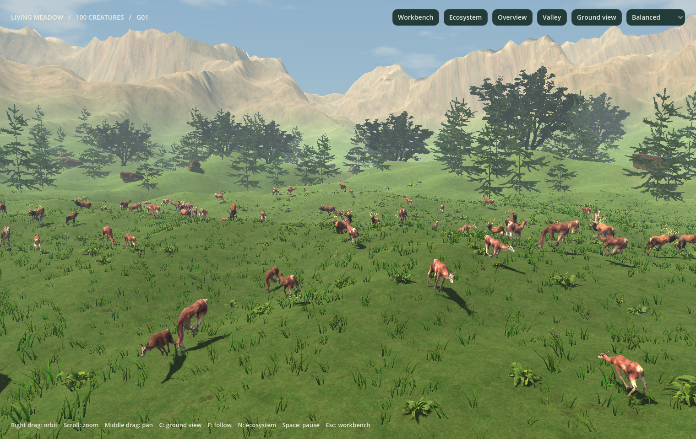

# Interactive ecosystem validation — 27 October 2026

The original Python numerical engine and all root files remain unchanged. The update is confined to `v2/`, combining passive Python observations, existing animal animation, food rendering, interaction and explicitly decorative weather/lighting.

| Check | Result | Evidence |
| --- | --- | --- |
| Original regression suite | **431 tests passed**, 114.478 s | [Original log](original-tests.log) |
| Original preservation | **1,241 original files / 591 tracked unchanged** | [Hash report](preservation.json) |
| Adapter / TCP / ecosystem observations | **34 tests passed** | [v2 tests](v2-tests.log) |
| Snapshot and interpolation | **18 checks passed** | [v2 tests](v2-tests.log) |
| Original v2 interface | **40 checks passed** | [v2 tests](v2-tests.log) |
| Skeletal animation and life events | **28 + 8 checks passed** | [v2 tests](v2-tests.log) |
| Ecosystem interaction and separation | **33 checks passed** | [v2 tests](v2-tests.log) |
| Fresh signed ZIP extraction | Six native visual cases; each original export verified and replayed exactly | [Package profiles](packaged-ecosystem.json) |
| All original simulation modes | Seven native renders, exports, manifest checks and exact replays; original CLI verify/replay passed | [Native log](all-modes-package.log), [mode records](../bridge-validation/packaged-macos.json) |
| Installed desktop app | Updated from signed ZIP and launched using saved engine paths, with no terminal path overrides | [Install log](installed-app.log) |
| Existing licensed art | 50 animal/runtime/editable files and 41 nature files verified with existing manifests | Existing checksum-verification tools |

The v2 total is **161 Python tests and Godot checks**, separate from the 431 original tests. All seven modes are compared against direct original-engine sessions at matched ticks. Additional observer tests check stable food identity, replacement at identical coordinates, no food mutation, exact capture participants, exact seasonal context and original opponent sensor visibility. Rendering controls are exercised against a live paused Python backend and compared against its full scientific state. Food picking, real meal-event filtering/navigation, scenery menu signals, day/night, precipitation, motion freeze, seasonal source labels and both interface layouts are covered.

## Native visual results



| Case | Python ticks | Mean FPS | Observed source events |
| --- | ---: | ---: | --- |
| Meadow day | 896 | 40.3 | 459 meals |
| Autumn rain | 869 | 38.9 | 444 meals; autumn is a decorative override |
| Predator–prey night | 549 | 73.4 | 36 captures, 36 deaths, 169 meals |
| Winter snow | 863 | 39.2 | 440 meals; winter/snow are decorative overrides |
| Python spring / fog | 794 | 43.0 | Actual spring food context, 310 meals; fog is decorative |
| Continuous reproduction | 746 | 46.0 | 31 births/reproductions, 11 deaths, 117 meals; growing state observed |

See [rain](../screenshots/ecosystem-autumn-rain.png), [night](../screenshots/ecosystem-predators-night.png), [snow](../screenshots/ecosystem-winter-snow.png), [Python spring](../screenshots/ecosystem-python-spring.png) and [continuous births](../screenshots/ecosystem-continuous-births.png).

These were six sequential runs of the actual ad-hoc signed universal Mac ZIP, freshly extracted outside the checkout, on this Apple M3. Each case displayed 480 frames at Balanced quality; the first 90 frames were excluded from timing. Real populations and wall-clock Python progress vary across cases, especially after predation, so these are rendering measurements rather than matched scientific comparisons. No feeding, births, deaths or captures were forced in these native runs. Every case had zero journal gaps. Each original bundle manifest passed and the original engine replayed its authoritative report exactly.

The `*-run.json`, `*-config.json` and `*-manifest.json` files retain source evidence from those temporary exports. These three copied records are **not standalone full export bundles**: the validator checked the complete bundles before deleting its temporary directory. Run the validator again to regenerate exports; the seven-mode validator retains full bundles under ignored `v2/build/bridge-validation/`. Visual settings and their decorative/source labels are in the separate package profiles, not fabricated as Python scientific telemetry.

This is local implementation validation, not independent replication. Only arm64 was executed; x86_64 execution, Apple notarization and manual operating-system mouse/keyboard QA are not claimed. Programmatic Godot controls and native rendered output were checked. Finder access to the Desktop repository remains subject to the Mac's existing privacy permission; installed-binary launch using saved engine paths passed.

## Reproduce

```bash
./v2/tools/test.sh
./.venv/bin/python -m unittest discover -v
python3 v2/tools/verify_original.py --all-existing
python3 v2/tools/fetch_animal_assets.py --verify-runtime
python3 v2/tools/fetch_nature_assets.py --verify-runtime
./v2/tools/build_macos.sh
./.venv/bin/python v2/tools/validate_ecosystem_macos.py
./.venv/bin/python v2/tools/validate_macos.py
```

On another checkout omit `--all-existing`, which also checks this Mac's pre-existing local experiment files. The code, checks and scene/source boundaries are explained in [Interactive ecosystem](../INTERACTIVE_ECOSYSTEM.md).
