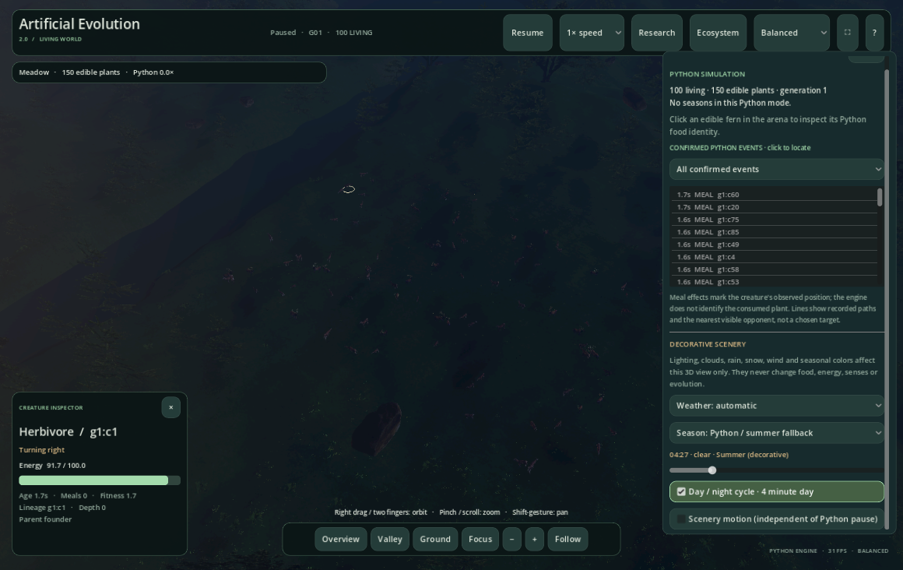

# Ecosystem panel input fix — 27 October 2026

The Ecosystem panel was visible above the immersive landscape but could not receive clicks or scrolling. The immersive viewport was inserted later in the scene tree and received pointer events first. Godot's [drawing Z index does not determine GUI input order](https://docs.godotengine.org/en/stable/classes/class_canvasitem.html#class-canvasitem-property-z-index).

The panel now stays last in its parent's child order after switching between Research and immersive views. This fixes Close, wheel and Mac trackpad scrolling, scrollbar dragging, dropdown opening, sliders and checkboxes. Uncovered landscape still accepts camera input. No Python engine rules or original 2D files changed.

## Verification

- The initial routed-input fixture reproduced **8 failures out of 12 checks** before the fix: [before-fix log](before-fix.log).
- The final full v2 suite passes **49 Python tests and 235 Godot checks**, including **17 pointer-input regression checks**: [suite log](v2-tests.log).
- Four native Metal GUI runs pass **17 checks each**, covering original and physical habitats at 1520 × 960 and 1160 × 760: [package record](packaged-panel-input.json).
- The fixture dispatches mouse buttons, wheel events, trackpad pan gestures and drags through the viewport. It does not emit button/menu signals to bypass hit testing. It checks paused Python state preservation and repeated view switches.
- Native pointer tests use the exact exported UI pack, the native Godot editor executable and bundled Python. Release templates do not expose `--script`; these are not claimed as injected script tests in the release executable or manual hardware input tests.
- The separately launched signed release executable connects to its bundled engine and captures the Ecosystem panel without development overrides: [release smoke log](release-smoke.log).
- **1,241 original files / 591 tracked files remain unchanged**: [preservation](preservation.json). The original Python suite was not rerun for this presentation-only fix; the preceding [habitat audit](../habitat-validation/README.md) records its 431 passing tests.



The [installed one-click launch](installed-launch.json) and signature check passed. The signed ZIP was rebuilt and installed in `~/Applications/Artificial Evolution 2.0.app`. The [package record](packaged-panel-input.json) identifies the tested archive hash. Earlier audits retain their own archive hashes and results.

## Reproduce

```bash
./v2/tools/test.sh
./v2/tools/build_macos.sh
python3 v2/tools/validate_panel_input_macos.py
python3 v2/tools/install_macos.py
./"v2/Launch 3D Application.command" --ecosystem-panel
```

The native validator requires Godot at `/Applications/Godot.app`, or a `GODOT_BIN` override. It extracts the actual ZIP outside the repository and denies reads from the checkout and Homebrew while testing. Test images and package logs retain the expected distinction between decorative settings and Python-controlled habitat behavior.
