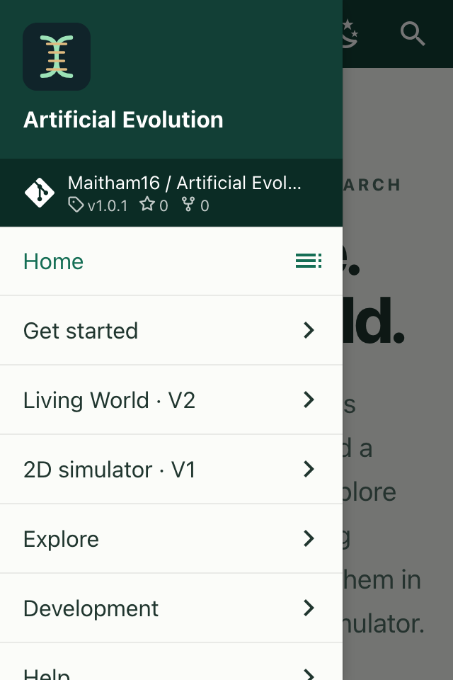
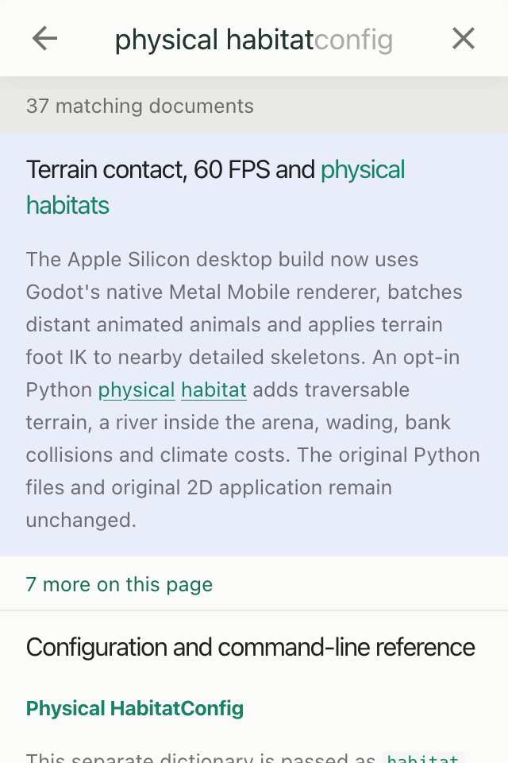

# Documentation and website audit

Audit date: **28 October 2026**. Application baseline: `358a2409855ac5882beb88ebc956834ec1de979c`. This work changes documentation and website validation only. It does not re-evaluate the scientific claims of every historical experiment.

The production website is **[maitham16.github.io/Artificial_Evolution](https://maitham16.github.io/Artificial_Evolution/)**. Its [XML sitemap](https://maitham16.github.io/Artificial_Evolution/sitemap.xml) is public. Search-engine indexing is **unverified**: no authenticated Google Search Console or Bing Webmaster Tools evidence was inspected.

## Findings and corrections

The gallery manifest described a V1 animation preview that the publication hook omitted because it was not embedded in Markdown. Its published `assets/gallery/v1-original.gif` URL returned 404. The hook now publishes every manifest output. The deployment checker requires all **38 gallery files** and verifies their SHA-256 hashes, including files that no page embeds.

The complete source link audit passed: **46 Markdown files, 706 relative links and 70 anchors**. It also checked syntax for 145 shell examples, one Python example and one JSON example; loaded three example configurations; and checked coverage of all 33 `RunConfig` and 10 `HabitatConfig` fields. Website-authored pages use generated routes and are checked against the strict MkDocs build instead.

External checks verified **188 repository file/directory paths** against tracked source and reached **55 external URLs**. The Pygame GettingStarted endpoint returned HTTP 502 and remains unverified; it was not classified as a missing page. HTTP reachability does not validate every assertion or fragment on an external site. Full observations are in the [machine-readable evidence](../assets/audit/2026-10-28/evidence.json).

## Website coverage

The final strict build contains **54 content pages**, with **5,958 local link/resource checks** and **461 search entries**. All content pages are reachable from the homepage. The website checker validates local links, HTML anchors, images, video posters, scripts and styles; homepage reachability; unique descriptive titles; descriptions; image alt attributes; canonical and social URLs; social-card dimensions; sitemap coverage; search content; and the hashes of **42 imported documentation sources**. A missing-gallery-file regression check exercises the new failure path.

All **14 real application capture bundles** passed integrity verification and numerical replay: 13 original-rule captures and one physical-habitat capture. The 38 gallery outputs passed size and hash checks, and every JPEG/GIF frame decoded. The social card matches its recorded actual-screenshot provenance. These checks preserve capture authenticity and replay results; they are not a new rendering benchmark.

### Responsive navigation

Firefox's responsive preview was exercised at **320 × 480 CSS pixels, device-pixel ratio 2**. The homepage remained readable; the drawer opened and its V2 link navigated successfully; search for `physical habitat` returned 37 documents; and a result opened the physical-habitat guide. Standard desktop browser loading and navigation were also inspected. This is responsive emulation, not physical-device or comprehensive accessibility certification.

| Homepage | Navigation | Search |
| --- | --- | --- |
|  |  |  |

These are unretouched browser viewport captures, not generated mockups. Their 640 × 960 PNG dimensions reflect the 2× pixel ratio.

## Application preservation and tests

| Check | Result |
| --- | --- |
| Original Python suite | **431 tests passed**, 114.877 seconds |
| V2 Python suite | **58 tests passed** |
| V2 Godot validation | **235 checks passed**, zero reported failures |
| Original file preservation | **1,241 existing local files** checked, including 591 original tracked files |
| Original V1 README | Verbatim archive retained; SHA-256 `d10768713ab30fe988b101a7686ab60fe39174d82eb82cc093507b9d615ccef2` |

Working-tree hashes were recorded before the audit. Application, engine, scene, model and runtime files retain those bytes; ten already-modified Godot import records are outside this change and were preserved. Neither V1 nor V2 receives a functional change.

The existing Linux/macOS test workflow for the baseline passed in [run 40608048333](https://github.com/Maitham16/Artificial_Evolution/actions/runs/40608048333). Its successful [Pages run 40608048323](https://github.com/Maitham16/Artificial_Evolution/actions/runs/40608048323) established the deployed baseline. Subsequent publication is visible in [Documentation website runs](https://github.com/Maitham16/Artificial_Evolution/actions/workflows/pages.yml).

## Deployment and search visibility

GitHub Pages is configured for **GitHub Actions**, HTTPS enforced, at the project URL above. The workflow builds with pinned dependencies, checks original-source preservation, builds in strict mode and runs the website validator before uploading its artifact. Only `master` deploys; pull-request builds have no Pages deployment permission. Deployment uses a separate job with scoped Pages/OIDC permissions.

The repository description, topics and website link match the two implemented applications. Each content page has its own canonical URL and social metadata. The screenshot-based social card has source hashes. The sitemap uses the production HTTPS project prefix. Public availability and correct metadata support discovery; neither proves indexing or ranking.

The project-path robots file includes the sitemap, but crawlers consult robots rules at the **host root**. Do not treat `/Artificial_Evolution/robots.txt` as authority for the whole GitHub Pages host. Google and Bing ownership could exist through another method or parent property even without the optional verification tags.

### Remaining owner actions

Follow [Discoverability and indexing](discoverability.md) to select or register the exact URL-prefix property, use your real account verification token if needed, wait for deployment, verify ownership, and submit the sitemap in both consoles. Inspect submission processing and individual URL indexing separately. Keep verification tokens after successful verification. No account-specific submission or search-indexing result is claimed by this audit.

## Reproduce the audit

From the repository root, install the [isolated website dependencies](website.md), then run:

```bash
.venv/bin/python -B v2/tools/check_documentation.py --report .cache/documentation-audit/markdown.json
.cache/website/venv/bin/mkdocs build --strict --config-file v2/website/mkdocs.yml
.cache/website/venv/bin/python v2/website/check_site.py
.cache/website/venv/bin/python v2/website/audit_site.py --live --external --report .cache/documentation-audit/published.json
python3 v2/tools/verify_original.py --all-existing
```

The live audit must run **after** the corresponding revision deploys. It fetches every sitemap page, all gallery outputs, the search index, source manifest and social card. External timeouts, rate limits and temporary server errors remain explicitly unverified. For the application suites, follow [Application development](application.md); the website environment does not replace application dependencies.
