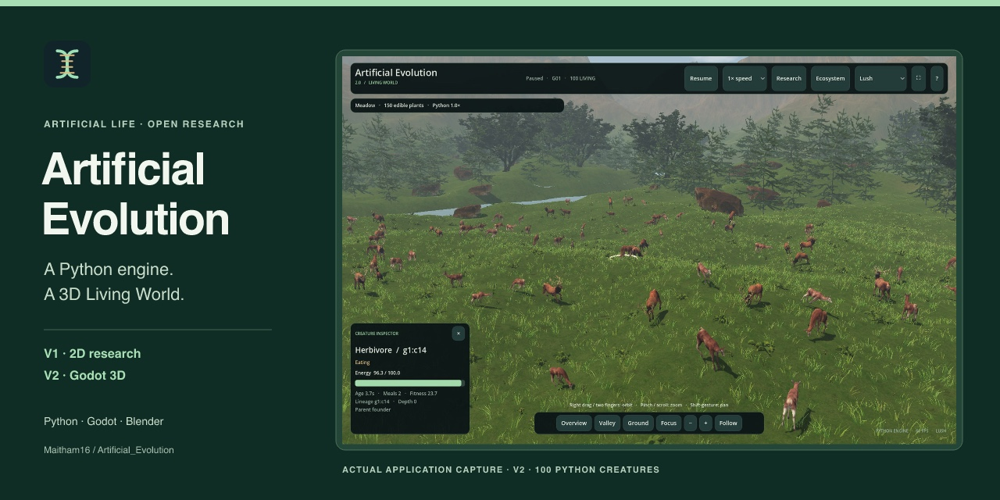

# Discoverability and indexing

The repository and documentation website describe the same project: artificial life and evolutionary simulation, with a Python neural-network engine, a Godot 4 3D ecosystem and Blender animal/animation authoring. Keywords belong in useful descriptions and headings, rather than repeated lists or invisible text.

## Applied repository settings

The GitHub **About** description is:

> Artificial life and evolutionary simulation with Python neural networks, a Godot 4 3D ecosystem, Blender-authored animals, and reproducible 2D research.

The website field points to **https://maitham16.github.io/Artificial_Evolution/**. README navigation links to the online installation tutorial, both versions, the real gallery and downloads; original V1 documentation remains available.

Relevant topics cover the actual implementation and research: `artificial-evolution`, `artificial-life`, `evolutionary-simulation`, `ecosystem-simulation`, `3d-simulation`, `neuroevolution`, `neural-networks`, `evolutionary-computation`, `agent-based-modeling`, `natural-selection`, `godot`, `godot4`, `blender`, `python`, `numpy`, `pygame` and `reproducible-research`.

Maintain these through the repository's **About → Edit** control or the GitHub API. Keep the name and default branch unchanged. These settings improve the project's description and classification; they do not establish a search ranking.

### Language classification

Experiment HTML reports and the large Graphify inspection visualization are generated outputs. Scoped `.gitattributes` files mark `results/**/*.html` and the specific `v2/docs/inspection/graph.html` as generated; the actual website template and brain viewer remain source. Export directories already stay out of Git. The root attributes, reports, datasets and application sources retain their bytes. GitHub's language breakdown updates after Linguist reprocesses a pushed revision; it may not change immediately. [GitHub Linguist overrides](https://github.com/github-linguist/linguist/blob/main/docs/overrides.md)

## Screenshot-based social preview



The card is **1280 × 640 pixels**, JPEG, under 1 MB. Branding surrounds the complete, proportionally resized application screenshot. No animals, scenery, interface values or source events are generated or retouched. The source screenshot remains unchanged in the [real gallery](../gallery/index.md).

- [Download the upload-ready JPEG](../assets/social/social-preview.jpg)
- [Editable SVG layout](../assets/social/social-preview.svg)
- [Source hashes and processing provenance](../assets/social/provenance.json)

The repository's **Settings → General → Social preview → Edit → Upload an image…** accepts this JPEG. Upload it again if the card changes; committing a file alone does not update GitHub's repository preview. GitHub recommends this size and an image under 1 MB. [GitHub preview instructions](https://docs.github.com/en/repositories/managing-your-repositorys-settings-and-features/customizing-your-repository/customizing-your-repositorys-social-media-preview)

Website links use the same image through Open Graph and Twitter metadata. The repository preview and website share metadata are separate settings. Social platforms may cache an earlier card.

## Website search metadata

The built site has descriptive titles and summaries, a canonical URL for each content page, semantic headings, real-image alt text, a searchable navigation structure and an [XML sitemap](https://maitham16.github.io/Artificial_Evolution/sitemap.xml). The homepage also identifies the public source repository through `SoftwareSourceCode` structured data. This describes the project; it does not promise eligibility for a rich-result feature.

The production root is **https://maitham16.github.io/Artificial_Evolution/**, including the project path and trailing slash. Do not set a canonical URL pointing every page to the homepage. The build checker compares each page with its own sitemap URL.

## Owner action: Google Search Console

GitHub repository administration does not automatically verify a Search Console property. This step requires your Google account and its actual verification token.

1. Open [Google Search Console](https://search.google.com/search-console/).
2. Select an existing property if it already covers this site; otherwise add a **URL prefix** property for `https://maitham16.github.io/Artificial_Evolution/`.
3. Select **HTML tag** verification. Copy only the token in its `content` attribute.
4. In `v2/website/mkdocs.yml`, put that token in `extra.search_verification.google`. The empty setting currently publishes no verification claim.
5. Commit/push the change and wait for **Documentation website** deployment to succeed. Confirm the live homepage contains the supplied meta tag, then choose **Verify** in Search Console.
6. Under **Sitemaps**, submit `https://maitham16.github.io/Artificial_Evolution/sitemap.xml`. If the form already supplies the complete property prefix, enter only `sitemap.xml`. Review the submitted row: **Success** confirms the sitemap was fetched and read, not that its pages were indexed.
7. Use **URL inspection** for the homepage and representative V1/V2 URLs. Review the indexed status separately from the live fetch test; request indexing if appropriate. Keep the verification token in place after verification.

For this project path, URL-prefix verification is appropriate; domain verification requires control of the host's DNS. Do not overwrite another owner's verification tokens. A verified parent property can also establish ownership; the absence of these meta tags alone does not establish account status. See Google's [ownership verification](https://support.google.com/webmasters/answer/9008080) and [Sitemaps report](https://support.google.com/webmasters/answer/7451001). Google's [recrawl instructions](https://developers.google.com/search/docs/crawling-indexing/ask-google-to-recrawl) explain sitemap submission and owner-only URL inspection. Crawling and inclusion are not immediate or guaranteed.

## Owner action: Bing Webmaster Tools

1. Open [Bing Webmaster Tools](https://www.bing.com/webmasters/).
2. Import the verified Search Console property, or add the same complete Pages URL.
3. For **Meta tag** verification, copy the `msvalidate.01` content token into `extra.search_verification.bing` in the same configuration file.
4. Commit/push, wait for deployment, confirm the live token and finish **Verify** in Bing.
5. Submit the same full XML sitemap URL through **Sitemaps → Submit sitemap**. Review processing status and errors, then use **URL inspection** for representative pages. A successful submission is distinct from indexing; keep any verification token in place.

Reuse an existing verified Bing property when available. If importing Search Console succeeds, a second meta-tag verification may not be necessary.

These are account-specific actions; neither a repository token nor a made-up verification string replaces them. [Bing verification methods](https://www2.bing.com/webmasters/help/add-and-verify-site-12184f8b) · [Bing sitemap submission](https://www2.bing.com/webmasters/help/sitemaps-3b5cf6ed)

### Robots and other search engines

The project's `robots.txt` contains its sitemap reference, but standard robots handling uses the **host root**, not an arbitrary project subdirectory. Do not assume `/Artificial_Evolution/robots.txt` controls `maitham16.github.io`; use verified sitemap submission for this project site. Existing canonical URLs, ordinary HTML links and the public sitemap also provide discovery signals to other crawlers. [Google robots guidance](https://developers.google.com/search/docs/crawling-indexing/robots/robots_txt)

No authenticated Google or Bing console was reviewed in the documentation audit. Ownership, sitemap submission and indexed-page status therefore remain unverified. Record the property, submission date, processing result and URL-inspection evidence after completing the account-specific steps; do not infer indexing from public HTTP availability.

## Check changes before publishing

From the repository root, with the isolated documentation environment installed:

```bash
.cache/website/venv/bin/mkdocs build --strict --config-file v2/website/mkdocs.yml
.cache/website/venv/bin/python v2/website/check_site.py
python3 v2/tools/verify_original.py
```

For verification tokens, confirm the actual live homepage after deployment rather than only checking the checkout. For a social-card change, inspect the final image and GitHub's saved preview. The original applications, numerical models and V1 research archive remain separate from this presentation work.
